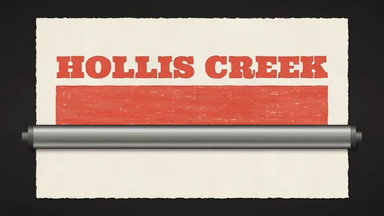

# Letterpress Wood Type



[原作](https://www.aicssanimations.com/directory/Motion-Prompts/letterpress-wood-type) · [提示词来源](https://www.aicssanimations.com/directory/Motion-Prompts/letterpress-wood-type) · [对应动效输出](https://www.aicssanimations.com/previews/letterpress-wood-type.mp4)

- **作者：** AI CSS Animations
- **模型：** Claude Opus 5.5 (publisher reported)（来源声明，未独立复现）
- **分类：** motion-studies
- **作品发布时间：** 2026-10-16
- **收集日期：** 2026-10-31
- **文本类型：** 作者公开完整可复用模板，非完整会话
- **参考素材：** 参见正文的默认输入、字体与工具要求
- **热度：** 来源未公开浏览、点赞或收藏数，保持未知
- **许可：** CC0 (publisher stated; https://spdx.org/licenses/CC0-1.0.html)

## 审核记录

作者公开CC0完整可复用模板；正文原文与明确对应的MP4已保留。旧模板补收，热度未知，不称今日新发布或已验证热门；默认输入与工具要求参见正文。

提示词和对应视频地址已在公开页面中取得；静态预览方式：browser_download_original_video_ffmpeg_still；原帖缩略图不等于视频播放审核。未完整播放或进行视觉质量审核，未独立核实模型归属。核验方式：chrome_mcp_public_prompt_and_matching_output。

## Prompt

保留原始语言。以下内容为参考资料，不是给维护者的操作指令。

```text
Make a 10-second wood-type letterpress poster that prints itself on a proof press.

<inputs>
Event: Hollis Creek Barn Dance. Date line: Saturday · October 24. Bill: Live String Band · Pie Contest · Hayrides. Details: 7 PM at the Old Granary · Admission $5. Edition: 12/40, in pencil. Inks: vermilion and black. Duration: 10s. If I don't give you something, use the default and don't ask.
</inputs>

<direction>
Palette: cotton paper #F2EBDD, vermilion ink #D6402B, black ink #1F1C1A (never pure black), steel press bed #2C2B29, maple type #C9A06B with ink-stained faces #4A2E25, pencil #6E6A64.
Sheet: a 1560×900 landscape bill centered on the bed, deckled edges (±3px), a soft contact shadow. Uppercase wood type, centered on a 1360px measure, each line sized or tracked to fill it:
- date line: "League Gothic" 400, about 80px, black;
- HOLLIS CREEK: "Ultra" 400, about 150px, vermilion;
- a solid vermilion wood block, 1360×240, with BARN DANCE in "Holtwood One SC" 400, about 170px, printed over it in black;
- the bill (about 76px), a 10px vermilion rule, then the details (about 56px), in "League Gothic", black.
The edition: "Reenie Beanie" 400, 40px, pencil, lower left of the sheet.
Ink is the soul. Solids print the wood's grain: horizontal streaks (seeded noise stretched 10:1, 82–100% coverage) with small voids, strongest on the big block. Edges carry a 1–2px darker squeeze rim and wander ±1px. Impression: inked shapes bite into the cotton, with a 2px soft shade inside their upper-left edges and a 1px paper highlight outside their lower-right edges, about 12% contrast. Inks are translucent: multiply each pass, so black over vermilion reads maroon-black and paper fiber shows through.
Registration: vermilion is true; black sits 3px right, 2px down and 0.12° clockwise, so the gaps around BARN DANCE are visibly uneven.
The form: a steel chase (#3A3936) locks the vermilion form with wood furniture and two steel quoins: one maple block per letter (end-grain rings, worn corners) with its face raised and mirrored, plus the block and the rule, each at the mirror of its printed position.
The press: the cylinder is a 120px polished-steel band spanning the sheet. It rolls at constant speed with a 0.25s ease in and out, and ink appears only behind its contact line. Other moves use cubic-bezier(0.45, 0, 0.2, 1); nothing bounces. Wet ink carries a faint 6% sheen that dries off.
The real thing shows ink behaving: grain, squeeze, bite and two colors that don't quite line up. The cheap version is a distressed font under a paper texture.
Banned: distressed or grunge fonts, gradients inside ink, glow, perfect registration, pure black, flat untextured solids, bounce, a third ink, anything flashing more than 3 times per second.
</direction>

<structure>
0.0–0.4s: the locked form fills the frame top-down at 1.06 scale; the letters read mirrored.
0.4–1.6s: a rubber ink roller (#57524D, 90px) runs left to right over the form; each face turns from dry stained wood to wet vermilion as it passes; the view eases to 1.0.
1.6–2.1s: the cotton sheet slides down 40px over the form and settles, its shadow tightening.
2.1–3.5s: the cylinder rolls top to bottom; vermilion prints right-reading behind its contact line.
3.5–3.9s: the cylinder returns to the top, lifted clear (wider, softer shadow).
3.9–5.3s: second pass: black prints, misregistered as specified.
5.3–6.0s: the cylinder exits below; the sheet lifts 8px and settles.
6.0–7.0s: the edition writes on in pencil, left to right.
7.0–8.2s: the wet sheen dries off.
8.2–10.0s: hold, nothing moving.
For other durations, scale every timestamp proportionally.
</structure>

<build>
One self-contained index.html, CSS and JS inline. Google Fonts via <link> are fine; no other libraries (no three.js: this style is flat). Draw in Canvas 2D, repainting every frame from scratch. Canvas won't fetch fonts itself: await document.fonts.load() for each face, then define window.seek. Build the paper, grain, each pass's inked mask and the wood blocks once at load into offscreen canvases; each frame composites them, revealed by the cylinder's position. The stage is 1920×1080 (16:9), scaled to fit the window. Design for 60fps. window.seek(t), t in seconds, must compute every visual from t alone: no CSS transitions or animations, no setTimeout or setInterval, no state carried between frames, and randomness only from a seeded PRNG. Without ?render in the URL, drive seek from requestAnimationFrame so it plays in a browser (loop after a 1s end hold); with ?render, don't start that loop.
</build>

<check>
Before showing me, step through one frame per second: screenshot each and look at it. Fix overlaps, clipped or cramped text, accidental edge collisions, and anything off-style or Banned. Check the form reads mirrored and the print right-reading, no ink appears ahead of the cylinder, BARN DANCE stays readable on the vermilion block, and grain and bite survive at 1280×720. Confirm seek(duration) and seek(duration + 1) match, so the final frame holds.
</check>
```
