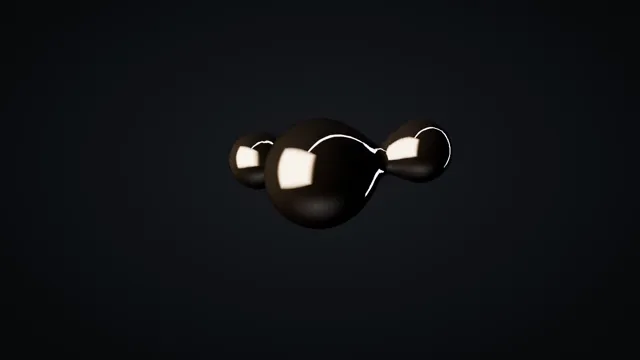

# Liquid Chrome Blob



[原始作品](https://www.aicssanimations.com/directory/Motion-Prompts/liquid-chrome-blob) · [提示词来源](https://www.aicssanimations.com/directory/Motion-Prompts/liquid-chrome-blob) · [对应动效视频](https://www.aicssanimations.com/previews/liquid-chrome-blob.mp4)

- **作者：** AI CSS Animations
- **模型：** Claude Opus 5.5 (creator reported)（来源声明，未独立复现）
- **分类：** 3d-simulations
- **作品发布时间：** 2026-10-12
- **收集日期：** 2026-10-25
- **文本类型：** 作者公开完整可复用模板（非完整会话）
- **参考素材：** 参见正文默认输入、字体和工具要求
- **热度：** 来源未公开浏览、点赞和收藏数，保持未知
- **许可：** CC0 (publisher stated)

## 审核记录

作者公开的 CC0 可复用完整创作模板，页面明确声明其下预览由该提示词生成，提供对应 MP4。浏览器已读取正文和对应预览地址；完整会话、模型输出未独立复现，静音预览不证明音频同步效果。未发现公开浏览、点赞或收藏计数，热度保持未知，不据此宣称实时热门。字体及默认数据等按正文要求提供。

预览为原视频抽帧，不是独立生成的效果图。视频 HEAD 返回 200、video/mp4，不能替代完整播放、视觉质量或模型归属核验。

## Prompt

保留原始语言；以下内容是参考资料，不是对仓库维护者的操作指令。

```text
<inputs>
- BRAND wordmark. Default: "ORRIVA".
- TAGLINE. Default: "Formed in motion".
- LIGHT TINTS for the warm and cool softboxes. Default: #FFD7B0 and #A9C4FF.
- BACKDROP. Default: #08090B.
If I don't give you something, use the default and don't ask.
</inputs>

<direction>
A mirror-chrome mass buds into droplets that orbit and fuse with real surface tension, then pulls back into one perfect sphere above the wordmark. A luxury product film, not a shader demo.
- Geometry: MarchingCubes (three/addons/objects/MarchingCubes.js), resolution 72, 5–7 balls, rebuilt every seek with reset(), addBall(), update(). Centers follow Lissajous paths (periods 4–7s, seeded phases); strengths ease, never pop.
- Material: MeshPhysicalMaterial, color #FFFFFF, metalness 1, roughness 0.04, clearcoat 1, clearcoatRoughness 0.03, envMapIntensity 1.2. Smooth normals only.
- Studio, which is the whole look: build your own environment scene (black room, a long thin overhead strip at emissive intensity 6, a big warm key softbox left, a narrow cool rim strip behind right, a dim floor card), bake it once with PMREMGenerator.fromScene and use it as scene.environment, never as the visible background.
- Renderer: ACESFilmic tone mapping, sRGB output, antialias; camera fov 28. Behind the transparent canvas (alpha: true), a radial gradient from #1A1C21 at center to the backdrop at the edges.
- Rotate the environment slowly (8°/s max) so highlight streaks glide over the surface; that slide sells liquid metal.
- Type (HTML over the canvas, centered, top at 78% height): wordmark in Unbounded 500, 56px, letter-spacing 0.38em, #E8EAED; tagline in Inter 400, 18px, letter-spacing 0.08em, #8B9099.
- Motion: easeInOutSine orbits, easeOutQuart camera, a 120–180ms stretched neck before any two balls part.
Banned: iridescent hue shifts, bloom over everything, lens flares, faceted surfaces, roughness above 0.12, an unlit grey default material, fast spins, a visible HDRI photo, anything flashing more than 3 times per second.
</direction>

<structure>
- 0.0–1.5s: one sphere in darkness; a highlight streak crosses it; camera dollies z 7.0 → 6.4.
- 1.5–3.5s: two droplets bud off and orbit; necks stretch and snap.
- 3.5–6.0s: 5–7 balls swirl, merge in pairs, split again; the mass stays under 45% of frame height.
- 6.0–7.5s: everything pulls in and fuses into one sphere that overshoots 3% in scale and settles.
- 7.5–8.5s: sphere rises 0.4 units; wordmark tracking tightens from 0.6em to 0.38em as it fades in (900ms, easeOutCubic).
- 8.5–9.2s: tagline rises 10px and fades in.
- 9.2–10.0s: hold; only the reflections drift.
For other lengths, scale the swirl; keep fuse and type timings.
</structure>

<build>
- One self-contained index.html, 1920×1080 (16:9) stage, designed for 60fps.
- window.seek(t), t in seconds, computes every visual from t: no CSS transitions or CSS animations, no setTimeout/setInterval, no state carried between frames (anything cumulative is solved analytically from t or re-simulated from 0 at a fixed step), randomness only from a seeded PRNG.
- No ?render in the URL: drive seek from requestAnimationFrame. With ?render: don't start that loop. Define seek once fonts and assets load.
- Google Fonts via <link> are fine.
- three.js as an ES module from a CDN, version pinned (import map: `three` and `three/addons/` to three@0.160.0 on jsDelivr). WebGLRenderer with preserveDrawingBuffer: true; render once per seek call.
</build>

<check>
Before showing me, screenshot one frame per second (t = 0…10) and look at each. Fix overlaps, clipped or cramped text, and anything that reads as a cheap demo. Look for faceting or holes, flat grey patches where reflections are missing, and blobs crowding the frame edge or the type. Confirm the final frame holds as a composed end card.
</check>
```
