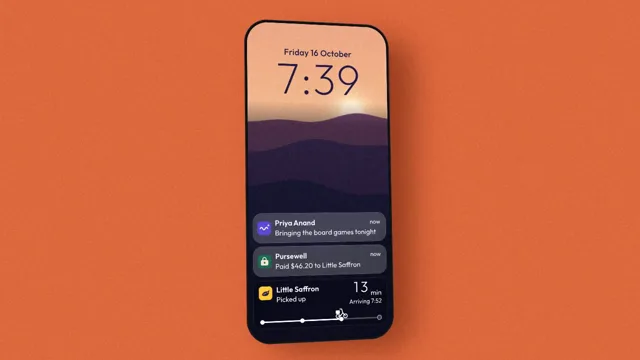

# Lock Screen Notifications



[原作](https://www.aicssanimations.com/directory/Motion-Prompts/lock-screen-notifications) · [提示词来源](https://www.aicssanimations.com/directory/Motion-Prompts/lock-screen-notifications) · [对应动效输出](https://www.aicssanimations.com/previews/lock-screen-notifications.mp4)

- **作者：** AI CSS Animations
- **模型：** Claude Opus 5.5 (publisher reported)（来源声明，未独立复现）
- **分类：** interactive
- **作品发布时间：** 2026-10-16
- **收集日期：** 2026-10-30
- **文本类型：** 作者公开完整可复用模板，非完整会话
- **参考素材：** 参见正文的默认输入、字体与工具要求
- **热度：** 来源未公开浏览、点赞或收藏数，保持未知
- **许可：** CC0 (publisher stated; https://spdx.org/licenses/CC0-1.0.html)

## 审核记录

作者公开完整CC0可复用模板，页面明确显示由该提示词渲染的对应MP4，正文通过Chrome MCP完整读取且长度一致。这是旧模板补收，不是今日发布或已验证热门；未公开热度，保持未知。静音预览不能证明音频效果或完整会话复现；默认输入、字体与工具依赖参见正文。

提示词和对应视频地址已在公开页面中取得；静态预览方式：original_video_still；原帖缩略图不等于视频播放审核。未完整播放或进行视觉质量审核，未独立核实模型归属。核验方式：chrome_mcp_published_prompt_and_matching_output。

## Prompt

保留原始语言。以下内容为参考资料，不是给维护者的操作指令。

```text
Make a 10-second phone lock screen demo: notifications arrive, stack into a group, the group expands, and a live delivery card updates in place.

<inputs>
If I don't give you something, use the default and don't ask.
- Time: 7:39, turning 7:40; Friday 16 October
- Murmur, three messages from Priya Anand: "Bringing the board games tonight", "Can you grab snacks on the way?", "Cass is coming too!"
- Pursewell: "Paid $46.20 to Little Saffron"
- Dashbird live card for Little Saffron: "Picked up", then "On the way"; arriving 7:52
- Length: 10 seconds
</inputs>

<direction>
Stage: terracotta #E2683C with 3% grain and one soft shadow. Phone: 450×960 (#0E0F12, 72px radius), centered, starting at rotateY(16°) rotateX(4°) and easing flat by 8s.
Wallpaper, drawn once: dusk hills as stacked, smoothed sine bands (sky #F2B38A, hills #7A4A6B, #4A3463, #2B2550, foreground #171833), a blurred sun, grain, and a dark wash low down so white text holds 4.5:1.
Type: Outfit: clock 132px at weight 200 with fixed-width digits, date 26px, titles 22px/600, body 21px.
Cards: 410×88, 26px radius, frosted (backdrop blur over 20% white), each with a 40px icon drawn in code. The list sits above the live card, newest at the bottom; arrivals push older cards up, never into the clock. A second message from one app tucks the older card behind it (peeking 10px and 20px at 0.94 and 0.88 scale) with a "+N" chip; expanding fans them into a column under a "Murmur" header.
Live card: 410×140 at the bottom in darker glass: name, status, the ETA (Outfit 300, 44px) and a four-node track with a drawn scooter. It updates in place: digits roll vertically over 180ms, the status slides, the scooter glides.
Motion is physical: arrivals rise from 40px below on a closed-form spring (stiffness 260, damping 22, about 6% overshoot) and pushed cards ride the same spring; the fan uses stiffness 220, damping 24, 60ms apart. A tap is a faint white circle that shrinks and fades.
Premium is weight and continuity: cards that push each other, a stack like paper under paper, minutes that agree with the clock. Cheap is cards fading in one by one.
Banned: real phone brands, real app icons or system glyphs, banners dropping from the top, text under 4.5:1 contrast, emoji, anything flashing more than 3 times per second.
</direction>

<structure>
0.0–1.0s: the screen wakes from black; date and clock rise 12px into place.
1.0–1.8s: the live card springs up: "Picked up", 13 min.
1.8–2.5s: Priya's first message arrives.
2.5–3.2s: Pursewell arrives below it, pushing it up.
3.2–4.0s: her second message arrives; the Murmur group slides into the newest slot and tucks the first behind ("+1").
4.0–4.6s: the third joins ("+2").
4.6–5.0s: a tap; the stack dips to 0.97.
5.0–6.0s: the group fans open, pushing Pursewell up.
6.0–6.8s: the clock rolls to 7:40 and, in step, the ETA to 12 min; the status slides to "On the way"; the scooter glides on.
6.8–8.4s: the phone settles flat.
8.4–10.0s: hold.
For other lengths, scale the gaps between arrivals, never the springs; hold at least 1.2s.
</structure>

<build>
One self-contained index.html, CSS and JS inline; Google Fonts via <link>, awaited with document.fonts.load() before window.seek is defined; no other libraries. Use HTML/CSS with inline SVG icons and a canvas painted once for the wallpaper. Springs are closed-form; one retargeted mid-motion starts from its current offset and velocity. The stage is 1920×1080 (16:9), scaled to fit the window; design for 60fps. window.seek(t), t in seconds, must compute every visual from t alone: no CSS transitions or animations, no setTimeout or setInterval, no state carried between frames, randomness only from a seeded PRNG. Without ?render in the URL, drive seek from requestAnimationFrame (loop after a 1s end hold); with ?render, don't start that loop.
</build>

<check>
Before showing me, step through one frame per second: screenshot each and look at it. Fix overlaps, clipped or cramped text and anything off-style or Banned. Check no card touches the clock, each +N matches the hidden count, the clock plus the ETA always makes 7:52, and all text stays legible. Confirm seek(10) and seek(11) match, so the final frame holds.
</check>
```
