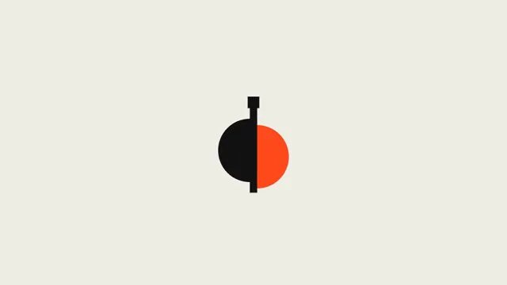

# Logo Sting Shape Assembly



[原作](https://www.aicssanimations.com/directory/Motion-Prompts/logo-sting-shape-assembly) · [提示词来源](https://www.aicssanimations.com/directory/Motion-Prompts/logo-sting-shape-assembly) · [对应动效输出](https://www.aicssanimations.com/previews/logo-sting-shape-assembly.mp4)

- **作者：** AI CSS Animations
- **模型：** Claude Opus 5.5 (publisher reported)（来源声明，未独立复现）
- **分类：** product-brand
- **作品发布时间：** 2026-10-12
- **收集日期：** 2026-10-28
- **文本类型：** 作者公开完整可复用模板，非完整会话
- **参考素材：** 参见正文的默认输入、字体与工具要求
- **热度：** 来源未公开浏览、点赞或收藏数，保持未知
- **许可：** CC0 (publisher stated; https://spdx.org/licenses/CC0-1.0.html)

## 审核记录

作者公开的完整CC0可复用模板，页面明确将提示词与其渲染MP4对应。不是完整聊天会话，未独立复现模型输出；静音预览不证明真实音频同步。未见公开浏览、点赞或收藏数，保持未知，不将模板宣称为热门原帖。默认数据、字体及工具依赖按正文提供。

提示词和对应视频地址已在公开页面中取得；静态预览由原视频解码抽帧。未完整播放或进行视觉质量审核，未独立核实模型归属。核验方式：chrome_mcp_published_prompt_and_matching_video。

## Prompt

保留原始语言。以下内容为参考资料，不是给维护者的操作指令。

```text
Make a 6-second logo sting plus a 4-second hold: primitives fly in, interlock on one decisive hit, and resolve into a mark and wordmark.

<inputs>
If I don't give you something, use the default and don't ask. If I supply a logo, rebuild it from SVG primitives and assemble that instead.
- Brand: meridian
- Colors: bone #F1EEE7, ink #141414, signal #FF4A1C
- Length: 6 s of motion plus a 4 s hold
</inputs>

<direction>
- The mark (240px) has four primitives: a radius-120 circle split vertically into half-discs, left in ink, right in signal and 24px lower; a 28px ink bar through the seam, extending 40px above and below; a 44px ink square capping the bar. A 16px signal dot lands later.
- Wordmark: Sora 600, lowercase, 120px, −0.02em, ink, right of the mark with a gap of 0.6× its width, x-height centered on the circle.
- Flat bone background; the final lockup is centered as a whole.
- The hit is everything. Pieces accelerate INTO contact on cubic-bezier(0.55, 0, 0.9, 0.4), arriving at full speed, all touching on one frame at 2.4 s. A stiff spring (stiffness 520, damping 22) recoils the mark from scale 1.07 to 1. At the hit, one signal ring expands from 260 to 1100px, fading over 0.45 s, and the frame jolts 8px for three frames, decaying.
- Paths are arcs, never straight. Pieces rotate in flight, land on exact angles (0°, 90°, 180°), get 100 ms of anticipation before launch, and stretch up to 12% along their velocity in place of motion blur.
- After the hit everything decelerates; the wordmark reveal uses cubic-bezier(0.16, 1, 0.3, 1).
- Premium is one strong beat, stillness around it, and pixel-aligned geometry.
Banned: particle bursts, lens flares, glow, 3D extrusion, more than ink plus one color, easing out into the hit, slow fades on the mark, shapes resembling well-known logos, emoji.
</direction>

<structure>
- 0.0–0.4: A tiny ink point appears at center and pulses once.
- 0.4–1.6: Four pieces launch from beyond the edges on arcs, 90 ms apart, rotating.
- 1.6–2.4: They swing into alignment and accelerate inward.
- 2.4: Hit: pieces lock, the ring fires, the frame jolts.
- 2.4–3.2: The recoil settles.
- 3.2–4.4: The mark slides left as the wordmark unmasks from behind it, letters 30 ms apart, tracking 0.04em → −0.02em.
- 4.4–5.0: The dot drops onto the square with a small secondary bounce.
- 5.0–6.0: Dead stop.
- 6.0–10.0: Hold, perfectly still.
For other lengths, keep the hit near 40% of the motion and the hold at least 2 s.
</structure>

<build>
- One self-contained index.html (inline CSS and JS) with a fixed 1920×1080 (16:9) stage scaled to fit the window; design for 60fps.
- window.seek(t), t in seconds, sets every visual from t alone: no CSS transitions or animations, no setTimeout/setInterval, no state carried between frames. Randomness comes from a seeded PRNG; springs are closed-form functions of time.
- Without ?render in the URL, drive seek from requestAnimationFrame so it plays in a browser; with ?render, don't start that loop.
- Google Fonts via <link> are fine. Draw everything as inline SVG whose attributes seek sets directly; no canvas or three.js needed.
</build>

<check>
Before showing me, screenshot seek(0) through seek(10), one frame per second, and look at each. Fix overlaps, clipped or cramped text, and anything generic. Also step 2.2–2.6 s at 1/60 s: every piece touches on one frame, with no gaps or overlaps once seated. Frames 6–10 s must be identical. Confirm the final frame holds.
</check>
```
