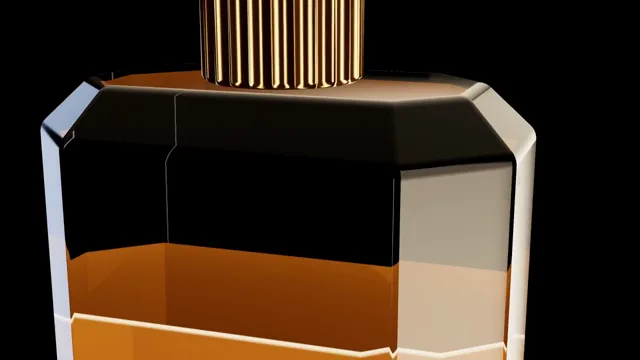

# Luxury Perfume Film



[原作](https://www.aicssanimations.com/directory/Motion-Prompts/luxury-perfume-film) · [提示词来源](https://www.aicssanimations.com/directory/Motion-Prompts/luxury-perfume-film) · [对应动效输出](https://www.aicssanimations.com/previews/luxury-perfume-film.mp4)

- **作者：** AI CSS Animations
- **模型：** Claude Opus 5.5 (publisher reported)（来源声明，未独立复现）
- **分类：** product-brand
- **作品发布时间：** 2026-10-16
- **收集日期：** 2026-10-28
- **文本类型：** 作者公开完整可复用模板，非完整会话
- **参考素材：** 参见正文的默认输入、字体与工具要求
- **热度：** 来源未公开浏览、点赞或收藏数，保持未知
- **许可：** CC0 (publisher stated; https://spdx.org/licenses/CC0-1.0.html)

## 审核记录

作者公开的完整CC0可复用模板，页面明确将提示词与其渲染MP4对应。不是完整聊天会话，未独立复现模型输出；静音预览不证明真实音频同步。未见公开浏览、点赞或收藏数，保持未知，不将模板宣称为热门原帖。默认数据、字体及工具依赖按正文提供。

提示词和对应视频地址已在公开页面中取得；静态预览由原视频解码抽帧。未完整播放或进行视觉质量审核，未独立核实模型归属。核验方式：chrome_mcp_published_prompt_and_matching_video。

## Prompt

保留原始语言。以下内容为参考资料，不是给维护者的操作指令。

```text
Make a 10-second luxury perfume film: a faceted glass bottle of amber liquid turns slowly in rim light on black, its gold cap catches one sweep of light, then a serif name appears.

<inputs>
- House: Maison Orvel.
- Fragrance: Ambre Lente.
- Descriptor: Eau de Parfum · 50 ml.
- Length: 10 seconds.
If I don't give you something, use the default and don't ask.
</inputs>

<direction>
Palette: stage #000000; amber #C8761E; gold #D4A955; rim light #FFE9C9 with a faint cool kicker #9FB4D9; type ivory #EDE3D1, descriptor #B8955A.
Bottle: a heavy octagonal prism (1.0 × 1.25 × 0.62), bevelled shoulder, thick base, flat-shaded so facet edges stay crisp. Glass: MeshPhysicalMaterial, transmission 1, ior 1.5, thickness 0.6, roughness 0.015.
Liquid: an inset octagon filling 72%. Transmission refracts only opaque objects, so the liquid is an opaque ShaderMaterial: deep #6E3509 in the core, warming to #C8761E where backlight passes, with a thin bright meniscus. The glass bends it at every facet.
Cap: a gold cylinder with 24 vertical flutes; metalness 1, roughness 0.2.
Studio, the whole look: bake an environment once from a black room with two tall strip lights behind the bottle, a dim overhead panel and a small warm softbox for the cap; scene.environment only, never the background.
Floor: black gloss; a mirrored copy of the bottle under a black plane fading to opaque within 0.25 units.
Camera: fov 22. A macro on the cap and shoulder, then a pull-back to the whole bottle while orbiting 40°, on cubic-bezier(0.45, 0, 0.15, 1). The light sweep is the environment rotating 35° once.
Final layout: the bottle centered, cap top near y 110, base near y 650. HTML type, centered: house in Bodoni Moda 500, 28px, uppercase, tracking 0.45em, baseline y 800; fragrance in Bodoni Moda 400 italic, 104px, baseline y 905; descriptor in Tenor Sans 400, 22px, uppercase, tracking 0.32em, baseline y 968. Each fades up over 1.4s as its tracking closes by 0.08em.
Motion is stillness: one move at a time, no bounce.
Premium is darkness, true refraction at the facets, amber glowing where light passes, one sweep of light. Cheap is a gold gradient, sparkles and a spinning bottle.
Banned: sparkles, particles, smoke, splashes, lens flares, bloom on type, a visible background, turning past 45°, anything flashing more than 3 times per second.
</direction>

<structure>
- 0.0–1.2s: black; a thin warm rim line draws down the bottle's right edge.
- 1.2–3.4s: macro: the camera glides across the cap's flutes and down the shoulder facets.
- 3.4–5.6s: it pulls back and orbits to reveal the bottle; the amber glows; the reflection pools.
- 5.6–6.8s: the sweep: one broad highlight crosses the facets; the flutes catch it in turn.
- 6.8–8.2s: house, fragrance and descriptor fade up, 0.3s apart.
- 8.2–10s: hold; the orbit creeps 2° further.
Other lengths: lengthen the macro and pull-back; keep the sweep 1.2s and 1.5s of hold.
</structure>

<build>
One self-contained index.html, inline CSS and JS, on a 1920×1080 (16:9) stage scaled to fit the window, built for 60fps. Google Fonts via <link>, awaited with document.fonts.load() before seek exists.
window.seek(t) sets every visual from t alone: no CSS transitions or animations, no setTimeout/setInterval, no state carried between frames, randomness only from a seeded PRNG. Camera path, environment rotation and type are eased functions of t.
Without ?render in the URL, drive seek from requestAnimationFrame; with ?render, don't start that loop.
three.js as an ES module pinned to three@0.160.0 via a jsDelivr import map (`three`, `three/addons/`); preserveDrawingBuffer: true; one render per seek. No image, model or typeface files beyond Google Fonts.
</build>

<check>
Before showing me, step through one frame per second (0–10s) and look at each. Fix overlaps, clipped or cramped text and anything off-style or Banned. Look for glass reading as a grey slab, liquid like orange plastic, large clipped highlights, reflection running into the type. Confirm the final frame holds.
</check>
```
