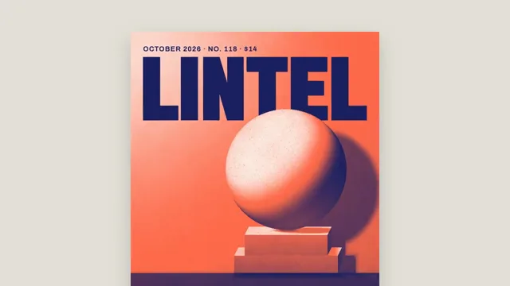

# Magazine Cover Build



[原作](https://www.aicssanimations.com/directory/Motion-Prompts/magazine-cover-build) · [提示词来源](https://www.aicssanimations.com/directory/Motion-Prompts/magazine-cover-build) · [对应动效输出](https://www.aicssanimations.com/previews/magazine-cover-build.mp4)

- **作者：** AI CSS Animations
- **模型：** Claude Opus 5.5 (publisher reported)（来源声明，未独立复现）
- **分类：** product-brand
- **作品发布时间：** 2026-10-16
- **收集日期：** 2026-10-31
- **文本类型：** 作者公开完整可复用模板，非完整会话
- **参考素材：** 参见正文的默认输入、字体与工具要求
- **热度：** 来源未公开浏览、点赞或收藏数，保持未知
- **许可：** CC0 (publisher stated; https://spdx.org/licenses/CC0-1.0.html)

## 审核记录

作者公开CC0完整可复用模板；正文原文与明确对应的MP4已保留。旧模板补收，热度未知，不称今日新发布或已验证热门；默认输入与工具要求参见正文。

提示词和对应视频地址已在公开页面中取得；静态预览方式：browser_download_original_video_ffmpeg_still；原帖缩略图不等于视频播放审核。未完整播放或进行视觉质量审核，未独立核实模型归属。核验方式：chrome_mcp_public_prompt_and_matching_output。

## Prompt

保留原始语言。以下内容为参考资料，不是给维护者的操作指令。

```text
Make a 10-second build of a monthly magazine cover, from blank stock to finished newsstand cover.

<inputs>
Masthead: LINTEL. Strapline: Architecture, objects and the people who make them. Issue line: October 2026 · No. 118 · $14. Lead cover line: The quiet return of concrete. Secondary lines: Six studios building with salvage; A chair that took nine years; Plus: the long table, rethought. Barcode: 9772049831006. Duotone inks: navy #1C2260 and coral #FF6B4A. Duration: 10s. If I don't give you something, use the default and don't ask.
</inputs>

<direction>
Stage: studio grey #E4E1DB. The cover is 720×934 (x 600–1320, y 73–1007), uncoated white #FBF7F1, with a soft shadow (0 24px 60px, 18% black). Positions below are cover pixels from its top-left; margins 36px.
Cover image, drawn in code once at load, full-bleed: a concrete sphere (radius 175, center 450, 400) on a two-step plinth (upper box x 330–570, y 590–650; lower box x 300–600, y 650–700) against a wall, floor from y 700 down. Light from the upper left: the wall brightest there, the floor in shadow, the cast shadow falling right. Render in grayscale with real shading (a Lambert sphere with a soft terminator and bounce light from the plinth, three values on the boxes, a cast shadow with a 30px penumbra, fine concrete pores), then map luminance through the duotone: navy shadows, coral midtones, paper highlights, plus 1.5% grain.
Masthead: LINTEL in "Archivo" (wght 900, wdth 62), navy, tracking −0.02em, fitted to the 648px between the margins, cap tops at y 74. Draw it between wall and sphere so the sphere's crown overlaps the foot of two letters: that interlock is the cover.
Type, two families only, "Archivo" and "Newsreader":
- issue line top-left on baseline y 56: Archivo 600, 20px, tracked 0.08em, uppercase, navy;
- strapline under the masthead in a left column (x 36–255): Newsreader italic, 22px, navy;
- secondary lines below it in that column: Archivo (wght 700, wdth 75), 26px, navy, two lines each;
- lead line on the dark floor, lower left: Newsreader 500 italic, 60px, two lines, paper white, under a 2px coral rule;
- barcode: a 200×120 white panel at lower right on the floor, a correct EAN-13 encoding of the number (longer guard bars, digits beneath in Archivo 500, 20px).
Hierarchy: masthead, lead line, secondary lines, then strapline and issue line, in size and in order of arrival.
Motion is editorial and assured: elements arrive on short moves (cubic-bezier(0.2, 0.7, 0, 1), 0.45–0.7s); text lines rise 14px out of masks at their baselines; the camera starts at 1.6× on the cover's upper half and pulls back to the whole cover on cubic-bezier(0.65, 0, 0.35, 1) over 0.8s. The real thing is a strict hierarchy, one strong image locked to the masthead and type that knows its sizes; the cheap version is a stock photo, five fonts and drop-shadowed cover lines.
Banned: drop shadows on type, outlined text, a third type family, starbursts or price-flash badges, gradients outside the image, image files, a recognizable person, real magazine names, anything flashing more than 3 times per second.
</direction>

<structure>
0.0–0.6s: studio grey; the blank cover slides up 40px into place; the camera holds at 1.6× on its upper half.
0.6–1.6s: the image develops like a two-ink proof: navy pass (0.6–1.1s), then coral pass (1.1–1.6s).
1.6–2.6s: the masthead rises letter by letter behind the sphere, 40ms apart; the issue line sets above it.
2.6–3.4s: the camera pulls back to the whole cover.
3.4–4.4s: the coral rule draws and the lead line sets on the floor, line by line.
4.4–5.4s: the strapline, then the three secondary lines, 0.2s apart, set down the left column.
5.4–6.2s: the barcode panel lands and its bars draw left to right.
6.2–7.0s: a soft paper sheen (a 6% white diagonal band) sweeps once across the cover.
7.0–10.0s: hold on the finished cover.
For other durations, scale every timestamp proportionally.
</structure>

<build>
One self-contained index.html, CSS and JS inline. Google Fonts via <link> are fine; no other libraries (no three.js: this style is flat). Use absolutely positioned elements, setting transforms, clip-paths and opacity from seek. Render the cover image into canvases once at load (the grayscale render through a 256-entry duotone lookup, plus a navy-only version for the first pass). Request the Archivo width axis. Await document.fonts.load() for each face, then define window.seek. The stage is 1920×1080 (16:9), scaled to fit the window. Design for 60fps. window.seek(t), t in seconds, must compute every visual from t alone: no CSS transitions or animations, no setTimeout or setInterval, no state carried between frames, and randomness only from a seeded PRNG. Without ?render in the URL, drive seek from requestAnimationFrame so it plays in a browser (loop after a 1s end hold); with ?render, don't start that loop.
</build>

<check>
Before showing me, step through one frame per second: screenshot each and look at it. Fix overlaps, clipped or cramped text, accidental edge collisions, and anything off-style or Banned. Check the sphere overlaps exactly two masthead letters, every cover line sits on a background it reads against, the barcode decodes to the number, and nothing crosses the cover's 36px margins. Confirm seek(duration) and seek(duration + 1) match, so the final frame holds.
</check>
```
