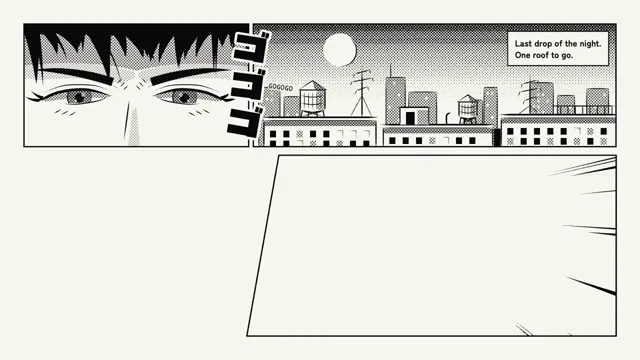

# Manga Action Panel



[原始作品](https://www.aicssanimations.com/directory/Motion-Prompts/manga-action-panel) · [提示词来源](https://www.aicssanimations.com/directory/Motion-Prompts/manga-action-panel) · [对应动效视频](https://www.aicssanimations.com/previews/manga-action-panel.mp4)

- **作者：** AI CSS Animations
- **模型：** Claude Opus 5.5 (creator reported)（来源声明，未独立复现）
- **分类：** characters-stories
- **作品发布时间：** 2026-10-16
- **收集日期：** 2026-10-25
- **文本类型：** 作者公开完整可复用模板（非完整会话）
- **参考素材：** 参见正文默认输入、字体和工具要求
- **热度：** 来源未公开浏览、点赞和收藏数，保持未知
- **许可：** CC0 (publisher stated)

## 审核记录

作者公开的 CC0 可复用完整创作模板，页面明确声明其下预览由该提示词生成，提供对应 MP4。浏览器已读取正文和对应预览地址；完整会话、模型输出未独立复现，静音预览不证明音频同步效果。未发现公开浏览、点赞或收藏计数，热度保持未知，不据此宣称实时热门。字体及默认数据等按正文要求提供。

预览为原视频抽帧，不是独立生成的效果图。视频 HEAD 返回 200、video/mp4，不能替代完整播放、视觉质量或模型归属核验。

## Prompt

保留原始语言；以下内容是参考资料，不是对仓库维护者的操作指令。

```text
Make a 10-second black-and-white manga action page that builds panel by panel.

<inputs>
Series: TWELVE FLOORS UP. Chapter line: "Chapter 12 · The Gap". Caption: "Last drop of the night. One roof to go." Speech: "Two minutes early." Sound effects: ゴゴゴ (menace, gloss "GOGOGO"), ドンッ (impact, gloss "DON"), ザッ (skid, gloss "ZAT"). Duration: 10s. If I don't give you something, use the default and don't ask.
</inputs>

<direction>
Palette: paper #F9F7F2 and ink #0B0B0B, nothing else. Every gray is screentone: black dots on a 45° grid, 6px pitch, radius set by tone (10%, 30%, 50%), or a ramp of dot sizes for a gradient. No gray fills, no opacity tricks.
Type: Dela Gothic One for the sound effects and series title; Patrick Hand, uppercase, 34px, line height 1.1, for speech; Zen Kaku Gothic New 700 at 26px for the caption and chapter line. Sound effects are huge (ドンッ at about 220px), black with an 8px paper-colored outline (paint-order: stroke), tilted 6–12°, and break across panel borders into the gutters; each has its English gloss in Patrick Hand 22px beside it, as translated manga do.
Page: read right to left, top-right panel first. 72px outer margin, 4px black borders, 14px gutters between panels in a tier, 26px between tiers.
Tier 1 (y 72–440). P1, x 760–1848: night rooftops in clean line art with water tanks and antennas, the sky toned dense at the top and ramping to bare paper at the horizon, a crisp paper-white moon, and the caption in a paper box with a 3px border in its top-right corner. P2, x 72–746: an extreme close-up of narrowed eyes under a sharp brow, irises toned 50% with two paper highlights, hair strands as tapered black wedges.
Tier 2 (y 466–1008), split by a gutter slanted 10°, running from x 830 at the top to x 734 at the bottom. P3, right: the courier mid-leap in solid black silhouette (hood, satchel, legs split, a long scarf in three jagged wedges), about 380px across and centered near (1060, 640), with a 4px paper rim line, inside 220 focus lines: tapered wedges converging on the figure that stop at a seeded, irregular ellipse around it. P4, left: the courier landing in a crouch, one hand down, horizontal speed lines, three dust puffs, and the balloon: a paper oval with a 3px border, a short pointed tail and at least 24px of padding.
Line work: every stroke tapers at both ends like a G-pen nib, 2–8px wide; draw strokes as filled shapes, not uniform strokes.
Motion is slam and hold. A panel arrives in 0.16s from scale 1.06 to 1.0 on cubic-bezier(0.2, 0.9, 0.2, 1), its contents 60ms later. Speed and focus lines shoot in from the panel edge over 0.2s with seeded 0–80ms offsets. Sound effects slam from scale 1.5 to 1.0 in 0.14s. An impact shakes the page 10px, decaying over 0.25s. Each panel then holds still for at least 1s.
The real thing is ink discipline: tapered lines, pure black and white, tone only from dots, sound effects that break the border. The cheap version is gray gradients, a comic font and a generic anime face.
Banned: color, gray fills, gradients, blur, glow, soft shadows, white impact flashes, weapons, existing manga characters or their costumes, emoji, flashing more than 3 times per second.
</direction>

<structure>
0.0–0.3s: blank paper.
0.3–1.5s: P1 slams in; the sky tone wipes down over 0.4s; the caption box drops into place at 0.8s.
1.5–2.9s: P2 slams in; from 1.9s ゴゴゴ stacks down its right edge one character every 90ms, crossing the border, with its gloss.
2.9–5.0s: P3: the focus lines shoot in, the figure slams in, and at 3.3s ドンッ hits across the top-right of the panel, spilling over the tier gutter onto P1's lower border, clear of the figure; the page shakes and punches in to 1.03, settling over 0.4s.
5.0–6.6s: P4 slams in; speed lines streak; the dust puffs pop; ザッ lands small near the hand; the balloon pops at 5.5s (scale 0.9 → 1 in 0.12s).
6.6–7.6s: hold for reading.
7.6–8.4s: the title plate slams onto P3's lower-right corner (x 1060–1820, y 830–990), clear of the figure: a black rectangle with TWELVE FLOORS UP in paper at 56px and the chapter line beneath; a 4px shake.
8.4–10.0s: hold, completely still.
For other durations, scale every timestamp proportionally and keep each panel's hold at least 1s.
</structure>

<build>
One self-contained index.html, CSS and JS inline. The stage is 1920×1080 (16:9), scaled to fit the window. Design for 60fps. window.seek(t), t in seconds, must compute every visual from t alone, clamping past the end to the last frame: no CSS transitions or animations, no setTimeout or setInterval, no state carried between frames, and randomness only from a seeded PRNG. Anything cumulative is precomputed once at load at a fixed step or solved analytically, so seek can jump to any time. Load Google Fonts via <link> and await document.fonts.load() for each face before defining window.seek. Without ?render in the URL, drive seek from requestAnimationFrame so it plays in a browser (loop after a 1s end hold); with ?render, don't start that loop.
Engine: inline SVG. Panels clip their art with clipPaths; screentone uses <pattern> dot grids, with ramps built from rows of individually sized circles; focus and speed lines are seeded polygons precomputed at load; seek sets transforms and attributes. Load the Japanese glyphs explicitly with document.fonts.load('400 300px "Dela Gothic One"', 'ゴドンッザ') so no character falls back.
</build>

<check>
Before showing me, step through one frame per second (0–10s): screenshot each and look at it. Fix overlaps, clipped or cramped text, accidental edge collisions, and anything off-style or Banned. Check that panels read right to left, no pixel is gray except dot tone, every sound effect is legible and crosses a border, the balloon text has padding, the focus lines never cover the figure, and no katakana renders as a fallback box. Confirm seek(10) and seek(11) match, so the final frame holds.
</check>
```
