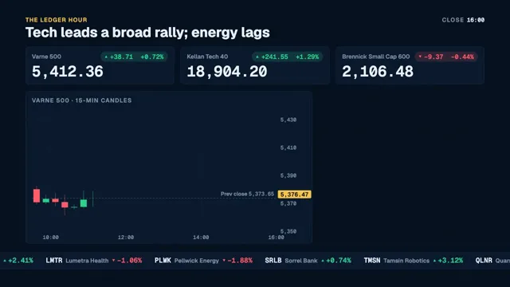

# Markets Recap



[原作](https://www.aicssanimations.com/directory/Motion-Prompts/markets-recap) · [提示词来源](https://www.aicssanimations.com/directory/Motion-Prompts/markets-recap) · [对应动效输出](https://www.aicssanimations.com/previews/markets-recap.mp4)

- **作者：** AI CSS Animations
- **模型：** Claude Opus 5.5 (publisher reported)（来源声明，未独立复现）
- **分类：** explainers-data
- **作品发布时间：** 2026-10-16
- **收集日期：** 2026-10-31
- **文本类型：** 作者公开完整可复用模板，非完整会话
- **参考素材：** 参见正文的默认输入、字体与工具要求
- **热度：** 来源未公开浏览、点赞或收藏数，保持未知
- **许可：** CC0 (publisher stated; https://spdx.org/licenses/CC0-1.0.html)

## 审核记录

作者公开CC0完整可复用模板；正文原文与明确对应的MP4已保留。旧模板补收，热度未知，不称今日新发布或已验证热门；默认输入与工具要求参见正文。

提示词和对应视频地址已在公开页面中取得；静态预览方式：browser_download_original_video_ffmpeg_still；原帖缩略图不等于视频播放审核。未完整播放或进行视觉质量审核，未独立核实模型归属。核验方式：chrome_mcp_public_prompt_and_matching_output。

## Prompt

保留原始语言。以下内容为参考资料，不是给维护者的操作指令。

```text
Make a 10-second end-of-day markets recap with fictional indices: index values roll, candlesticks draw, change chips land, a sector heat grid fills, and the ticker stops at the close.

<inputs>
- Show: The Ledger Hour. Headline: "Tech leads a broad rally; energy lags".
- Indices at the close: Varne 500 5,412.36, +38.71 (+0.72%), from 5,373.65; Kellan Tech 40 18,904.20, +241.55 (+1.29%), from 18,662.65; Brennick Small Cap 600 2,106.48, −9.37 (−0.44%), from 2,115.85.
- Varne 500 session, 09:30–16:00 in 26 fifteen-minute candles: open 5,380.10, high 5,421.80, low 5,361.42, close 5,412.36.
- Sectors, weight in the index and change: Technology 30%, +1.73%; Financials 13%, +0.61%; Health Care 12%, +0.42%; Consumer 10%, +0.18%; Communication 9%, +0.97%; Industrials 8%, +0.35%; Staples 6%, +0.12%; Energy 4%, −1.12%; Utilities 3%, −0.27%; Materials 3%, −0.08%; Real Estate 2%, −0.64%. Weighted, they give the index's +0.72%.
- Breadth: 318 advancers, 176 decliners, 6 unchanged.
- Ticker (fictional companies): Corvane Systems CRVN +2.41%, Lumetra Health LMTR −1.06%, Pellwick Energy PLWK −1.88%, Sorrel Bank SRLB +0.74%, Tamsin Robotics TMSN +3.12%, Quarry Lane Retail QLNR +0.21%.
- Length: 10 seconds.
If I don't give you something, use the default and don't ask.
</inputs>

<direction>
Palette: ground #07111F with a 1px grid of #0E1E33 every 40px; panels #0C1A2E with a 1px #1B2D47 border and 10px radius; text #EAF0F7; muted #8193AB; up #2FD18F; down #FF5D6C; neutral #5F6F86; accent #F5C451 for the show name and the live price tag. Heat colors interpolate in OKLab from −2% #B3263A through 0% #26354D to +2% #1E9E6A, clamped beyond. Green only ever means up, red only down.
Type: Geist 600 and 700 for words (headline 52px; panel titles 22px, uppercase, tracked 0.1em; sector names 22px), Geist Mono 500 and 600 for every number (index values 56px, chips 24px, axis labels 20px, ticker 26px), so digits never shift.
Layout, 96px sides: header y 64–150 (the show name in accent and the headline on the left; "CLOSE 16:00" and a breadth bar on the right); three index tiles at y 176–316, 560×140 each with 24px gutters; candlestick panel x 96–1176, y 344–916; heat panel x 1200–1824, y 344–916; ticker band y 948–1012, the only element that runs to the frame edges.
Candles: a price scale from 5,350 to 5,430 with right-hand labels every 20 points, time labels at 10:00, 12:00, 14:00 and 16:00, and a dashed (6/6) muted line at the previous close labeled "Prev close 5,373.65". 26 equal slots, bodies 68% of the slot, 1px wicks, up candles filled green, down candles filled red. Generate them once from a seeded Brownian bridge from the open to the close; each candle opens at the previous close; make one high exactly 5,421.80 near 14:45 and one low exactly 5,361.42 near 10:15, with every other high and low inside them.
Index values roll like odometers: each digit column slides vertically to its next digit, carrying properly, from the previous close to the close over 1.0s on cubic-bezier(0.16, 1, 0.3, 1). Chips are pills led by a 10px triangle, the text in the full color on the same color at 16%, sliding 12px in from the left as they fade up (0.25s).
Candles draw left to right, 0.1s apart: the wick grows from the open out to its high and low (0.12s), then the body grows from the open to the close (0.16s), easeOutCubic. A live price tag (an accent plate, 22px) rides the latest close on the right axis.
Heat grid: a squarified treemap of the 11 sectors by weight, 4px gaps, 8px radius. Tiles reveal in weight order (scale 0.94 → 1 while the fill moves from neutral to its heat color, 0.35s, 60ms apart), each with its name (abbreviated in tiles under 150px wide) and its change (Geist Mono 600, 28px) counting up from 0.00%.
Ticker: items crawl right to left at a constant 140px/s, each change led by a 10px colored triangle, 48px apart with a thin divider.
The real thing is a calm instrument: numbers that agree everywhere, one color for up and one for down, and nothing moving that isn't data. The cheap version is a glowing 3D line racing over a trading-floor photo with flying dollar signs.
Banned: flying currency symbols, glow, 3D charts, gradient bars, slot-machine digit spins, arrows larger than the numbers they mark, real indices, exchanges or companies, any number that disagrees with the inputs, anything flashing more than 3 times per second.
</direction>

<structure>
0.0–0.8s: the grid fades up; the header builds left to right: the show name, then the headline rising 16px out of a mask, then "CLOSE 16:00".
0.8–2.0s: the index tiles build 120ms apart (border draws, fill, name); values roll from the previous close to the close; each chip lands as its roll finishes.
1.2s: the ticker band rises from below and starts crawling.
2.0–5.0s: the candle panel's axes, gridlines and previous-close line draw; the 26 candles draw left to right with the price tag riding the latest close.
4.6–6.6s: the heat tiles reveal in weight order, their changes counting.
5.0–5.6s: "H 5,421.80" and "L 5,361.42" markers drop onto their candles on 1px leaders; the open and close print under the panel title.
6.6–7.6s: the Technology tile gains a 2px white outline and the heat panel's title extends to "SECTORS · 7 OF 11 HIGHER"; the header's breadth bar builds (318 green, 6 neutral, 176 red, with counts).
8.4–9.0s: the ticker decelerates to a stop over 0.6s as a "CLOSED" chip slides in at its left end.
9.0–10.0s: hold, nothing moving.
For other durations, stretch the candle draw and the heat reveal first, keep the ticker stop just before the hold, and hold at least 1s.
</structure>

<build>
One self-contained index.html, CSS and JS inline. Google Fonts via <link> are fine; await document.fonts.load() for each face before defining window.seek. No other libraries (no three.js, no chart libraries). Draw in inline SVG with hand-computed scales, setting attributes from seek; odometer digits can be clipped columns of text. The stage is 1920×1080 (16:9), scaled to fit the window. Design for 60fps. window.seek(t), t in seconds, must compute every visual from t alone: no CSS transitions or animations, no setTimeout or setInterval, no state carried between frames, and randomness only from a seeded PRNG. Generate the candles and the treemap layout once at load; the ticker offset is 140px/s × elapsed time, with its stop solved analytically. Without ?render in the URL, drive seek from requestAnimationFrame so it plays in a browser (loop after a 1s end hold); with ?render, don't start that loop.
</build>

<check>
Before showing me, step through one frame per second: screenshot each and look at it. Fix overlaps, clipped or cramped text, accidental edge collisions, and anything off-style or Banned. Recheck every number against the inputs: each candle opens at the previous close, the session's high and low match exactly, the weighted sector changes give +0.72%, and every chip agrees with its value. Make sure digits never jitter sideways, labels clear the candles, and the ticker has fully stopped before the hold. Confirm seek(duration) and seek(duration + 1) match, so the final frame holds.
</check>
```
