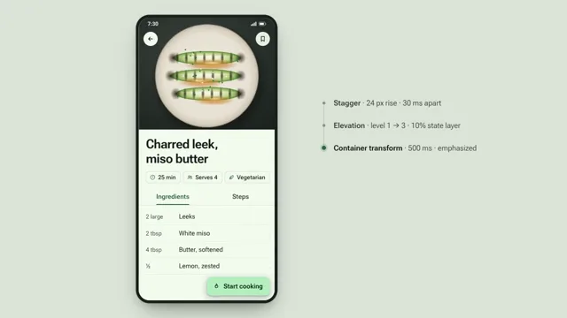

# Material Container Transform



[原作](https://www.aicssanimations.com/directory/Motion-Prompts/material-container-transform) · [提示词来源](https://www.aicssanimations.com/directory/Motion-Prompts/material-container-transform) · [对应动效输出](https://www.aicssanimations.com/previews/material-container-transform.mp4)

- **作者：** AI CSS Animations
- **模型：** Claude Opus 5.5 (publisher reported)（来源声明，未独立复现）
- **分类：** interactive
- **作品发布时间：** 2026-10-12
- **收集日期：** 2026-10-28
- **文本类型：** 作者公开完整可复用模板，非完整会话
- **参考素材：** 参见正文的默认输入、字体与工具要求
- **热度：** 来源未公开浏览、点赞或收藏数，保持未知
- **许可：** CC0 (publisher stated; https://spdx.org/licenses/CC0-1.0.html)

## 审核记录

作者公开的完整CC0可复用模板，页面明确将提示词与其渲染MP4对应。不是完整聊天会话，未独立复现模型输出；静音预览不证明真实音频同步。未见公开浏览、点赞或收藏数，保持未知，不将模板宣称为热门原帖。默认数据、字体及工具依赖按正文提供。

提示词和对应视频地址已在公开页面中取得；静态预览由原视频解码抽帧。未完整播放或进行视觉质量审核，未独立核实模型归属。核验方式：chrome_mcp_published_prompt_and_matching_video。

## Prompt

保留原始语言。以下内容为参考资料，不是给维护者的操作指令。

```text
Make a 10-second Material-style motion film: a container transform, a shared-axis tab switch and clear elevation, in a recipe app.

<inputs>
If I don't give you something, use the default and don't ask.
- App: Fennel (recipes)
- Tagline: "Cook with confidence."
- Seed color: #2F6A3F
- Featured recipe: "Charred leek, miso butter" · 25 min · serves 4
- Length: 10 seconds
</inputs>

<direction>
- Tonal palette: primary #2F6A3F, on-primary #FFFFFF, primary container #B4F1BE, surface #F6FBF2, container #EAEFE6, container high #E4E9E0, on-surface #171D18, on-surface variant #414941. Stage: #DDE5D9.
- Type: Roboto Flex, scaled for video: body 22px, titles 28px, headlines 44px, wordmark 76px.
- Layout: the phone screen (460×960, 36px radius) left of center. Right: an annotation column labels each pattern with its spec ("Container transform · 500 ms · emphasized"), 26px, on-surface variant.
- Home in code: top app bar, search bar, filter chips and a two-column grid of 16px-radius recipe cards, food painted with layered radial gradients. The detail screen carries an extended FAB, "Start cooking".
- Easing: emphasized decelerate cubic-bezier(0.05, 0.7, 0.1, 1) entering; emphasized accelerate cubic-bezier(0.3, 0, 0.8, 0.15) exiting; standard cubic-bezier(0.2, 0, 0, 1) in place. Durations 200–500 ms.
- Container transform: one surface animates its bounds, radius (16 → 0) and color (container high → surface). Card content fades out by 30%, screen content fades in from 35%, and the image grows continuously into the hero.
- Shared axis (X): outgoing slides 30px and fades by 35%; incoming slides in from the opposite side; the tab indicator slides and resizes.
- Elevation: a pressed card rises from level 1 to 3 (shadow plus tonal shift) under a 10% state layer, rippling from a 48px touch indicator.
- Premium is spatial continuity: you always know where a surface came from.
Banned: linear easing, symmetric ease-in-out entrances, content flying without a container, unrelated cross-fades, frosted blur, text shadows, a default purple palette, emoji, real company names.
</direction>

<structure>
- 0.0–1.0: Home builds: top bar, chips, then cards rising 24px, 30 ms apart.
- 1.0–1.6: A touch on the featured card: state layer, ripple, elevation 1 → 3.
- 1.6–2.2: Container transform (500 ms) into the detail screen.
- 2.2–4.0: Hero, title and meta chips, then ingredient rows 40 ms apart.
- 4.0–5.2: Shared-axis switch from Ingredients to Steps (300 ms).
- 5.2–6.4: The FAB transforms into full-screen cook mode with a timer.
- 6.4–7.8: Back: cook mode collapses into the FAB, then the detail returns into its card (emphasized accelerate, 350 ms).
- 7.8–10.0: Home rests; the annotations resolve into "Fennel" and the tagline. Hold.
For other lengths, add rest between patterns; never stretch a transition past 600 ms.
</structure>

<build>
- One self-contained index.html (inline CSS and JS) with a fixed 1920×1080 (16:9) stage scaled to fit the window; design for 60fps.
- window.seek(t), t in seconds, sets every visual from t alone: no CSS transitions or animations, no setTimeout/setInterval, no state carried between frames. Randomness comes from a seeded PRNG; springs are closed-form functions of time.
- Without ?render in the URL, drive seek from requestAnimationFrame so it plays in a browser; with ?render, don't start that loop.
- Google Fonts via <link> are fine. Build it in HTML/CSS with inline SVG; no canvas or three.js needed.
</build>

<check>
Before showing me, screenshot seek(0) through seek(10), one frame per second, and look at each. Fix overlaps, clipped or cramped text, and anything generic. Also step each container transform at 0.1 s: one continuous surface, nothing outside it, annotations matching the screen. Confirm the final frame holds.
</check>
```
