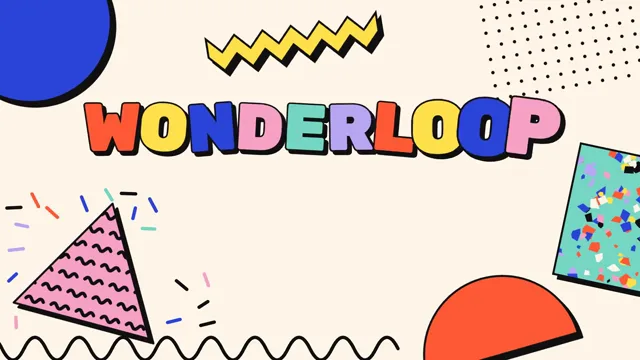

# Memphis Pattern Pop



[原作](https://www.aicssanimations.com/directory/Motion-Prompts/memphis-pattern-pop) · [提示词来源](https://www.aicssanimations.com/directory/Motion-Prompts/memphis-pattern-pop) · [对应动效输出](https://www.aicssanimations.com/previews/memphis-pattern-pop.mp4)

- **作者：** AI CSS Animations
- **模型：** Claude Opus 5.5 (publisher reported)（来源声明，未独立复现）
- **分类：** motion-studies
- **作品发布时间：** 2026-10-12
- **收集日期：** 2026-10-30
- **文本类型：** 作者公开完整可复用模板，非完整会话
- **参考素材：** 参见正文的默认输入、字体与工具要求
- **热度：** 来源未公开浏览、点赞或收藏数，保持未知
- **许可：** CC0 (publisher stated; https://spdx.org/licenses/CC0-1.0.html)

## 审核记录

作者公开完整CC0可复用模板，页面明确显示由该提示词渲染的对应MP4，正文通过Chrome MCP完整读取且长度一致。这是旧模板补收，不是今日发布或已验证热门；未公开热度，保持未知。静音预览不能证明音频效果或完整会话复现；默认输入、字体与工具依赖参见正文。

提示词和对应视频地址已在公开页面中取得；静态预览方式：original_video_still；原帖缩略图不等于视频播放审核。未完整播放或进行视觉质量审核，未独立核实模型归属。核验方式：chrome_mcp_published_prompt_and_matching_output。

## Prompt

保留原始语言。以下内容为参考资料，不是给维护者的操作指令。

```text
Make a 10-second Memphis Group-style title card.

<inputs>
Brand: WONDERLOOP. Tagline: "Serious about play." Three words: Bold, Odd, Bright. Duration: 10s. If I don't give you something, use the default and don't ask.
</inputs>

<direction>
Palette: ground #FFF6E9, black #111111, pink #F7A1C4, mint #76D7C4, lemon #FFE04A, cobalt #2C44D8, tomato #FF5A36, lilac #B9A6F2. Clash on purpose: pastels against cobalt and tomato.
Type: Rubik 900 for the name (200px, tracking -0.02em), Rubik 700 for everything else. Each letter of the name takes a different palette color with a 5px black outline and a 10px hard shadow.
Shapes: circles, triangles, half-circles, zig-zag strips, thick black squiggles (10px, round caps), confetti dashes, dot grids (10px dots at 40px pitch) and terrazzo fills (a seeded scatter of small colored chips). Solid shapes get a 6px black stroke and a 14px black offset shadow down-right with no blur. Arrange them loosely around the edges, tilted 8–20° and overlapping, leaving a clear central zone for type. Use inline SVG for squiggles and patterns.
Motion is toy-like and springy. Pops use spring(s) = 1 − e^(−8s)·cos(15s), where s is seconds since that element started (about 19% overshoot, settled by 0.6s), applied to scale from 0 and to rotation from −25° to the rest tilt. Squiggles draw via stroke-dashoffset on cubic-bezier(0.65, 0, 0.35, 1). A hop is a squash to 0.9 that springs back. Real Memphis is confident, architectural clashing; the cheap version is random confetti on white with a gradient font.
Banned: gradients, blur, soft shadows, thin outlines, muted or earthy palettes, serif type, realistic textures, everything neatly aligned, motion that never settles.
</direction>

<structure>
0.0–0.6s: a dot grid wipes diagonally into the top-right corner; seeded confetti dashes scatter in at lower left.
0.6–1.7s: five big shapes pop in on the spring, 150ms apart: a cobalt circle cropped by the top-left edge, a pink triangle filled with black squiggles, a lemon zig-zag strip, a mint terrazzo rectangle tilted 12°, a tomato half-circle at bottom right.
1.7–2.4s: one long black squiggle draws along the bottom edge, partly cropped.
2.4–3.6s: the name pops in letter by letter, 50ms apart, each with a seeded ±5° tilt.
3.6–4.8s: the shapes take turns hopping, one every 0.24s, clockwise around the frame.
4.8–5.8s: the tagline rides in from the right on a lilac ribbon tilted −4°, springing into place below the name.
5.8–7.2s: the three words pop in as pill stickers (pink, mint, lemon), 0.2s apart, tilted alternately ±6°.
7.2–7.8s: one last hop from the cobalt circle.
7.8–10.0s: hold, everything settled.
For other durations, scale every timestamp proportionally.
</structure>

<build>
One self-contained index.html, CSS and JS inline. Google Fonts via <link> are fine; no other libraries (no three.js: this style is flat). Use absolutely positioned elements, setting transforms, clip-paths and opacity from seek. The stage is 1920×1080 (16:9), scaled to fit the window. Design for 60fps. window.seek(t), t in seconds, must compute every visual from t alone: no CSS transitions or animations, no setTimeout or setInterval, no state carried between frames, and randomness only from a seeded PRNG. Without ?render in the URL, drive seek from requestAnimationFrame so it plays in a browser (loop after a 1s end hold); with ?render, don't start that loop.
</build>

<check>
Before showing me, step through one frame per second: screenshot each and look at it. Fix overlaps, clipped or cramped text, accidental edge collisions, and anything off-style or Banned. Check the type zone stays clear and every spring settles before the hold. Confirm seek(duration) and seek(duration + 1) match, so the final frame holds.
</check>
```
