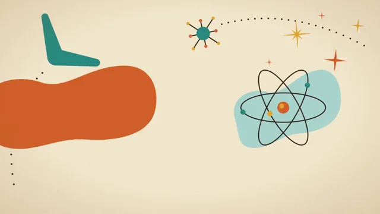

# Mid-Century Atomic



[原作](https://www.aicssanimations.com/directory/Motion-Prompts/mid-century-atomic) · [提示词来源](https://www.aicssanimations.com/directory/Motion-Prompts/mid-century-atomic) · [对应动效输出](https://www.aicssanimations.com/previews/mid-century-atomic.mp4)

- **作者：** AI CSS Animations
- **模型：** Claude Opus 5.5 (publisher reported)（来源声明，未独立复现）
- **分类：** motion-studies
- **作品发布时间：** 2026-10-12
- **收集日期：** 2026-10-30
- **文本类型：** 作者公开完整可复用模板，非完整会话
- **参考素材：** 参见正文的默认输入、字体与工具要求
- **热度：** 来源未公开浏览、点赞或收藏数，保持未知
- **许可：** CC0 (publisher stated; https://spdx.org/licenses/CC0-1.0.html)

## 审核记录

作者公开完整CC0可复用模板，页面明确显示由该提示词渲染的对应MP4，正文通过Chrome MCP完整读取且长度一致。这是旧模板补收，不是今日发布或已验证热门；未公开热度，保持未知。静音预览不能证明音频效果或完整会话复现；默认输入、字体与工具依赖参见正文。

提示词和对应视频地址已在公开页面中取得；静态预览方式：original_video_still；原帖缩略图不等于视频播放审核。未完整播放或进行视觉质量审核，未独立核实模型归属。核验方式：chrome_mcp_published_prompt_and_matching_output。

## Prompt

保留原始语言。以下内容为参考资料，不是给维护者的操作指令。

```text
Make a 10-second mid-century atomic-age brand spot.

<inputs>
Brand: Orbitwell. Descriptor: Home Appliances. Tagline: "Tomorrow's kitchen, today." Three words: Bright, Easy, Modern. Duration: 10s. If I don't give you something, use the default and don't ask.
</inputs>

<direction>
Palette: cream #F2E6CC, teal #2B8A80, pale aqua #A8D4CB, mustard #DFA530, burnt orange #D35F2A, chocolate #2E2219 for linework and type. It should look like ink on aging stock: a seeded speckle at 2–3% opacity and a faint warm vignette.
Type: Yellowtail for the brand script (190px, tilted −6°, with a hand-drawn swash underline as a path); Barlow Condensed 600, uppercase, tracked 0.16em, at 34–40px for supporting copy.
Motifs: boomerangs, kidney shapes, 4- and 8-point starbursts with long needle points, an atom of three ellipses at 0°, 60° and 120° with electron dots, dotted arcs, and a Sputnik ball with spokes. Shapes are flat with no outlines; only the chocolate linework is stroked, at 5px. Compose asymmetrically on diagonals, shapes floating in plenty of cream, the script crossing a kidney panel.
Motion is buoyant optimism. Things glide on arcs, never straight lines, and arrive with a light overshoot on cubic-bezier(0.34, 1.35, 0.64, 1) over 0.6–1.0s; drifts use sine easing. Starbursts twinkle in (scale 0 → 1 while rotating 0 → 45°). Electrons orbit at constant speed, then decelerate to rest (integrate speed analytically so the angle stays continuous). The real thing feels warm, hand-inked and hopeful; the cheap version is neon, chrome and a generic retro font.
Banned: neon, pure black or white, chrome or metallic effects, heavy outlines on every shape, rigid grids, glitch effects, straight linear motion, harsh cuts.
</direction>

<structure>
0.0–0.9s: a teal boomerang swoops in on an arc from bottom-left to the left third, rotating 40° as it travels.
0.9–1.8s: five starbursts twinkle in, mustard and orange, 40–160px, 0.15s apart, scattered upper right.
1.8–2.8s: the atom's orbits draw around a point right of center over 0.8s, then the electrons start circling.
2.8–4.0s: an orange kidney panel glides in on an arc behind center-left; the script writes on via a left-to-right clip slanted to match the letters, over 1.0s on cubic-bezier(0.45, 0, 0.25, 1); the swash draws 0.2s after.
4.0–5.0s: the descriptor arcs in under the script and settles.
5.0–6.4s: the tagline drops in word by word onto a mustard banner, 0.15s apart, with the light overshoot.
6.4–7.6s: the three words appear with small starburst bullets between them, 0.2s apart.
7.6–8.6s: the electrons slow to a stop; every drift eases to rest.
8.6–10.0s: hold.
For other durations, scale every timestamp proportionally.
</structure>

<build>
One self-contained index.html, CSS and JS inline. Google Fonts via <link> are fine; no other libraries (no three.js: this style is flat). Draw in inline SVG. The stage is 1920×1080 (16:9), scaled to fit the window. Design for 60fps. window.seek(t), t in seconds, must compute every visual from t alone: no CSS transitions or animations, no setTimeout or setInterval, no state carried between frames, and randomness only from a seeded PRNG. Without ?render in the URL, drive seek from requestAnimationFrame so it plays in a browser (loop after a 1s end hold); with ?render, don't start that loop.
</build>

<check>
Before showing me, step through one frame per second: screenshot each and look at it. Fix overlaps, clipped or cramped text, accidental edge collisions, and anything off-style or Banned. Check the script stays legible over the panel and nothing is still drifting in the hold. Confirm seek(duration) and seek(duration + 1) match, so the final frame holds.
</check>
```
