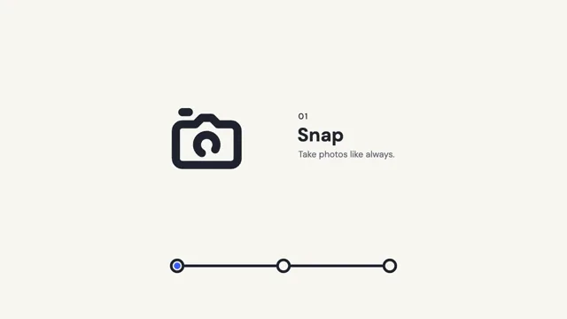

# Monoline Icon Explainer



[原作](https://www.aicssanimations.com/directory/Motion-Prompts/monoline-icon-explainer) · [提示词来源](https://www.aicssanimations.com/directory/Motion-Prompts/monoline-icon-explainer) · [对应动效输出](https://www.aicssanimations.com/previews/monoline-icon-explainer.mp4)

- **作者：** AI CSS Animations
- **模型：** Claude Opus 5.5 (publisher reported)（来源声明，未独立复现）
- **分类：** explainers-data
- **作品发布时间：** 2026-10-12
- **收集日期：** 2026-10-30
- **文本类型：** 作者公开完整可复用模板，非完整会话
- **参考素材：** 参见正文的默认输入、字体与工具要求
- **热度：** 来源未公开浏览、点赞或收藏数，保持未知
- **许可：** CC0 (publisher stated; https://spdx.org/licenses/CC0-1.0.html)

## 审核记录

作者公开完整CC0可复用模板，页面明确显示由该提示词渲染的对应MP4，正文通过Chrome MCP完整读取且长度一致。这是旧模板补收，不是今日发布或已验证热门；未公开热度，保持未知。静音预览不能证明音频效果或完整会话复现；默认输入、字体与工具依赖参见正文。

提示词和对应视频地址已在公开页面中取得；静态预览方式：original_video_still；原帖缩略图不等于视频播放审核。未完整播放或进行视觉质量审核，未独立核实模型归属。核验方式：chrome_mcp_published_prompt_and_matching_output。

## Prompt

保留原始语言。以下内容为参考资料，不是给维护者的操作指令。

```text
<inputs>
You're making a monoline icon animation explaining a three-step process. I may supply any of these; if I don't give you something, use the default and don't ask.
- Product: Fernway, a fictional photo backup app.
- Steps (icon, title, line): camera, "Snap", "Take photos like always." → cloud, "Sync", "They upload over Wi-Fi." → shield, "Safe", "Every shot, kept."
- Tagline: "Fernway keeps every photo."
- Length: 10 seconds.
</inputs>

<direction>
Ground #FAF8F3, line #1F2430, spark #FFB547, accent #3B5BFF for the rail dot, filled nodes and checkmark only.
Icons are classic line icons: a 24-unit grid, 2.5-unit stroke, round caps and joins, scaled as a whole (hero 264px) so the weight-to-size ratio never changes. The rail and nodes match the small recap icons' 9px line. Geometry: circles, arcs, 90° and 45° lines; corner radius 2 units.
Layout: hero icon centered at x 700, text left-aligned at x 1010, a progress rail along y 900 with three nodes. Type, all "DM Sans": step number ("01") 500, 28px, tracking 0.1em; title 700, 64px; line 400, 30px, #5A6070.
Draw-on: stroke-dashoffset per subpath (0.5–0.7s, easeOutQuart), outer shape first, 60ms apart.
Morph: resample source and target to 160 points by arc length, rotate the target's start index to minimize total travel, then interpolate (0.7s, easeInOutCubic). Morphs carry meaning: the camera lens becomes the cloud's big bump; the sync arrows fold into the checkmark. Subpaths without a partner draw off or on instead.
Accents: three spark ticks burst from a finished icon (0 → 28px → 0 over 0.35s). Text rises 20px as it fades in (0.4s, easeOutCubic) and exits upward in 0.25s.
Authentic: one weight, one cap style, grid geometry, morphs that make sense. Cheap: crossfades posing as morphs, shapes turning inside out mid-morph.
Banned: fills (except the rail dot and nodes), square caps, mixed weights, shadows, gradients, 3D, icon fonts or libraries, emoji.
</direction>

<structure>
- 0–0.8s: the rail draws on; three hollow nodes pop on.
- 0.8–2.2s: the camera draws on (body, lens, shutter); "01 Snap" rises in; spark at 1.9s; node 1 fills.
- 2.2–3.0s: hold; the lens ring turns 30°.
- 3.0–3.8s: camera morphs to cloud; text swaps; the dot slides to node 2.
- 3.8–5.4s: sync arrows draw around the cloud and spin one turn.
- 5.4–6.2s: arrows fold into a check as the cloud becomes a shield; dot to node 3.
- 6.2–7.6s: "03 Safe" lands; the shield pops to 104% and settles; sparks.
- 7.6–8.8s: the shield shrinks to a third over node 3 as camera and cloud redraw small over nodes 1 and 2.
- 8.8–10s: the tagline fades up; hold from 9.2s.
Other lengths: scale proportionally; never morph faster than 0.5s.
</structure>

<build>
One self-contained index.html (inline CSS and JS; Google Fonts via <link> are fine), a 1920×1080 (16:9) stage scaled to fit the window, built for 60fps. Draw in SVG (resample with getPointAtLength); three.js isn't needed.
window.seek(t) (t in seconds) sets every visual from t alone, clamping past the end to the last frame. No CSS transitions or CSS animations, no setTimeout/setInterval, no state carried between frames. Any randomness comes from a seeded PRNG keyed to the frame, never Math.random.
With no ?render in the URL, call seek from requestAnimationFrame so it plays in a browser; with ?render, don't start that loop.
</build>

<check>
Before showing me, step through one frame per second (0–10s) and look at each. Fix overlaps, clipped or cramped text and anything off-style: equal weight on every icon, no morph folding through itself, text clear of the hero icon. Confirm the final frame holds.
</check>
```
