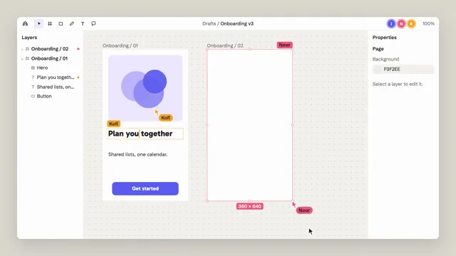

# Multiplayer Design Canvas



[原作](https://www.aicssanimations.com/directory/Motion-Prompts/multiplayer-design-canvas) · [提示词来源](https://www.aicssanimations.com/directory/Motion-Prompts/multiplayer-design-canvas) · [对应动效输出](https://www.aicssanimations.com/previews/multiplayer-design-canvas.mp4)

- **作者：** AI CSS Animations
- **模型：** Claude Opus 5.5 (publisher reported)（来源声明，未独立复现）
- **分类：** interactive
- **作品发布时间：** 2026-10-16
- **收集日期：** 2026-10-31
- **文本类型：** 作者公开完整可复用模板，非完整会话
- **参考素材：** 参见正文的默认输入、字体与工具要求
- **热度：** 来源未公开浏览、点赞或收藏数，保持未知
- **许可：** CC0 (publisher stated; https://spdx.org/licenses/CC0-1.0.html)

## 审核记录

作者公开CC0完整可复用模板；正文原文与明确对应的MP4已保留。旧模板补收，热度未知，不称今日新发布或已验证热门；默认输入与工具要求参见正文。

提示词和对应视频地址已在公开页面中取得；静态预览方式：browser_download_original_video_ffmpeg_still；原帖缩略图不等于视频播放审核。未完整播放或进行视觉质量审核，未独立核实模型归属。核验方式：chrome_mcp_public_prompt_and_matching_output。

## Prompt

保留原始语言。以下内容为参考资料，不是给维护者的操作指令。

```text
Make a 10-second multiplayer design canvas demo: three people work in one file at once, their named cursors drawing a frame, editing text and pinning a comment, while selection handles and the layer list update live.

<inputs>
If I don't give you something, use the default and don't ask.
- Tool: Tracery. File: "Onboarding v3"
- You: Ilse (black pointer, selection #5B5BF0). Collaborators: Noor #F2557A, Kofi #F5A524
- Frame "Onboarding / 01": hero art, title "Plan trips together", body "Shared lists, one calendar.", a 280×56 "Get started" button
- Edits: Kofi retitles it "Plan your week together"; Noor draws "Onboarding / 02" and comments "Can the button be 8px wider?"; you widen it to 288 and reply "Done, 288 now."
- Length: 10 seconds
</inputs>

<direction>
Palette: stage #DAD7CF; chrome #FFFFFF; canvas #F3F2EE with a 24px dot grid; ink #1D1D1F; secondary #6F6E73. The design has its own palette: white frames, a #EDE7FF hero with three overlapping circles, a #5B5BF0 button.
Type: Schibsted Grotesk 400–600 for the tool at 20–22px; the design uses Gabarito (title 34px/700, body 22px), so the work reads apart from the chrome.
Layout: a 1776×936 window at (72, 72): a 56px toolbar (drawn tools, file name, three avatars ringed in their colors), a 280px layers panel, a 300px properties panel, the canvas between. Frame 01 is 360×640, 80px in from the canvas's top-left; the new frame lands 80px to its right.
Remote cursors: an arrow in the person's color with a white outline and a 20px name pill beside it (ink text on amber). They move like hands: curved paths at uneven speeds (0.4–0.9s on cubic-bezier(0.4, 0, 0.2, 1)) and a small seeded idle wander that fades out by 8.6s. Yours is a plain black arrow.
Selections: a 1.5px box in the owner's color with eight white handles and a size chip; remote boxes carry the owner's name. Edited text shows a caret and a 25% highlight in the editor's color. Frame drags show a live "W × H" chip and snap to 8px.
Panels: layers (Onboarding / 01 with Hero, Title, Body, Button) dot each row in the color of whoever is touching it, slide new rows in and rename text layers as they change; properties show your selection (W, H, X, Y, fill, radius), values rolling as they change.
Comments: a round pin in Noor's color drops on a spring and opens a 300px thread card beside it, never over frame 01's content.
Actions overlap but stay legible: starts at least 0.3s apart; cursors and tags never cross.
Premium is collaboration you can follow: three hands with distinct habits, every action echoed in the panels. Cheap is colored arrows drifting over a static mockup.
Banned: real design-tool names or copies of their UI, anonymous or teleporting cursors, overlapping tags, emoji, anything flashing more than 3 times per second.
</direction>

<structure>
0.0–0.9s: the window rises 24px and fades in on frame 01; the toolbar avatars pop in 80ms apart.
0.9–2.8s: Noor enters from the right and drags out the new frame, the chip counting to "360 × 640"; it becomes "Onboarding / 02" and its row slides in with her dot.
1.4–4.2s: Kofi double-clicks the title (an amber box with his name), selects "trips" and types "your week" at about 10 characters a second; the layer renames; he clicks away.
3.6–5.0s: Noor drops the pin on the button's top-right corner; her thread opens.
5.0–6.8s: your pointer selects the button (indigo handles, "280 × 56") and drags the right handle 8px; chip and W roll to 288.
6.8–8.0s: your reply types into the thread and posts; the pin gains a check.
8.0–8.6s: the cursors settle clear of the content.
8.6–10.0s: hold, perfectly still.
For other lengths, scale the beats but keep typing speeds fixed and hold at least 1s.
</structure>

<build>
One self-contained index.html, CSS and JS inline; Google Fonts via <link>, awaited with document.fonts.load() before window.seek is defined; no other libraries. Use HTML/CSS with inline SVG for cursors, handles, pins and icons; each person's moves and actions are a timeline built once at load and read by t. The stage is 1920×1080 (16:9), scaled to fit the window; design for 60fps. window.seek(t), t in seconds, must compute every visual from t alone: no CSS transitions or animations, no setTimeout or setInterval, no state carried between frames, randomness only from a seeded PRNG. Without ?render in the URL, drive seek from requestAnimationFrame (loop after a 1s end hold); with ?render, don't start that loop.
</build>

<check>
Before showing me, step through one frame per second: screenshot each and look at it. Fix overlaps, clipped or cramped text and anything off-style or Banned. Check tags never overlap each other or edited text, the panels always agree with the canvas (new frame listed, title renamed, W 288 at the end), and both frames sit on the 8px grid. Confirm seek(10) and seek(11) match, so the final frame holds.
</check>
```
