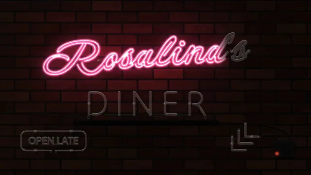

# Neon Sign



[原作](https://www.aicssanimations.com/directory/Motion-Prompts/neon-sign-glow) · [提示词来源](https://www.aicssanimations.com/directory/Motion-Prompts/neon-sign-glow) · [对应动效输出](https://www.aicssanimations.com/previews/neon-sign-glow.mp4)

- **作者：** AI CSS Animations
- **模型：** Claude Opus 5.5 (publisher reported)（来源声明，未独立复现）
- **分类：** motion-studies
- **作品发布时间：** 2026-10-16
- **收集日期：** 2026-10-31
- **文本类型：** 作者公开完整可复用模板，非完整会话
- **参考素材：** 参见正文的默认输入、字体与工具要求
- **热度：** 来源未公开浏览、点赞或收藏数，保持未知
- **许可：** CC0 (publisher stated; https://spdx.org/licenses/CC0-1.0.html)

## 审核记录

作者公开CC0完整可复用模板；正文原文与明确对应的MP4已保留。旧模板补收，热度未知，不称今日新发布或已验证热门；默认输入与工具要求参见正文。

提示词和对应视频地址已在公开页面中取得；静态预览方式：browser_download_original_video_ffmpeg_still；原帖缩略图不等于视频播放审核。未完整播放或进行视觉质量审核，未独立核实模型归属。核验方式：chrome_mcp_public_prompt_and_matching_output。

## Prompt

保留原始语言。以下内容为参考资料，不是给维护者的操作指令。

```text
Make a 10-second shopfront neon sign warming up on a brick wall at night.

<inputs>
Script word: Rosalind's. Block word: DINER. Small sign: OPEN LATE. Accent: an arrow of three chevrons pointing down-left toward the door. Colors: pink script, aqua DINER, red small sign, amber arrow. Duration: 10s. If I don't give you something, use the default and don't ask.
</inputs>

<direction>
Wall: running-bond brick, 180×60 bricks with 10px recessed mortar #1E1A18, each brick a seeded tint between #3A1E19 and #5C2D22 with speckle, pitting and a few chipped corners. It's seen only by the sign's light: 12% ambient at the frame edges plus a faint cool street light from the upper left (#9FB4C8, 6%).
Tubes, core → color: pink #FFE6F2 → #FF3E93, aqua #E6FFFC → #16D2C3, red #FFE2DC → #FF2B2B, amber #FFF2D6 → #FF9F1C.
Type as tubes: "Neonderthaw" 400 for the script (about 280px, rising 4°), "Tilt Neon" 400 for DINER (about 230px, tracked 0.14em) and OPEN LATE (64px). Big tubes read 14px wide, small ones 8px.
Each lit tube is four additive layers: a wall wash (a 300–500px radial light at 16–22% in its color, multiplied into the brick so mortar stays darker), a halo (30px blur, 45%), a body (5px blur) and a near-white core. A 1.5px white glass highlight runs along each tube's upper edge, lit or not.
Hardware sells it: unlit tubes are pale glass #8D8A86 at 28%; black blockout paint on the jumps between letters; dark electrode caps at tube ends; clear supports every 200px or so with small soft shadows; a slim black raceway under DINER; a transformer box at lower right with a tiny pilot light and a wire.
Layout: script centered at (900, 330); DINER centered under it at y 640; OPEN LATE in a rounded-rectangle tube centered at (330, 870); the arrow centered at (1500, 860). Keep 100px clear of the edges.
Warm-up: tubes light in sequence. The script writes itself behind a mask that follows its writing direction at 900px/s. The script and DINER each get one ignition stutter (0 → 35% in 0.06s, back to 10% by 0.24s, up to 100% by 0.6s with ease-out); other tubes ramp up smoothly over 0.5s. Never more than 3 brightness swings anywhere in the frame in any second. Each wall wash lags its tube by 0.15s.
Then life: a slow hum breathing ±3% over 2.4s; the R of DINER dips once to 70% and recovers; the chevrons chase one step every 0.6s, then all hold lit.
The real thing is glass, hardware and colored light falling off across brick; the cheap version is a blurred font on flat black with an even glow.
Banned: flat black backgrounds, rainbow or gradient tubes, glitch effects, rapid flicker, strobing, lens flares, anything flashing more than 3 times per second.
</direction>

<structure>
0.0–1.0s: the dark wall, every tube unlit: glass highlights, blockout, supports and raceway catch only the street light.
1.0–1.3s: the transformer's pilot light comes on.
1.3–3.4s: the script stutters, then writes itself; the wall warms pink around it.
3.4–4.6s: DINER stutters and lights D to R in 0.8s; aqua light floods the bricks below.
4.6–5.4s: OPEN LATE and its border ramp up in red.
5.4–6.2s: the chevrons light one by one, then begin chasing.
6.2–8.0s: everything hums; at 7.6s the R dips to 70% for 0.3s and recovers.
8.0–8.6s: the chase stops with all chevrons lit; the hum settles to steady.
8.6–10.0s: hold, a steady glow.
For other durations, scale every timestamp proportionally.
</structure>

<build>
One self-contained index.html, CSS and JS inline. Google Fonts via <link> are fine; no other libraries (no three.js: this style is flat). Draw in Canvas 2D, repainting every frame from scratch. Canvas won't fetch fonts itself: await document.fonts.load() for each face, then define window.seek. Use additive ('lighter') blending for light. Build the brick wall and each tube's glass, halo, body and core layers once at load into offscreen canvases, so each frame only composites them at the right brightness and reveal. The stage is 1920×1080 (16:9), scaled to fit the window. Design for 60fps. window.seek(t), t in seconds, must compute every visual from t alone: no CSS transitions or animations, no setTimeout or setInterval, no state carried between frames, and randomness only from a seeded PRNG. Without ?render in the URL, drive seek from requestAnimationFrame so it plays in a browser (loop after a 1s end hold); with ?render, don't start that loop.
</build>

<check>
Before showing me, step through one frame per second: screenshot each and look at it. Fix overlaps, clipped or cramped text, accidental edge collisions, and anything off-style or Banned. Check unlit tubes are visible before warm-up, brick shows only where light reaches it, the script and DINER have crisp near-white cores, and count brightness swings in each second: never more than 3. Confirm seek(duration) and seek(duration + 1) match, so the final frame holds.
</check>
```
