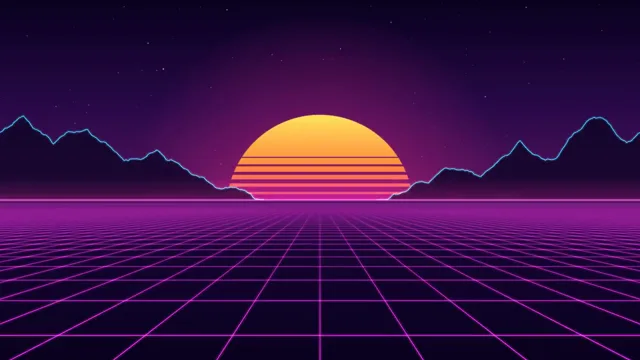

# Synthwave Neon Grid



[原作](https://www.aicssanimations.com/directory/Motion-Prompts/neon-synthwave-grid) · [提示词来源](https://www.aicssanimations.com/directory/Motion-Prompts/neon-synthwave-grid) · [对应动效输出](https://www.aicssanimations.com/previews/neon-synthwave-grid.mp4)

- **作者：** AI CSS Animations
- **模型：** Claude Opus 5.5 (publisher reported)（来源声明，未独立复现）
- **分类：** motion-studies
- **作品发布时间：** 2026-10-12
- **收集日期：** 2026-10-31
- **文本类型：** 作者公开完整可复用模板，非完整会话
- **参考素材：** 参见正文的默认输入、字体与工具要求
- **热度：** 来源未公开浏览、点赞或收藏数，保持未知
- **许可：** CC0 (publisher stated; https://spdx.org/licenses/CC0-1.0.html)

## 审核记录

作者公开CC0完整可复用模板；正文原文与明确对应的MP4已保留。旧模板补收，热度未知，不称今日新发布或已验证热门；默认输入与工具要求参见正文。

提示词和对应视频地址已在公开页面中取得；静态预览方式：browser_download_original_video_ffmpeg_still；原帖缩略图不等于视频播放审核。未完整播放或进行视觉质量审核，未独立核实模型归属。核验方式：chrome_mcp_public_prompt_and_matching_output。

## Prompt

保留原始语言。以下内容为参考资料，不是给维护者的操作指令。

```text
<inputs>
If I don't give you something, use the default and don't ask.
- Chrome title: default "SUNDOWN"
- Script word: default "Riders"
- Tagline: default "Out past the last exit"
- Neon colors: default magenta #FF2BD6, cyan #23E5FF
- Length: default 10 seconds
</inputs>

<direction>
An 80s-revival title: a night drive toward an impossible sunset, chrome lettering, neon that hums.

Palette: sky #0A0220 → #2B0A4A → #5A1460 at the horizon; grid magenta; mountains #120629 with a 2 px cyan rim; sun #FFE45C → #FF8A3D → #FF2B8F top to bottom; stars #F5E9FF.

Floor (horizon at y=600): a true perspective grid (spacing compresses toward the horizon), horizontals moving toward camera. Integrate speed analytically so position stays a pure function of t. Lines brighten near camera and fade into horizon haze. Glow: stroke twice, wide and faint then narrow and bright, 'lighter' compositing.

Sun: a 560 px disc half-sunk at the horizon, cut by 7 gaps that thicken downward and drift slowly down.

Type (DOM): chrome title in Kanit 800 italic, 220 px, with a hard-edged gradient fill (white → #A9D4FF → #2A2E78, an abrupt horizon at 52%, then #FFC2F0 → white) and an 8 px stepped extrusion in #1B0B3A. Neon script in Mr Dafoe, 150 px, magenta, crossing the title's lower right at -8°, stacked text-shadow glow. Tagline: Kanit 400, 26 px, caps, tracked 0.4em, cyan.

Motion: sine and expo glides; the only abrupt event is the neon ignition. The title arrives from depth (scale 0.55 → 1.0, easeOutExpo, 1.2 s), then a diagonal glint crosses it in 0.8 s. Ignition: two off-on flickers within 0.8 s, then steady. Stars twinkle on seeded sines slower than 0.5 Hz. The tagline holds at least 1.5 s.

Authentic: real perspective math, layered glow, chrome with a hard horizon. Cheap: a flat tilted grid image.

Banned: VHS noise, glitch, RGB split, palm-tree or car clip art, rainbow gradients, flicker faster than 3 times per second.
</direction>

<structure>
Default 10 s:
- 0.0–1.2: stars; grid lines draw out from the horizon, already moving.
- 1.2–3.6: the sun rises to half-sunk (easeOutSine); mountains fade up either side.
- 3.6–5.0: a slow tilt: horizon up 40 px while grid speed swells 1.0 → 1.5× and settles.
- 5.0–6.2: the chrome title arrives, upper center; glint at 5.8.
- 6.2–7.2: the script ignites (two flickers), then glows steady.
- 7.2–8.2: tagline fades in beneath, over a thin cyan rule growing from center.
- 8.2–10.0: hold; only the grid and the sun's gaps keep moving.

Other lengths: scale the beats; keep grid speed constant outside the tilt.
</structure>

<build>
- One self-contained index.html, no libraries (three.js from a CDN only when a style truly needs 3D); a 1920×1080 (16:9) stage scaled to fit the window; designed for 60fps.
- window.seek(t), t in seconds, computes every visual from t alone: no CSS transitions or animations, no setTimeout/setInterval, no state carried between frames. Randomness comes from a seeded PRNG: stars keyed to each star, anything per-frame keyed to the frame.
- No ?render in the URL: drive seek from requestAnimationFrame so it plays in a browser. With ?render: don't start that loop.
- Google Fonts via <link>; await document.fonts.load() for each face before assigning window.seek.
- Canvas 2D for the scene; DOM for type, all set in seek.
</build>

<check>
Before showing me, step through one frame per second and look at each. Fix overlaps, clipped or cramped text and anything off-style. Check the title stays legible over the sun and clears the script word. Confirm the final frame holds.
</check>
```
