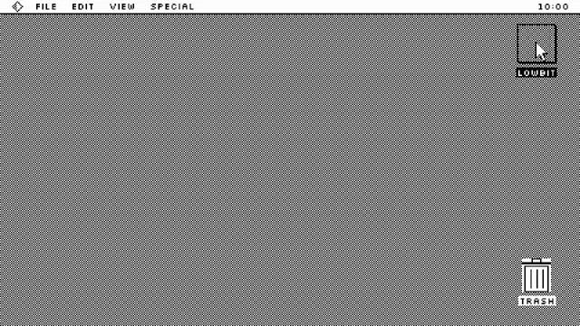

# One-Bit Dithered Desktop



[原作](https://www.aicssanimations.com/directory/Motion-Prompts/one-bit-dither) · [提示词来源](https://www.aicssanimations.com/directory/Motion-Prompts/one-bit-dither) · [对应动效输出](https://www.aicssanimations.com/previews/one-bit-dither.mp4)

- **作者：** AI CSS Animations
- **模型：** Claude Opus 5.5 (publisher reported)（来源声明，未独立复现）
- **分类：** motion-studies
- **作品发布时间：** 2026-10-12
- **收集日期：** 2026-10-30
- **文本类型：** 作者公开完整可复用模板，非完整会话
- **参考素材：** 参见正文的默认输入、字体与工具要求
- **热度：** 来源未公开浏览、点赞或收藏数，保持未知
- **许可：** CC0 (publisher stated; https://spdx.org/licenses/CC0-1.0.html)

## 审核记录

作者公开完整CC0可复用模板，页面明确显示由该提示词渲染的对应MP4，正文通过Chrome MCP完整读取且长度一致。这是旧模板补收，不是今日发布或已验证热门；未公开热度，保持未知。静音预览不能证明音频效果或完整会话复现；默认输入、字体与工具依赖参见正文。

提示词和对应视频地址已在公开页面中取得；静态预览方式：original_video_still；原帖缩略图不等于视频播放审核。未完整播放或进行视觉质量审核，未独立核实模型归属。核验方式：chrome_mcp_published_prompt_and_matching_output。

## Prompt

保留原始语言。以下内容为参考资料，不是给维护者的操作指令。

```text
<inputs>
If I don't give you something, use the default and don't ask.
- Product name: default "LOWBIT"
- Version: default "1.0"
- Tagline: default "Less color. More character."
- Ink and paper: default #000000 / #FFFFFF (any two-color pair works)
- Length: default 10 seconds
</inputs>

<direction>
An early monochrome desktop, shown with love: every pixel ink or paper, tone made from pattern, interface built from 1 px lines.

Pixels: draw everything on an offscreen 480×270 canvas, then blit to the stage at exactly 4× with image smoothing off. Every output pixel is one of the two colors: no grey, no anti-aliasing, no alpha.

Dithering: compute tone (shading, gradients, shadows) per pixel, then threshold it against an 8×8 Bayer matrix locked to screen coordinates, so when light moves the pattern crawls across surfaces instead of travelling with them. That crawl is the signature.

Type: Silkscreen (Google Fonts) drawn on the low-res canvas at 8 px (16 for headings, 24 for the hero), hard-thresholded at 50% so glyphs are pure pixels.

UI: a 50% checker desktop; a menu bar with a 1 px rule; windows with a 1 px border, 1 px offset shadow and a title bar of six horizontal stripes with the title on a knocked-out plate; buttons, the default with a thick ring; an arrow cursor sprite. Invent your own icons; no real OS logos.

Motion: positions round to whole low-res pixels, so motion is stepped and crisp. Cursor legs take 0.6–0.9 s, easeInOutQuad. Windows open with zoom rectangles: 5 outlines expanding from the icon over 0.3 s. Pressed controls invert while held. Light orbits take at least 3 s. The dialog stays up at least 2 s.

Authentic: screen-locked patterns and exact 1 px rules; cheap: anti-aliased type and noisy dither.

Banned: blur, glow, smoothed scaling, error-diffusion dither that boils, scanlines, CRT curvature, more than one full-screen inversion, blinking more than 3 times per second.
</direction>

<structure>
Default 10 s:
- 0.0–0.8: white screen; the checker desktop fills downward in 8-pixel bands.
- 0.8–1.4: menu bar and a desktop icon named for the product snap in.
- 1.4–3.0: the cursor travels to the icon, which inverts on arrival; a double-click at 2.8 opens it.
- 3.0–3.3: zoom rectangles expand to the window bounds.
- 3.3–6.2: the window shows a big Bayer-shaded sphere with a cast shadow, light orbiting so the pattern crawls.
- 6.2–7.4: a progress bar fills in steps (25%, 50%, solid), labelled "RENDERING 1-BIT…".
- 7.4–8.0: a double-bordered dialog pops center: name and version at 24 px, tagline at 8 px, an OK button.
- 8.0–10.0: the cursor glides to OK and rests; still from 8.8.

Other lengths: scale the holds, keep cursor timing.
</structure>

<build>
- One self-contained index.html, no libraries (three.js from a CDN only when a style truly needs 3D); a 1920×1080 (16:9) stage scaled to fit the window; designed for 60fps.
- window.seek(t), t in seconds, computes every visual from t alone: no CSS transitions or animations, no setTimeout/setInterval, no state carried between frames. Any randomness comes from a seeded PRNG keyed to the frame.
- No ?render in the URL: drive seek from requestAnimationFrame so it plays in a browser. With ?render: don't start that loop.
- Google Fonts via <link>; await document.fonts.load() for each face before assigning window.seek.
- Canvas 2D only.
</build>

<check>
Before showing me, step through one frame per second and look at each. Fix overlaps, clipped or cramped text and anything off-style. Sample pixels to prove only two colors exist. Confirm the final frame holds.
</check>
```
