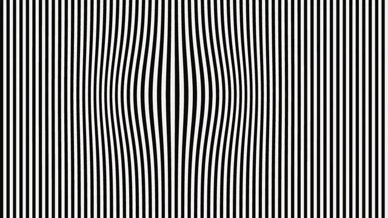

# Op Art Illusion



[原作](https://www.aicssanimations.com/directory/Motion-Prompts/op-art-illusion) · [提示词来源](https://www.aicssanimations.com/directory/Motion-Prompts/op-art-illusion) · [对应动效输出](https://www.aicssanimations.com/previews/op-art-illusion.mp4)

- **作者：** AI CSS Animations
- **模型：** Claude Opus 5.5 (publisher reported)（来源声明，未独立复现）
- **分类：** motion-studies
- **作品发布时间：** 2026-10-12
- **收集日期：** 2026-10-28
- **文本类型：** 作者公开完整可复用模板，非完整会话
- **参考素材：** 参见正文的默认输入、字体与工具要求
- **热度：** 来源未公开浏览、点赞或收藏数，保持未知
- **许可：** CC0 (publisher stated; https://spdx.org/licenses/CC0-1.0.html)

## 审核记录

作者公开的完整CC0可复用模板，页面明确将提示词与其渲染MP4对应。不是完整聊天会话，未独立复现模型输出；静音预览不证明真实音频同步。未见公开浏览、点赞或收藏数，保持未知，不将模板宣称为热门原帖。默认数据、字体及工具依赖按正文提供。

提示词和对应视频地址已在公开页面中取得；静态预览由原视频解码抽帧。未完整播放或进行视觉质量审核，未独立核实模型归属。核验方式：chrome_mcp_published_prompt_and_matching_video。

## Prompt

保留原始语言。以下内容为参考资料，不是给维护者的操作指令。

```text
Make a 10-second black-and-white Op Art piece in the spirit of Bridget Riley and Victor Vasarely.

<inputs>
Title: PARALLAX. Subtitle: Moving Lines. Details: Gallery 2 · Until 30 June. Three words: Line, Wave, Depth. Duration: 10s. If I don't give you something, use the default and don't ask.
</inputs>

<direction>
Palette: black #0E0E0E and white #F3F2EE, nothing else.
Type: Archivo at width 125, weight 800 (load the wdth axis), uppercase; the title as large as fits, about 250px. The title is never solid: it exists only where stripes turn horizontal inside the vertical field. Details: Archivo 500, 28px, on a solid white band.
Field: vertical stripes edge to edge, 32px period, half black. Warp them by displacing each stripe's x with a Gaussian lens bulge (a sphere swelling from the surface) and a slow sine wave. Draw stripes as filled polygons sampled every 8px for crisp edges. For the type, mask a horizontal-stripe layer with text drawn to an offscreen canvas (destination-in). No stripe may get thinner than 10px, or the 1280×720 preview will moiré.
Safety is part of the brief: no flashing faster than 3 times a second and no strobing. In practice: no pixel cycles black-white more than twice a second, so stripes move sideways under 64px/s. Never invert the field, pulse, or reverse direction abruptly; every change eases over at least 1s.
Motion is slow and hypnotic: warp amplitudes move on cubic-bezier(0.45, 0, 0.55, 1) over 2–3s. Real op art is precise, binary and mathematical; the cheap version is a spinning spiral or a strobing checkerboard.
Banned: color, gradients, blur, glow, flashing, spirals, rotating fields, inversion, stripes under 10px, gray blending.
</direction>

<structure>
0.0–1.2s: white field; vertical stripes grow down from the top edge, staggered 12ms left to right, 0.5s each on cubic-bezier(0.65, 0, 0.35, 1).
1.2–3.4s: a lens bulge (radius 360px) swells left of center, amplitude 0 → 48px.
3.4–5.4s: the bulge drifts gently to center while a sine wave (amplitude 0 → 24px, wavelength 600px) phases in along the stripes.
5.4–6.8s: the title emerges as a vertical mask edge sweeps left to right across it over 1.2s, turning the stripes horizontal inside the letters; the bulge warps both layers.
6.8–7.8s: a 140px white band slides up from the bottom; subtitle, details and the three words sit on it in black between thin rules.
7.8–8.8s: warps ease to a still, gently curved rest.
8.8–10.0s: hold.
For other durations, scale every timestamp proportionally.
</structure>

<build>
One self-contained index.html, CSS and JS inline. Google Fonts via <link> are fine; no other libraries (no three.js: this style is flat). Draw in Canvas 2D, repainting every frame from scratch. Canvas won't fetch fonts itself: await document.fonts.load() for each face, then define window.seek. The stage is 1920×1080 (16:9), scaled to fit the window. Design for 60fps. window.seek(t), t in seconds, must compute every visual from t alone: no CSS transitions or animations, no setTimeout or setInterval, no state carried between frames, and randomness only from a seeded PRNG. Without ?render in the URL, drive seek from requestAnimationFrame so it plays in a browser (loop after a 1s end hold); with ?render, don't start that loop.
</build>

<check>
Before showing me, step through one frame per second: screenshot each and look at it. Fix overlaps, clipped or cramped text, accidental edge collisions, and anything off-style or Banned. Also sample three pixels at 60fps and count black-white changes: never more than 4 in any second. Confirm seek(duration) and seek(duration + 1) match, so the final frame holds.
</check>
```
