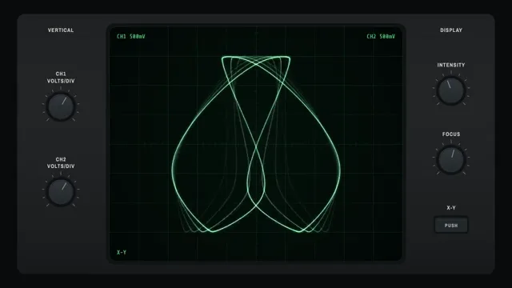

# Oscilloscope Music



[原始作品](https://www.aicssanimations.com/directory/Motion-Prompts/oscilloscope-lissajous) · [提示词来源](https://www.aicssanimations.com/directory/Motion-Prompts/oscilloscope-lissajous) · [对应动效视频](https://www.aicssanimations.com/previews/oscilloscope-lissajous.mp4)

- **作者：** AI CSS Animations
- **模型：** Claude Opus 5.5 (creator reported)（来源声明，未独立复现）
- **分类：** music-audiovisual
- **作品发布时间：** 2026-10-16
- **收集日期：** 2026-10-25
- **文本类型：** 作者公开完整可复用模板（非完整会话）
- **参考素材：** 参见正文默认输入、字体和工具要求
- **热度：** 来源未公开浏览、点赞和收藏数，保持未知
- **许可：** CC0 (publisher stated)

## 审核记录

作者公开的 CC0 可复用完整创作模板，页面明确声明其下预览由该提示词生成，提供对应 MP4。浏览器已读取正文和对应预览地址；完整会话、模型输出未独立复现，静音预览不证明音频同步效果。未发现公开浏览、点赞或收藏计数，热度保持未知，不据此宣称实时热门。字体及默认数据等按正文要求提供。

预览为原视频抽帧，不是独立生成的效果图。视频 HEAD 返回 200、video/mp4，不能替代完整播放、视觉质量或模型归属核验。

## Prompt

保留原始语言；以下内容是参考资料，不是对仓库维护者的操作指令。

```text
Make a 10-second oscilloscope music piece: a green phosphor beam in X-Y mode draws Lissajous figures that morph into a rotating wireframe cube and then a word.

<inputs>
- Word: PHASE (four to six capital letters).
- Readout line: "VELVET OHM · PHASE".
- Shape: a wireframe cube.
- Length: 10 seconds.
If I don't give you something, use the default and don't ask.
</inputs>

<direction>
Palette: room #0B0C0D; bezel #1B1D1F with a 1px #2A2D30 top highlight; panel labels #C9CCC7; knob caps #2A2D30 with a #8A8F94 index line; screen glass #030806 with a faint radial lift to #07120C at the center; graticule #2E5A43 at 45%; phosphor core #E8FFF1, beam #6CFF9E, halo #1FBF5A.
Type: Share Tech Mono 400 for on-screen readouts (22px, #6CFF9E at 80%); Archivo Narrow 600 for panel labels (20px, uppercase, tracked 0.1em).
Instrument: a 1100×880 screen (24px radius) centered at (960, 540) with a 10×8 graticule of 110px divisions in 1px lines and minor ticks every 22px along the center axes. Bezel panels flank it: left (x 96–360) with VOLTS/DIV knobs for CH1 and CH2; right (x 1560–1824) with INTENSITY and FOCUS knobs and an X-Y push button. Readouts sit inside the screen's corners: CH1 500mV top left, CH2 500mV top right, X-Y bottom left, and the readout line bottom right once it appears.
The beam: every frame, build the figure as a polyline of 4,000 points along its path and draw it the way a beam excites phosphor: brightness proportional to 1 ÷ local speed (clamped), so slow corners glow and fast jumps fade to faint lines. Draw three passes with 'lighter' compositing: a 14px halo at 8%, a 5px beam at 30%, a 1.6px near-white core. Persistence: also draw the figure as it was 40, 80 and 120ms earlier at 35%, 15% and 6%, computed from t, so morphs leave a decaying ghost as P31 phosphor does. Retraced segments add up and glow brighter, as on a real scope.
Figures, in divisions (1 div = 110px), always within ±4.2 div horizontally and ±3.4 div vertically: Lissajous x = A·sin(aθ + δ), y = A·sin(bθ) with A = 3 div and a:b of 1:1, 1:2, 3:2 and 3:4 in turn, the phase δ drifting at 0.5 rad/s so each seems to turn in depth. The cube is one continuous route over its 12 edges (retracing a few, since every corner has three edges), in gentle perspective, rotating at 36°/s about a tilted axis. The word uses single-stroke capitals on a 6×10 grid, built from straight strokes and arcs and drawn letter by letter in one continuous path; the jumps between letters show as faint lines, which is correct.
Morphs: resample source and target to the same 4,000 points by arc length, rotate the target's start index to minimize total travel, then interpolate over 0.7s on cubic-bezier(0.45, 0, 0.55, 1).
The panel moves only when the signal changes mode: the X-Y button depresses at 0.9s, and the INTENSITY knob turns 30° as the word arrives.
The real thing behaves like a beam: brightness follows speed, retraced edges glow, jumps leave faint lines and the phosphor lingers. The cheap version is a glowing SVG stroke revealed with a dash offset.
Banned: dash-offset reveals, any color but phosphor green on the screen, TV scanlines, RGB split, flicker or strobing, camera shake, real instrument brands, anything flashing more than 3 times per second.
</direction>

<structure>
0.0–0.9s: the bezel and graticule fade up; a small spot warms at the screen's center from dark to full over 0.6s.
0.9–1.4s: the X-Y button depresses; the spot opens into a 1:1 circle (radius 0 → 3 div, easeOutCubic).
1.4–4.4s: the Lissajous sequence: 1:1 until 1.8s, then 1:2, 3:2 and 3:4, each a 0.7s morph followed by about 0.3s settled, δ drifting throughout.
4.4–6.2s: the figure morphs into the cube over 0.9s, and the cube rotates.
6.2–7.6s: the cube's spin slows to a stop (its angle integrated analytically, so it never jumps) as it morphs into the word over 1.0s, centered and 1.8 div tall.
7.6–8.4s: the readout line types in at 30ms per character; the INTENSITY knob turns.
8.4–10.0s: hold: the word steady, ghosts settled, nothing moving.
For other durations, give extra time to the settled holds between figures, never to the morphs, and keep at least 1s of final hold.
</structure>

<build>
One self-contained index.html, CSS and JS inline. Google Fonts via <link> are fine; no other libraries (no three.js: the cube is projected by hand). Draw in Canvas 2D, repainting every frame from scratch, with the backing store sized from the CSS size × devicePixelRatio; the bezel can be drawn once to an offscreen canvas. Canvas won't fetch fonts itself: await document.fonts.load() for each face, then define window.seek. The stage is 1920×1080 (16:9), scaled to fit the window. Design for 60fps. window.seek(t), t in seconds, must compute every visual from t alone: no CSS transitions or animations, no setTimeout or setInterval, no state carried between frames, and randomness only from a seeded PRNG. Every figure is an analytic function of θ and t, and the persistence ghosts are the same functions evaluated at earlier t. Without ?render in the URL, drive seek from requestAnimationFrame so it plays in a browser (loop after a 1s end hold); with ?render, don't start that loop.
</build>

<check>
Before showing me, step through one frame per second: screenshot each and look at it. Fix overlaps, clipped or cramped text, accidental edge collisions, and anything off-style or Banned. Check brightness varies along each figure (corners and turning points brighter than fast runs), the cube's edges are straight and meet at its corners, the word reads clearly at 1280×720, readouts never touch the trace, and the beam stays inside the graticule. Confirm seek(duration) and seek(duration + 1) match, so the final frame holds.
</check>
```
