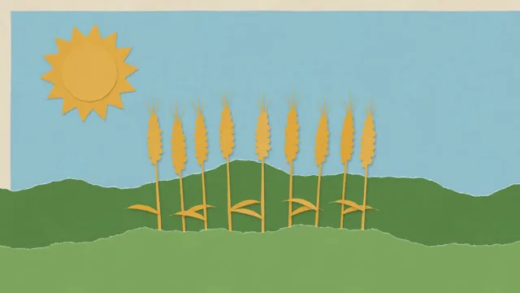

# Paper Cut-Out Collage



[原始作品](https://www.aicssanimations.com/directory/Motion-Prompts/paper-cutout-collage) · [提示词来源](https://www.aicssanimations.com/directory/Motion-Prompts/paper-cutout-collage) · [对应动效视频](https://www.aicssanimations.com/previews/paper-cutout-collage.mp4)

- **作者：** AI CSS Animations
- **模型：** Claude Opus 5.5 (creator reported)（来源声明，未独立复现）
- **分类：** characters-stories
- **作品发布时间：** 2026-10-12
- **收集日期：** 2026-10-25
- **文本类型：** 作者公开完整可复用模板（非完整会话）
- **参考素材：** 参见正文默认输入、字体和工具要求
- **热度：** 来源未公开浏览、点赞和收藏数，保持未知
- **许可：** CC0 (publisher stated)

## 审核记录

作者公开的 CC0 可复用完整创作模板，页面明确声明其下预览由该提示词生成，提供对应 MP4。浏览器已读取正文和对应预览地址；完整会话、模型输出未独立复现，静音预览不证明音频同步效果。未发现公开浏览、点赞或收藏计数，热度保持未知，不据此宣称实时热门。字体及默认数据等按正文要求提供。

预览为原视频抽帧，不是独立生成的效果图。视频 HEAD 返回 200、video/mp4，不能替代完整播放、视觉质量或模型归属核验。

## Prompt

保留原始语言；以下内容是参考资料，不是对仓库维护者的操作指令。

```text
<inputs>
You're making a layered paper cut-out animation with a stop-motion feel. I may supply any of these; if I don't give you something, use the default and don't ask.
- Story: "From field to loaf": wheat field → windmill → bakery window.
- Brand: Juniper Street Bakery (fictional), set as the title at the end.
- Length: 10 seconds.
</inputs>

<direction>
Construction paper on a cream backing board #EADFC8. Pieces: sky #9CC8D4, far hills #5E8C4A, near hills #7DA65A, wheat #E2AE48, windmill #C4573A, sails #F2E8D5, bakery #F0C9A8, awning stripes #C4573A and #F7F0E3, loaf #B5692E, letters #2B2724. Shift each piece's lightness ±3%.
Cutting: every shape is a faceted polygon. A circle is 16–20 straight snips; edges wander ±1.5px. Torn edges show a thin white fibrous rim at 45%. Grain: a 512px fiber texture, generated once, multiplied into each piece at 6–8% with a per-piece offset.
Depth: five layers, each casting a soft warm shadow, rgba(60,35,15,0.28), whose offset and blur grow with height (back 3px/4px, front 10px/12px). A piece being placed is lifted (18px offset, 20px blur, 3% larger) and settles as it lands.
Type: "Bowlby One" letters, each its own cut-out with a 6px uncut margin of #F7F0E3, rotated ±4°, casting its own shadow. One strip of translucent masking tape (#EDE3C2 at 70%) crosses a corner.
The defining rule: everything moves on twos. Drive all motion from tq = floor(t·12)/12, so the image changes 12 times a second while the page runs at 60fps. Each step also gives every piece a tiny handling jitter (±0.6px, ±0.3°) seeded by (pieceId, step). Moves use easeOutBack or easeInOutQuad; the stepping makes them read as hand-placed. Cycles (steam, sails) swap three replacement drawings. The camera pans as a multiplane: back 0.3×, middle 0.6×, front 1×.
Authentic: imperfect cuts, warm layered shadows, visible steps. Cheap: smooth tweens under a paper texture.
Banned: smooth unstepped motion, motion blur, outlines, glossy bevels, gradients other than shadows, pure black shadows, image files, emoji.
</direction>

<structure>
- 0–1.5s: sky and both hill layers slide up in turn, shadows tightening as each lands.
- 1.5–3.0s: nine wheat stalks pop up behind the near hill, swaying ±4°; the sun rises inside a slowly turning ray ring.
- 3.0–5.0s: the camera pans right one screen; the windmill rises, its sails make one turn, a flour sack drops.
- 5.0–7.0s: the pan reaches the bakery; the awning flips down strip by strip; the loaf in the window rises in three steps; steam cycles.
- 7.0–8.6s: the title letters drop in one by one, lifted then placed; the tape lands last.
- 8.6–10s: hold, jitter halved.
Other lengths: scale proportionally but keep 12 steps per second.
</structure>

<build>
One self-contained index.html (inline CSS and JS; Google Fonts via <link> are fine), a 1920×1080 (16:9) stage scaled to fit the window, built for 60fps. Draw on one Canvas 2D (shadowBlur gives the soft shadows); three.js isn't needed.
window.seek(t) (t in seconds) sets every visual from t alone, clamping past the end to the last frame. No CSS transitions or CSS animations, no setTimeout/setInterval, no state carried between frames. Jitter comes from a seeded PRNG keyed to the step; grain and color shifts use a fixed seed; never Math.random.
With no ?render in the URL, call seek from requestAnimationFrame so it plays in a browser; with ?render, don't start that loop.
</build>

<check>
Before showing me, step through one frame per second (0–10s) and look at each. Fix overlaps, clipped or cramped text and anything off-style: visible 12-per-second stepping, soft warm shadows, nothing vector-perfect, readable letters. Confirm the final frame holds.
</check>
```
