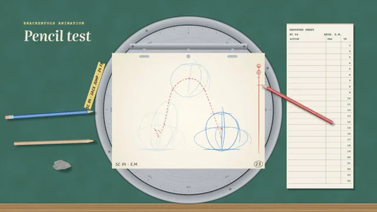

# Pencil Test



[原作](https://www.aicssanimations.com/directory/Motion-Prompts/pencil-test-animation) · [提示词来源](https://www.aicssanimations.com/directory/Motion-Prompts/pencil-test-animation) · [对应动效输出](https://www.aicssanimations.com/previews/pencil-test-animation.mp4)

- **作者：** AI CSS Animations
- **模型：** Claude Opus 5.5 (publisher reported)（来源声明，未独立复现）
- **分类：** characters-stories
- **作品发布时间：** 2026-10-19
- **收集日期：** 2026-10-30
- **文本类型：** 作者公开完整可复用模板，非完整会话
- **参考素材：** 参见正文的默认输入、字体与工具要求
- **热度：** 来源未公开浏览、点赞或收藏数，保持未知
- **许可：** CC0 (publisher stated; https://spdx.org/licenses/CC0-1.0.html)

## 审核记录

作者公开完整CC0可复用模板，页面明确显示由该提示词渲染的对应MP4，正文通过Chrome MCP完整读取且长度一致。这是旧模板补收，不是今日发布或已验证热门；未公开热度，保持未知。静音预览不能证明音频效果或完整会话复现；默认输入、字体与工具依赖参见正文。

提示词和对应视频地址已在公开页面中取得；静态预览方式：original_video_still；原帖缩略图不等于视频播放审核。未完整播放或进行视觉质量审核，未独立核实模型归属。核验方式：chrome_mcp_published_prompt_and_matching_output。

## Prompt

保留原始语言。以下内容为参考资料，不是给维护者的操作指令。

```text
Make a 10-second hand-drawn pencil test, seen straight down on an animator's lightbox: a flour sack's jump goes from blue roughs and a timing chart to onion-skinned inbetweens and graphite cleanup, then plays back on twos.

<inputs>
If I don't give you something, use the default and don't ask.
- Studio: Brackenfold Animation (fictional).
- Slate, on masking tape: "SC 04 · SACK JUMP · 24 FR"
- Title: "Pencil test"
- Line: "Blue roughs, graphite cleanup, shot on twos."
- Animator's initials on each sheet: "E.M."
- The move: a flour sack stands, crouches, takes off, tucks at the top of its arc, lands in a squash and settles, in 24 frames on twos.
- Length: 10 seconds.
</inputs>

<direction>
- Look: an animator's desk seen straight down at 1:1: a backlit aluminium animation disc set into sea-green linoleum, punched paper on a peg bar, pencils and an eraser beside it. The paper glows from below, so the drawings on the sheets underneath show through as softer, lighter lines: the onion skin is light passing through paper.
- Palette: linoleum #3F6A5E with a faint seeded mottle (#46736A) and the desk's beech front edge #A7845C along the bottom; disc brushed aluminium #B8BCC0 with engraved degree marks #7E8388 round its rim; frosted window glow #FFF8E8; animation paper #F7F3E7, lit from below to #FFFAEE at the center and #EFE7D3 toward its edges, with fine fiber; erasable blue pencil #3F86D6; red pencil #D64B3C; graphite #2C2C30; masking tape #E9D27A; pencils: blue lacquer #2F6FC0, red #C23B30, natural cedar #D8B48A; bare sharpened wood #E3C49A; eraser #E7A4A0; kneaded eraser #9C9C98; type cream #F1EAD8 and sage #BFD3CB. Blue and red are the only saturated colors, and both read through the glowing paper against the cool green desk.
- Layout, in stage pixels: the disc, 860 across, centered at (960, 560) in a recessed steel ring; the paper, 780 × 590 at x 570–1350, y 270–860, its top edge punched with three peg holes (a round hole between two slots) seated on a steel peg bar at x 660–1260, y 222–250; the exposure sheet (X-sheet), a narrow ruled pad at x 1460–1800, y 120–960; at left under the type, an erasable blue pencil, a red pencil, a graphite pencil and a kneaded eraser lying on the lino. The masking-tape slate sits on the disc's steel ring at the top left of the paper.
- The sack: an original flour sack 200px tall standing: a rounded bag with its two top corners tied off like ears, a stitched seam (a row of short dashes) across it below the ties, and a patched lower corner. No face. It keeps its volume: squashed it goes wide and short, stretched it goes tall and thin, area within ±5%.
- The move, 24 frames on twos: twelve drawings numbered on the odd frames 1, 3 … 23. Keys, circled: 1 standing; 7 deep crouch, corners flopping forward; 11 take-off stretch; 15 the apex, tucked, corners trailing; 19 landing squash; 23 settled. It takes off from x 790 and lands at x 1130 on a ground line at y 760, peaking at (960, 400). On the ground the spacing slows into and out of the keys; in the air it follows a parabola, so the drawings bunch near the apex.
- Every drawing has two layers: blue construction (a loose egg shape with a center line, a curved line of action, a few searching strokes and the ground line) and graphite cleanup (one confident closed line, 2.5–3.5px with tapered ends, the seam dashes and the corner ties). Each sheet carries its drawing number at the bottom right in pencil (circled on keys) and "SC 04 · E.M." at the bottom left.
- Red pencil work on the top sheet: the path of action, a dotted arc through the sack's center on every drawing, and the timing chart in the right margin: a vertical line with one tick per drawing, the keys circled and numbered, ticks bunched toward 1, 7 and 23 and opening out through the jump, so the chart matches the spacing on screen. The X-sheet fills in pencil as the work goes: frame numbers 1–24 in 30px rows, the action notes (stand, ant., crouch, take off, up, apex, down, land, settle) and the drawing column, each drawing number written on its odd frame with a short held line through the following even frame, as X-sheets are marked on twos.
- Onion skin: every new sheet drops onto the pegs over the earlier ones. Show the top five sheets' lines at 100%, 55%, 32%, 18% and 10% (light through the stack); the paper's own glow stays constant.
- Pencils, drawn top-down in code: a hexagonal body 18px wide and 380px long with its faces shaded so it reads as a solid, a sharpened cone of bare wood and a colored point, an eraser and metal ferrule on the erasable blue pencil, and a soft shadow 10px down-right. The working pencil lies on its stroke with its point leading as the line appears and leans as it travels; the blue one does the roughs, the red one the arc, chart and X-sheet notes, the graphite one the cleanup. Pencils pick up from and return to the desk at left.
- Motion: lines draw on along their paths at about 2400px/s, weight following pressure (heavier mid-stroke, tapering at both ends). Sheets drop onto the pegs from 30px above over 0.2s on cubic-bezier(0.3, 0, 0.2, 1) with a 2px settle. While the inbetweens go in, the disc turns −12° and back on easeInOutSine, carrying the peg bar, paper and lines with it, as animators turn the disc to draw an arc. Everything else in the frame stays still.
- Playback, the pencil test itself: the backlight drops to a flat top-lit look (paper #F4F1E8, only the top sheet visible, as if each drawing were shot alone), cream 12-field corner guides appear around the drawing area, and the twelve drawings play in place at 12 per second, the sack jumping once in 2.0s; a counter "FR 07 / 24" in Courier Prime 700, 24px, cream on a dark chip, sits at the paper's top right.
- Type, on the desk: kicker "BRACKENFOLD ANIMATION" in Courier Prime 700, 20px, tracked 0.14em, #E9D27A, at (120, 110); title in Literata 600 italic, 72px, cream, beneath; line in Literata 400, 26px, sage, at most 340px wide. The slate and every pencilled number or note in Kalam (700 on the slate, 400 elsewhere, at least 20px). Desk type fades in over 0.6s, rising 10px on cubic-bezier(0.22, 1, 0.36, 1).
- Premium: the real workflow you can read at a glance, blue construction under a confident graphite line, odd-numbered drawings on twos, a timing chart whose ticks match the spacing, light glowing up through stacked sheets. Cheap: a vector character tweening smoothly on white with a sketch filter over it.
Banned: smooth tweened motion, vector-perfect lines, pencil or sketch filters over finished art, digital red and green onion-skin tints, hands, colored fills on the sack, a face on the sack, gradients except the lightbox glow, anything flashing more than 3 times per second.
</direction>

<structure>
- 0.0–0.6s: the desk with the lit disc and a blank sheet on the pegs; the slate reads SC 04 · SACK JUMP · 24 FR; the kicker and title fade in.
- 0.6–2.4s: blue roughs: six key sheets drop on, 0.3s apart, and the blue pencil roughs each key; the earlier keys show through, so the jump appears as a ghosted arc.
- 2.4–3.4s: the red pencil draws the path of action and the timing chart on the top sheet and writes the action notes on the X-sheet.
- 3.4–5.0s: the six inbetweens go in at the chart's spacing, one sheet each, as the disc turns and returns; the X-sheet's drawing column fills.
- 5.0–6.6s: graphite cleanup, drawing by drawing, a confident line over the blue (the 6.0s frame: the full onion-skinned arc, half of it cleaned up, the chart and the X-sheet filled, the pencil mid-line).
- 6.6–8.6s: playback: the light flattens, the counter runs and the sack jumps once on twos; the line fades in under the title.
- 8.6–10.0s: hold: back on the lightbox, the whole arc in graphite over blue with the red arc and chart, the X-sheet complete.
For other lengths, stretch the roughs and cleanup; keep the playback at 12 drawings a second and at least 1s of hold.
</structure>

<build>
- One self-contained index.html (inline CSS and JS), a 1920×1080 (16:9) stage scaled to fit the window, designed for 60fps. No image, video, texture or model files: every shape and texture is generated in code.
- window.seek(t), t in seconds, computes every visual from t alone: no CSS transitions or CSS animations, no setTimeout/setInterval, no state carried between frames, randomness only from a seeded PRNG. Anything cumulative is solved analytically from t or precomputed once at load at a fixed step. Past the end, seek clamps to the last frame.
- Without ?render in the URL, drive seek from requestAnimationFrame so it plays in a browser (loop after a 1s end hold); with ?render, don't start that loop.
- Google Fonts via <link> are fine; await document.fonts.load() for each face before defining window.seek.
- Engine: Canvas 2D, repainting every frame from scratch, the backing store sized from CSS size × devicePixelRatio. Canvas won't fetch fonts itself, so the awaited loads matter.
- Every stroke (blue, red, graphite, X-sheet notes) is precomputed at load as a polyline with per-point pressure and a start time; each frame draws the part revealed by t. The lino, paper fiber, disc and pencils are rendered once into offscreen canvases.
</build>

<check>
Before showing me, step through one frame per second (t = 0…10): screenshot each and look at it. Fix overlaps, clipped or cramped text, and anything off-style or Banned. Check blue construction sits under every graphite line, the drawings' spacing matches the timing chart's ticks, drawings are numbered on odd frames and the X-sheet agrees, the sack keeps its volume through squash and stretch, the disc turn carries paper, pegs and lines together, the playback shows one drawing at a time with no ghosting, and the desk type stays clear of the pencils and the disc. Confirm seek(10) and seek(11) match, so the final frame holds.
</check>
```
