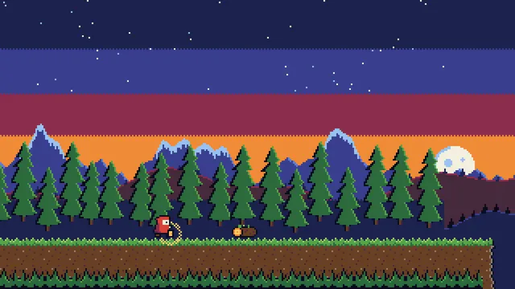

# 8-Bit Pixel Art Scene



[原作](https://www.aicssanimations.com/directory/Motion-Prompts/pixel-art-8bit) · [提示词来源](https://www.aicssanimations.com/directory/Motion-Prompts/pixel-art-8bit) · [对应动效输出](https://www.aicssanimations.com/previews/pixel-art-8bit.mp4)

- **作者：** AI CSS Animations
- **模型：** Claude Opus 5.5 (publisher reported)（来源声明，未独立复现）
- **分类：** characters-stories
- **作品发布时间：** 2026-10-12
- **收集日期：** 2026-10-30
- **文本类型：** 作者公开完整可复用模板，非完整会话
- **参考素材：** 参见正文的默认输入、字体与工具要求
- **热度：** 来源未公开浏览、点赞或收藏数，保持未知
- **许可：** CC0 (publisher stated; https://spdx.org/licenses/CC0-1.0.html)

## 审核记录

作者公开完整CC0可复用模板，页面明确显示由该提示词渲染的对应MP4，正文通过Chrome MCP完整读取且长度一致。这是旧模板补收，不是今日发布或已验证热门；未公开热度，保持未知。静音预览不能证明音频效果或完整会话复现；默认输入、字体与工具依赖参见正文。

提示词和对应视频地址已在公开页面中取得；静态预览方式：original_video_still；原帖缩略图不等于视频播放审核。未完整播放或进行视觉质量审核，未独立核实模型归属。核验方式：chrome_mcp_published_prompt_and_matching_output。

## Prompt

保留原始语言。以下内容为参考资料，不是给维护者的操作指令。

```text
<inputs>
If I don't give you something, use the default and don't ask.
- Game title: default "LANTERN HOLLOW"
- Prompt line: default "PRESS START"
- Studio line: default "MOSSWICK GAMES"
- Length: default 10 seconds
</inputs>

<direction>
The attract screen of a lovingly made 8-bit adventure, set in a dusk forest.

Resolution: draw on an offscreen 320×180 canvas and blit at exactly 6× with image smoothing off. Integer coordinates only; no alpha blending or anti-aliasing.

Palette, the only 16 colors allowed: #0D0B1E #1F2350 #3A3F8F #5B7FD6 #9BC4F2 #F4F1E1 #FFD166 #F28C38 #D9433B #8C2F4F #4A2A3D #6B4226 #2E6B3F #58A44A #A6D86E #8E8478.

Sprites: author each one in code as an array of strings, one character per pixel mapped to palette indexes. Hero: 16×16 with a #0D0B1E outline, a 4-frame walk and 2-frame idle, carrying a lantern whose glow is a checkerboard ring of #FFD166 pixels. 16×16 tiles for ground, grass, a fallen log and trees.

Parallax, back to front: sky in 4 flat bands joined by 1-pixel checker dithering, stars, a big moon, mountains (0.1× scroll), hills (0.3×), tree line (0.6×), ground (1.0×), foreground grass (1.4×). Floor each layer's offset to whole pixels.

Animation: sprite frames step at 8 fps (floor(t×8) mod 4), never tweened. The camera scrolls 24 px/s at native resolution, then eases to a stop. Jumps are parabolas computed from t, with a 1-frame squash on landing. Fireflies are single #A6D86E pixels on seeded sine paths.

Type: Press Start 2P on the low-res canvas at 8 px (16 px for the title), thresholded to solid pixels; title #FFD166 with a 1 px #8C2F4F shadow. Copy holds at least 2 s.

Authentic: hand-placed sprites, integer pixels, stepped animation; sub-pixel shimmer reads cheap.

Banned: gradients, alpha glows, tweened frames, rotation, sprite scaling, more than 16 colors, screen shake, blinking faster than twice a second.
</direction>

<structure>
Default 10 s:
- 0.0–0.8: palette fade from black in 4 steps of 0.2 s, each layer stepping up through darker palette colors.
- 0.8–4.0: the scene scrolls; the hero walks in and holds at 35% of screen width.
- 4.0–4.8: the hero hops the log (0.6 s arc, squash on landing).
- 4.8–6.4: scrolling eases to a stop at an overlook; the hero idles; fireflies rise; the moon clears the trees.
- 6.4–7.6: the title drops from above in whole-pixel steps, bouncing twice (8 px, then 3 px) to rest in the upper third.
- 7.6–8.6: "PRESS START" blinks at 1 Hz beneath it; studio line at the bottom.
- 8.6–10.0: "PRESS START" locks solid; only the idle and fireflies move.

Other lengths: stretch the walk and final hold; keep animation rates fixed.
</structure>

<build>
- One self-contained index.html, no libraries (three.js from a CDN only when a style truly needs 3D); a 1920×1080 (16:9) stage scaled to fit the window; designed for 60fps.
- window.seek(t), t in seconds, computes every visual from t alone: no CSS transitions or animations, no setTimeout/setInterval, no state carried between frames. Randomness comes from a seeded PRNG: firefly paths keyed to each firefly, anything per-frame keyed to the frame.
- No ?render in the URL: drive seek from requestAnimationFrame so it plays in a browser. With ?render: don't start that loop.
- Google Fonts via <link>; await document.fonts.load() for each face before assigning window.seek.
- Canvas 2D only.
</build>

<check>
Before showing me, step through one frame per second and look at each. Fix overlaps, clipped or cramped text and anything off-style. Count a frame's distinct colors: 16 at most, all from the list. Confirm the final frame holds.
</check>
```
