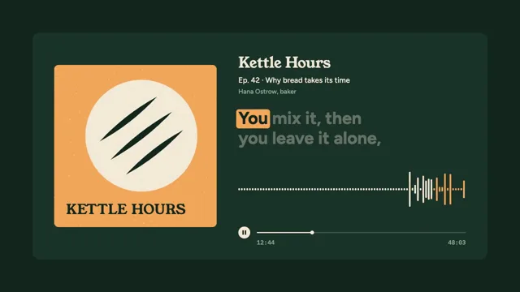

# Podcast Audiogram



[原始作品](https://www.aicssanimations.com/directory/Motion-Prompts/podcast-audiogram) · [提示词来源](https://www.aicssanimations.com/directory/Motion-Prompts/podcast-audiogram) · [对应动效视频](https://www.aicssanimations.com/previews/podcast-audiogram.mp4)

- **作者：** AI CSS Animations
- **模型：** Claude Opus 5.5 (creator reported)（来源声明，未独立复现）
- **分类：** music-audiovisual
- **作品发布时间：** 2026-10-16
- **收集日期：** 2026-10-25
- **文本类型：** 作者公开完整可复用模板（非完整会话）
- **参考素材：** 参见正文默认输入、字体和工具要求
- **热度：** 来源未公开浏览、点赞和收藏数，保持未知
- **许可：** CC0 (publisher stated)

## 审核记录

作者公开的 CC0 可复用完整创作模板，页面明确声明其下预览由该提示词生成，提供对应 MP4。浏览器已读取正文和对应预览地址；完整会话、模型输出未独立复现，静音预览不证明音频同步效果。未发现公开浏览、点赞或收藏计数，热度保持未知，不据此宣称实时热门。字体及默认数据等按正文要求提供。

预览为原视频抽帧，不是独立生成的效果图。视频 HEAD 返回 200、video/mp4，不能替代完整播放、视觉质量或模型归属核验。

## Prompt

保留原始语言；以下内容是参考资料，不是对仓库维护者的操作指令。

```text
Make a 10-second podcast audiogram: cover art, a live waveform and word-by-word captions.

<inputs>
Show: Kettle Hours. Episode: "Ep. 42 · Why bread takes its time". Guest: Hana Ostrow, baker. Quote, in three phrases: "Most of baking is waiting." / "You mix it, then you leave it alone," / "and the dough does the work." Clip position: 12:41 of 48:03. Duration: 10s. If I don't give you something, use the default and don't ask.
</inputs>

<direction>
Palette: ground forest #14271F, card #1B3329, cream #F3EAD8, apricot #F2A65A, sage #8FAF97 for secondary text.
Type: Young Serif 400 for the show name (54px) and on the cover; Figtree for everything else: captions 64px 700, line height 1.15; episode line 28px 500; guest line 24px 500 in sage. Timestamps in IBM Plex Mono 500, 22px.
Layout: a 1680×840 card, radius 28px, centered on the ground (x 120–1800, y 120–960). Left, the cover: 600×600 at x 200, y 240, radius 16px. Right column, x 880–1720: the show name at y 210 with the episode and guest lines beneath; captions in a two-line block at y 400–560; the waveform strip at y 620–780; at y 860 a 44px round play-pause button, then the progress track to x 1720, with timestamps under its ends.
Cover art, drawn in code: an apricot ground, a big cream circle like a loaf seen from above with three diagonal score cuts in forest green, a faint seeded flour speckle, and "KETTLE HOURS" in Young Serif at its lower left.
The signal: a synthetic speech envelope built from the quote. Phrase windows: 0.90–2.60s, 2.95–5.40s, 5.75–8.20s. Inside each, words get time in proportion to their syllables, with 0.06s gaps and 0.22s after the comma. Each syllable is a raised-cosine bump of seeded height 0.55–1.0 over a 0.05 breath floor, with fine texture from seeded value noise at 30Hz. Captions and waveform read the same timing table, so peaks sit under spoken words and pauses show as low bars.
Waveform: 84 bars, 6px wide with 4px gaps and rounded caps, mirrored about the strip's centerline. It scrolls left at 100px/s with "now" at the right end: bar positions shift by (100t mod 10)px and each bar's height is the envelope at its own moment. Bars are cream; the newest 12 are apricot.
Captions: one phrase at a time, flush left. Spoken words in cream, upcoming words in cream at 35%, and the current word on an apricot pill (radius 10px, 8px side padding) in forest. The pill glides and resizes between words in 0.12s on cubic-bezier(0.3, 0, 0.2, 1). A new phrase replaces the old by rising 16px out of a mask over 0.3s, starting 0.2s before its first word.
Progress: a 4px track in cream at 20%, a cream fill and a 14px knob, advancing from 12:41 toward 12:51; the left timestamp counts up once per second.
Motion is calm: entrances take 0.5–0.7s on cubic-bezier(0.2, 0, 0, 1), and the cover's circle swells by at most 1% with the envelope.
Premium is tight sync: pill, peaks and words agree to the frame. Cheap is a random bouncing equalizer with captions on their own clock.
Banned: bar heights unrelated to the speech, rainbow bars, glow, gradients, emoji, real podcast app logos, flashing more than 3 times per second.
</direction>

<structure>
0.0–0.8s: the card rises 24px as it fades in; cover, header and progress row follow 0.08s apart; the waveform's floor draws left to right.
0.9–2.6s: phrase 1, word by word.
2.95–5.4s: phrase 2.
5.75–8.2s: phrase 3.
8.2–8.8s: the envelope settles to the floor; at 8.8s the button turns from pause to play, and the waveform and progress freeze.
8.8–10.0s: hold, still, the last phrase fully cream.
For other durations, keep the phrase timing and stretch the gaps between phrases.
</structure>

<build>
One self-contained index.html, CSS and JS inline. The stage is 1920×1080 (16:9), scaled to fit the window. Design for 60fps. window.seek(t), t in seconds, must compute every visual from t alone, clamping past the end to the last frame: no CSS transitions or animations, no setTimeout or setInterval, no state carried between frames, and randomness only from a seeded PRNG. Anything cumulative is precomputed once at load at a fixed step or solved analytically, so seek can jump to any time. Load Google Fonts via <link> and await document.fonts.load() for each face before defining window.seek. Without ?render in the URL, drive seek from requestAnimationFrame so it plays in a browser (loop after a 1s end hold); with ?render, don't start that loop.
Engine: inline SVG for the cover, waveform and progress, with captions as HTML spans; measure each word's box once after the fonts load and position the pill from those boxes. No canvas or three.js.
</build>

<check>
Before showing me, step through one frame per second (0–10s): screenshot each and look at it. Fix overlaps, clipped or cramped text, accidental edge collisions, and anything off-style or Banned. Check that the pill sits on the word being spoken in each sampled frame, peaks line up under spoken words with low bars in the pauses, captions never exceed two lines, and the play-pause icon changes exactly once. Confirm seek(10) and seek(11) match, so the final frame holds.
</check>
```
