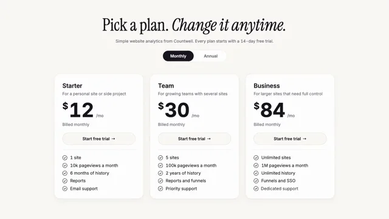

# Pricing Page



[原作](https://www.aicssanimations.com/directory/Motion-Prompts/pricing-page-reveal) · [提示词来源](https://www.aicssanimations.com/directory/Motion-Prompts/pricing-page-reveal) · [对应动效输出](https://www.aicssanimations.com/previews/pricing-page-reveal.mp4)

- **作者：** AI CSS Animations
- **模型：** Claude Opus 5.5 (publisher reported)（来源声明，未独立复现）
- **分类：** product-brand
- **作品发布时间：** 2026-10-16
- **收集日期：** 2026-10-30
- **文本类型：** 作者公开完整可复用模板，非完整会话
- **参考素材：** 参见正文的默认输入、字体与工具要求
- **热度：** 来源未公开浏览、点赞或收藏数，保持未知
- **许可：** CC0 (publisher stated; https://spdx.org/licenses/CC0-1.0.html)

## 审核记录

作者公开完整CC0可复用模板，页面明确显示由该提示词渲染的对应MP4，正文通过Chrome MCP完整读取且长度一致。这是旧模板补收，不是今日发布或已验证热门；未公开热度，保持未知。静音预览不能证明音频效果或完整会话复现；默认输入、字体与工具依赖参见正文。

提示词和对应视频地址已在公开页面中取得；静态预览方式：original_video_still；原帖缩略图不等于视频播放审核。未完整播放或进行视觉质量审核，未独立核实模型归属。核验方式：chrome_mcp_published_prompt_and_matching_output。

## Prompt

保留原始语言。以下内容为参考资料，不是给维护者的操作指令。

```text
Make a 10-second pricing page animation: a monthly/annual toggle flips, prices roll to their new values, the recommended plan lifts, and feature checkmarks cascade.

<inputs>
If I don't give you something, use the default and don't ask.
- Product: default "Countwell" (website analytics)
- Headline: default "Pick a plan. Change it anytime."
- Plans, monthly: default Starter $12, Team $30 (recommended), Business $84; annual is two months free: $10, $25, $70 a month, billed $120, $300, $840 a year
- Features: default five per plan: sites (1 / 5 / unlimited), pageviews (10k / 100k / 1M), history (6 months / 2 years / unlimited), reports / funnels / SSO, support
- Length: default 10 seconds
</inputs>

<direction>
- Palette: page #FAF9F5; ink #17161E; muted #6E6B78; hairline #E6E3DA; cards #FFFFFF. One accent, lime #D5F76B, for the badge, the "2 months free" chip and the recommended card's button and checks; that card turns ink with #F5F3EE text.
- Type: headline Instrument Serif 84px, centered, "Change it anytime." in italic; everything else Inter with tabular figures: plan names 30px 600, prices 96px 700 with a raised 44px "$" and muted "/mo", features 21px, small text 20px.
- Layout: headline cap top y 90; a 320×60 toggle pill centered at y 276 with the chip beside it; three 440×616 cards at x 268, 740, 1212, top y 364, 28px radius: name, description, price, billing line, a 60px "Start free trial →" button, five rows with 24px check circles.
- Odometer: each digit is a fixed-width slot rolling a 0–9 strip through every numeral between (2→1→0), downward as prices fall: 0.55s on cubic-bezier(0.65, 0, 0.35, 1), right digit first, 40ms apart. Old prices reappear small beside "/mo" as a line draws through them; billing lines slide 12px through a mask.
- Lift: Team rises 20px and scales to 1.04 (0.6s, cubic-bezier(0.22, 1, 0.36, 1)) under a deeper shadow, and flips to ink through a circle growing from its badge (0.5s), colors switching exactly at the wipe edge.
- Checks: circle draws (220ms), then tick, then text slides 10px in; rows 70ms apart, cards 120ms apart. The knob rides a spring (stiffness 520, damping 34); an SVG arrow cursor moves on curves, clicks pressing to 97%.
- Premium is a calm page where only the numbers move, each digit rolling in its own slot, with one plan clearly favored. Cheap is cross-fading prices, three equally loud cards, glowing borders and urgency badges.
Banned: cross-faded prices, digits shifting width, gradient borders, glows, confetti, countdowns or scarcity badges, wrong math, emoji, real company names, anything flashing more than 3 times per second.
</direction>

<structure>
- 0.0–0.9: The headline rises out of line masks, sentences 120ms apart.
- 0.9–2.1: The toggle appears on Monthly; cards rise 32px, 90ms apart: $12, $30, $84.
- 2.1–3.3: Checks cascade.
- 3.3–4.2: The cursor clicks "Annual"; the knob slides and the chip pops (cubic-bezier(0.34, 1.56, 0.64, 1)).
- 4.1–4.9: Prices roll to $10, $25, $70; old prices strike through; billing reads "$120 billed yearly" and so on.
- 4.9–5.9: A "Recommended" badge drops into Team's corner; Team lifts and wipes to ink; its checks turn lime.
- 5.9–7.5: The cursor hovers Team's button (its arrow nudges 6px) and clicks; the label rolls to "Trial started".
- 7.5–8.6: The cursor eases away and fades.
- 8.6–10.0: Hold.
For other lengths, scale the beats, keep rolls at least 0.45s and hold at least 1s.
</structure>

<build>
One self-contained index.html (inline CSS and JS), a 1920×1080 (16:9) stage scaled to fit the window, built for 60fps. Google Fonts via <link>, awaiting document.fonts.load() for each face before defining window.seek. HTML/CSS with inline SVG; no canvas or three.js. window.seek(t) (t in seconds) sets every visual from t alone, clamping past the end: no CSS transitions or animations, no setTimeout/setInterval, no state carried between frames, randomness only from a seeded PRNG. Without ?render in the URL, drive seek from requestAnimationFrame; with ?render, don't start that loop.
</build>

<check>
Before showing me, step through one frame per second (0–10s) and look at each. Fix overlaps, clipped or cramped text and anything off-style or Banned. Recheck every price (annual = monthly × 10 ÷ 12) and step one roll at 0.05s: no width jitter, no skipped numerals. Confirm seek(10) and seek(11) match.
</check>
```
