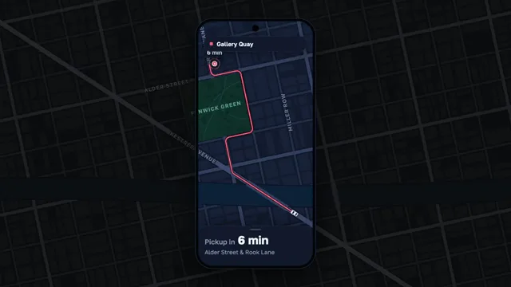

# Ride-Hailing App



[原作](https://www.aicssanimations.com/directory/Motion-Prompts/ride-hailing-app) · [提示词来源](https://www.aicssanimations.com/directory/Motion-Prompts/ride-hailing-app) · [对应动效输出](https://www.aicssanimations.com/previews/ride-hailing-app.mp4)

- **作者：** AI CSS Animations
- **模型：** Claude Opus 5.5 (publisher reported)（来源声明，未独立复现）
- **分类：** interactive
- **作品发布时间：** 2026-10-16
- **收集日期：** 2026-10-30
- **文本类型：** 作者公开完整可复用模板，非完整会话
- **参考素材：** 参见正文的默认输入、字体与工具要求
- **热度：** 来源未公开浏览、点赞或收藏数，保持未知
- **许可：** CC0 (publisher stated; https://spdx.org/licenses/CC0-1.0.html)

## 审核记录

作者公开完整CC0可复用模板，页面明确显示由该提示词渲染的对应MP4，正文通过Chrome MCP完整读取且长度一致。这是旧模板补收，不是今日发布或已验证热门；未公开热度，保持未知。静音预览不能证明音频效果或完整会话复现；默认输入、字体与工具依赖参见正文。

提示词和对应视频地址已在公开页面中取得；静态预览方式：original_video_still；原帖缩略图不等于视频播放审核。未完整播放或进行视觉质量审核，未独立核实模型归属。核验方式：chrome_mcp_published_prompt_and_matching_output。

## Prompt

保留原始语言。以下内容为参考资料，不是给维护者的操作指令。

```text
Make a 10-second ride-hailing app demo: on a night map the route draws along the streets, a car follows it to the pickup, the ETA counts down and the driver card slides up.

<inputs>
If I don't give you something, use the default and don't ask.
- App: Pillion. Pickup: Alder Street & Rook Lane. Destination: Gallery Quay
- Driver: Tomas R., 4.92, grey hatchback, plate KLV 482
- ETA: 6 min, down to "Arriving"
- Route color: #FF5C7A. Length: 10 seconds
</inputs>

<direction>
The map is fictional and procedural: a street grid rotated −12° with seeded 150–210px blocks, an avenue crossing it at 33°, a river with two bridges, a park ("Fenwick Green") and building footprints. Four streets are labelled, Alder Street and Rook Lane among them.
Night palette: land #0E1422, blocks #131B2C, streets #243049 and #33405E, avenue #3D4C70, river #0B2238, park #10302A, labels #6F7C9B. The route is 8px over a dark casing, fading to 25% behind the car. Car: a top-down white hatchback, 24×46px. Pin: a route-colored disc with one slow halo every 1.6s.
The phone is a lens: a 450×940 phone centered on stage, and the same map at the same transform fills the whole stage, dimmed and desaturated outside the phone and full strength inside, so the phone reads as a window onto a bigger city.
Route: streets only, four right-angle turns, one leg along the avenue over a bridge, corners filleted at 28px. The car slows to 45% near each corner, arrives at 8.2s and always points along the path.
ETA = ceil(6 × remaining ÷ total length) min, in a chip above the pin and in the sheet, rolling when it changes; "Arriving" for the last 6%.
Camera: an overview at scale 0.55, then easing to 1.0 on a point ahead of the car, averaged over its previous 0.5s so it trails without stored state; north stays up.
Phone UI: a top pill with "Gallery Quay"; a dark bottom sheet that starts 150px tall ("Pickup in 6 min") and slides up to 330px into the driver card: avatar, "Tomas R.", "★ 4.92", "Grey hatchback", the plate in an outlined box, "Message" and "Call".
Type: Golos Text 400–700; street labels 20px uppercase along their streets; sheet text 22–26px, ETA 44px.
Motion: the route draws by dash offset over 1.2s on cubic-bezier(0.45, 0, 0.2, 1); sheet and pin ride springs (stiffness 240, damping 26); UI fades take 0.3s on cubic-bezier(0.22, 1, 0.36, 1).
Premium is a city you believe and a car that drives it: turns that slow, a camera that trails. Cheap is a car icon sliding diagonally over a grey grid.
Banned: real map data or cities, map libraries, real ride-hailing looks, teardrop pins, 3D tilt, a car cutting across blocks, emoji, anything flashing more than 3 times per second.
</direction>

<structure>
0.0–1.0s: the map fades up, inside the phone first, then the dimmed surround; the top pill and small sheet rise.
1.0–1.6s: the pin drops on a spring and its halo starts; the car appears.
1.6–2.8s: the route draws from car to pin over the overview.
2.8–3.8s: the camera eases in to follow as the car pulls away.
3.8–6.6s: the car drives, slowing through turns and crossing the bridge; the ETA rolls down.
6.6–7.4s: the sheet slides up into the driver card.
7.4–8.2s: the car takes its last corner and stops beside the pin: "Arriving".
8.2–8.8s: the halo stops; the camera comes to rest.
8.8–10.0s: hold.
For other lengths, stretch the drive and keep at least 1s of hold; the car always arrives before it.
</structure>

<build>
One self-contained index.html, CSS and JS inline; Google Fonts via <link>, awaited with document.fonts.load() before window.seek is defined; no other libraries. Draw the map, route, pin and car in one inline SVG, the map built once into a <g> used twice (dimmed outside, clipped to the screen inside); the phone UI is HTML/CSS on top. The stage is 1920×1080 (16:9), scaled to fit the window; design for 60fps. window.seek(t), t in seconds, must compute every visual from t alone: no CSS transitions or animations, no setTimeout or setInterval, no state carried between frames, randomness only from a seeded PRNG. Precompute the car's distance-by-time table once at load at a 1/240s step. Without ?render in the URL, drive seek from requestAnimationFrame (loop after a 1s end hold); with ?render, don't start that loop.
</build>

<check>
Before showing me, step through one frame per second: screenshot each and look at it. Fix overlaps, clipped or cramped text and anything off-style or Banned. Check the car stays on its street and points along it, the route crosses water only on a bridge, the two map layers align at the phone's edge, and the ETA only falls. Confirm seek(10) and seek(11) match, so the final frame holds.
</check>
```
