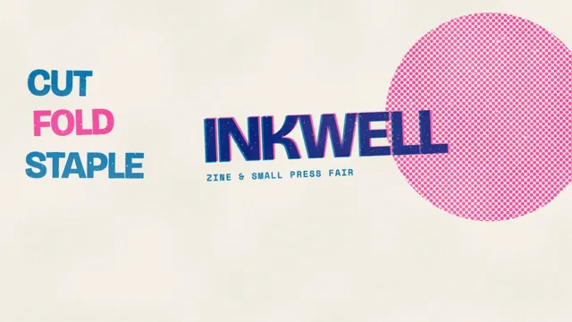

# Risograph Print



[原始作品](https://www.aicssanimations.com/directory/Motion-Prompts/risograph-print) · [提示词来源](https://www.aicssanimations.com/directory/Motion-Prompts/risograph-print) · [对应动效视频](https://www.aicssanimations.com/previews/risograph-print.mp4)

- **作者：** AI CSS Animations
- **模型：** Claude Opus 5.5 (creator reported)（来源声明，未独立复现）
- **分类：** motion-studies
- **作品发布时间：** 2026-10-12
- **收集日期：** 2026-10-25
- **文本类型：** 作者公开完整可复用模板（非完整会话）
- **参考素材：** 参见正文默认输入、字体和工具要求
- **热度：** 来源未公开浏览、点赞和收藏数，保持未知
- **许可：** CC0 (publisher stated)

## 审核记录

作者公开的 CC0 可复用完整创作模板，页面明确声明其下预览由该提示词生成，提供对应 MP4。浏览器已读取正文和对应预览地址；完整会话、模型输出未独立复现，静音预览不证明音频同步效果。未发现公开浏览、点赞或收藏计数，热度保持未知，不据此宣称实时热门。字体及默认数据等按正文要求提供。

预览为原视频抽帧，不是独立生成的效果图。视频 HEAD 返回 200、video/mp4，不能替代完整播放、视觉质量或模型归属核验。

## Prompt

保留原始语言；以下内容是参考资料，不是对仓库维护者的操作指令。

```text
Make a 10-second animated risograph zine poster.

<inputs>
Name: INKWELL. Line: Zine & Small Press Fair. Tagline: "Print it yourself." Three words: CUT, FOLD, STAPLE. Details: Sat 14 Nov · Hall B. Inks: Fluorescent Pink and Blue. Duration: 10s. If I don't give you something, use the default and don't ask.
</inputs>

<direction>
Inks: Fluorescent Pink #FF48B0 and Blue #0078BF (Yellow #FFE800 only if asked) on paper #F4EFE4. Each ink is its own layer, a density mask composited with multiply, so pink over blue prints deep violet.
Type: Bricolage Grotesque 800 for the name (220px, tight); Space Mono 700 for details (26–30px).
Texture is the soul: solids print at 92–100% density through seeded noise with speckle voids; tints are 45° halftone dots at 14px pitch; add patchy unevenness (up to 15%) and a faint roller streak per layer. Generate grain once at load; it's printed, so it doesn't boil.
Registration: each layer sits at its own fixed 2–5px offset and ≤0.15° rotation, so edges show slivers of each ink.
Composition: paste-up energy: a big halftone circle, chunky title, stacked words, rough hand-drawn stars and arrows, everything tilted a seeded ±3° and cropped by the edges.
Motion: elements slide or stamp in on cubic-bezier(0.16, 1, 0.3, 1) over 0.35–0.6s. The signature is the two-pass print: an element lands in one ink, then its second-ink layer slides in from 40px away and snaps into near-registration. Real riso is two inks doing the work of many, flaws kept; the cheap version is a CMYK image with a noise filter.
Banned: gradients, shadows, glow, pure black, grainless fills, perfect registration, colors that aren't inks or overprints.
</direction>

<structure>
0.0–0.8s: a pink halftone circle (700px, cropped by the right edge) prints onto the paper in a top-to-bottom roller wipe.
0.8–1.6s: the name slides in from the left in blue, violet where it crosses the circle; the line follows beneath in Space Mono.
1.6–2.2s: its pink pass slides in from 40px up-right and snaps to a 4px offset.
2.2–3.6s: the three words stamp in, stacked left in alternating inks, 0.35s apart, each scaling 1.04 → 1.
3.6–4.8s: a blue halftone band sweeps across the bottom third, dots ramping 0% → 70%; two pink hand-drawn stars pop on.
4.8–6.0s: the tagline prints in a blue-tint box as a pink arrow scribbles toward it.
6.0–7.2s: details print in pink at bottom-left; two staple marks appear top-left.
7.2–8.0s: every layer drifts 6px out of register and settles back, once.
8.0–10.0s: hold.
For other durations, scale every timestamp proportionally.
</structure>

<build>
One self-contained index.html, CSS and JS inline. Google Fonts via <link> are fine; no other libraries (no three.js: this style is flat). Draw in Canvas 2D, repainting every frame from scratch. Canvas won't fetch fonts itself: await document.fonts.load() for each face, then define window.seek. The stage is 1920×1080 (16:9), scaled to fit the window. Design for 60fps. window.seek(t), t in seconds, must compute every visual from t alone: no CSS transitions or animations, no setTimeout or setInterval, no state carried between frames, and randomness only from a seeded PRNG. Without ?render in the URL, drive seek from requestAnimationFrame so it plays in a browser (loop after a 1s end hold); with ?render, don't start that loop.
</build>

<check>
Before showing me, step through one frame per second: screenshot each and look at it. Fix overlaps, clipped or cramped text, accidental edge collisions, and anything off-style or Banned. Check overprints read violet, grain survives at 1280×720, and type stays legible. Confirm seek(duration) and seek(duration + 1) match, so the final frame holds.
</check>
```
