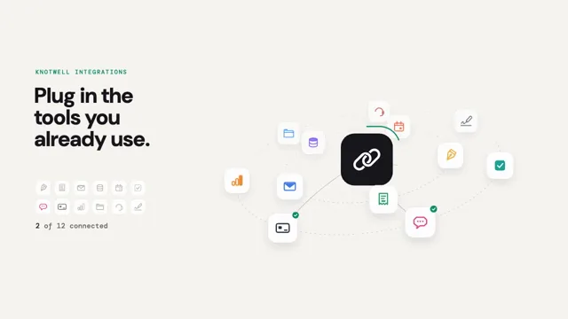

# Integrations Orbit



[原作](https://www.aicssanimations.com/directory/Motion-Prompts/saas-integrations-orbit) · [提示词来源](https://www.aicssanimations.com/directory/Motion-Prompts/saas-integrations-orbit) · [对应动效输出](https://www.aicssanimations.com/previews/saas-integrations-orbit.mp4)

- **作者：** AI CSS Animations
- **模型：** Claude Opus 5.5 (publisher reported)（来源声明，未独立复现）
- **分类：** product-brand
- **作品发布时间：** 2026-10-18
- **收集日期：** 2026-10-30
- **文本类型：** 作者公开完整可复用模板，非完整会话
- **参考素材：** 参见正文的默认输入、字体与工具要求
- **热度：** 来源未公开浏览、点赞或收藏数，保持未知
- **许可：** CC0 (publisher stated; https://spdx.org/licenses/CC0-1.0.html)

## 审核记录

作者公开完整CC0可复用模板，页面明确显示由该提示词渲染的对应MP4，正文通过Chrome MCP完整读取且长度一致。这是旧模板补收，不是今日发布或已验证热门；未公开热度，保持未知。静音预览不能证明音频效果或完整会话复现；默认输入、字体与工具依赖参见正文。

提示词和对应视频地址已在公开页面中取得；静态预览方式：original_video_still；原帖缩略图不等于视频播放审核。未完整播放或进行视觉质量审核，未独立核实模型归属。核验方式：chrome_mcp_published_prompt_and_matching_output。

## Prompt

保留原始语言。以下内容为参考资料，不是给维护者的操作指令。

```text
Make a 10-second integrations hero for a SaaS landing page: twelve fictional app tiles orbit a hub on tilted rings, connect to it one by one, and data pulses travel along the lines between them.

<inputs>
If I don't give you something, use the default and don't ask.
- Product: Knotwell, a data sync platform (fictional).
- Kicker: KNOTWELL INTEGRATIONS. Headline: "Plug in the tools you already use." Closing line: "Two-minute setup. No code."
- Integrations (name, what it does, color): Quillnote notes #F2B33D · Tallyhand invoices #2FA36B · Creekmail email #3D7BF0 · Kitebase database #8A5CF6 · Moorcal calendar #F0643C · Fenwork tasks #17A398 · Driftchat chat #E9488F · Tillrow payments #2E3440 · Gaugely analytics #F28A2E · Burrowdrive files #4FA3F7 · Hearthdesk support #D9534F · Inkseal e-signatures #6B7280
- Length: 10 seconds.
</inputs>

<direction>
- Palette: paper #F6F5F1 under a dot grid (2px #DAD7CE dots at a 32px pitch) that fades out radially from the hub; ink #17171C; secondary #6B6A66; orbit paths #CFCBC0; pine #0F8F6E for the kicker, the checks and the hub's progress ring; connection lines in ink at 22%.
- Hub: an ink rounded square, 176px with a 46px radius, centered at (1240, 540), carrying the Knotwell mark in white: two interlocking rounded rings like chain links, 8px strokes, at 45°. A 4px pine progress ring 24px outside it fills one twelfth per connection.
- Orbits: two rings in 3D around the hub, tilted 64° from facing so they read as ellipses and rotated −8° in the picture plane: the inner at radius 280px with 5 tiles, the outer at 440px with 7. Project with mild perspective (focal length 1800px) so near tiles are larger (scale 0.78–1.08) and lower. The inner ring turns 12°/s counterclockwise and the outer 8°/s clockwise, both easing to a stop at 8.4s at angles where no tile overlaps another tile or the hub. Paths are 1.5px dashed lines (6px dash, 10px gap), the far half behind the hub at 50%.
- Tiles: white 96px rounded squares (26px radius) with a 1px #E7E4DB border and a soft shadow (0 14px 30px rgba(23,23,28,0.12), growing with nearness), always facing the camera. Each holds a 48px glyph drawn in code in its color: a pen nib, a receipt with a torn edge, an envelope, three stacked discs, a calendar with binder rings, a ticked checkbox, a speech bubble, a card with a chip, rising bars, a folder, a headset, a pen over a signature line. Glyphs use 4px round-cap strokes plus one solid fill each, never letters or real logos. Depth-sort every frame: tiles behind the hub draw before it, at 85% opacity.
- Connecting: a line draws from the hub's edge to the tile's edge over 0.4s along a gentle quadratic curve (control point bowed 40px off the straight line), then a 22px pine check badge springs onto the tile's top-right corner (at most 10% overshoot). Lines follow their tiles every frame.
- Data pulses: connected lines carry pulses, each a 16×6px capsule in the tile's color with a 40px fading trail, moving at 520px/s along the curve, alternating inbound and outbound on seeded schedules (one every 1.1–1.8s per line), never more than 9 on screen at once. No pulse launches after 7.4s, so all have landed by 8.4s.
- Left column, x 120–700: the kicker in DM Mono 500, 20px, tracked 0.14em, pine, at y 250; the headline in DM Sans 700, 72px, leading 1.02, ink, three lines, from y 290; from y 610 a 6×2 grid of 52px mini-chips (white, 1px border, 14px radius, 12px gaps), each holding its app's glyph at 28px as a grey #BDB9AE outline until that app connects, then filling with its color in a 0.25s pop; under the grid the counter "0 of 12 connected" in DM Mono 500, 24px, rolling its digits; the closing line in DM Sans 500, 30px, secondary, at y 900.
- Motion: entrances rise 14px over 0.5s on cubic-bezier(0.22, 1, 0.36, 1); tile pops use a closed-form spring (stiffness 300, damping 20); orbit speeds ease on easeInOutSine.
- Premium: a calm, print-clean hero with crisp depth, every connection echoed in the chips, the count and the hub ring, pulses that flow and then rest. Cheap: neon lines on black, glowing logos of real companies, a ring spinning forever.
Banned: real company names, logos or icons, dark backgrounds, glow, bloom, lens flares, 3D text, lines entering the left column, overlapping tiles, pulses on unconnected lines, anything flashing more than 3 times per second.
</direction>

<structure>
- 0.0–0.8s: paper; the dot grid fades in from the hub outward; the hub scales 0.9 → 1 and its mark draws.
- 0.8–1.8s: the orbit paths draw around; the tiles pop onto them 50ms apart, inner ring first, already turning; the kicker and headline rise in.
- 1.8–2.2s: the mini-chip grid appears as grey outlines; the counter reads 0 of 12.
- 2.2–5.2s: the tiles connect one by one, 0.25s apart, nearest the camera first: each line draws, its check pops, its mini-chip fills, the counter rolls and the hub ring grows; pulses start on every connected line.
- 5.2–7.4s: all twelve are connected and pulses run in and out. At 6.0s the whole network is complete and alive.
- 7.4–8.4s: the orbits ease to a stop; the last pulses land; the closing line rises in.
- 8.4–10.0s: hold, completely still.
For other lengths, change the gap between connections and the length of the pulsing beat; keep at least 1s of hold.
</structure>

<build>
- One self-contained index.html (inline CSS and JS), a 1920×1080 (16:9) stage scaled to fit the window, designed for 60fps. No image, video, texture or model files: every shape and texture is generated in code.
- window.seek(t), t in seconds, computes every visual from t alone: no CSS transitions or CSS animations, no setTimeout/setInterval, no state carried between frames, randomness only from a seeded PRNG. Anything cumulative is solved analytically from t or precomputed once at load at a fixed step. Past the end, seek clamps to the last frame.
- Without ?render in the URL, drive seek from requestAnimationFrame so it plays in a browser (loop after a 1s end hold); with ?render, don't start that loop.
- Google Fonts via <link> are fine; await document.fonts.load() for each face before defining window.seek.
- Engine: Canvas 2D, repainting every frame from scratch, the backing store sized from CSS size × devicePixelRatio. Canvas won't fetch fonts itself, so the awaited loads matter.
- Ring angles are closed-form functions of t; connection times and pulse schedules are seeded tables built once at load, and every pulse position is computed from its launch time.
</build>

<check>
Before showing me, step through one frame per second (t = 0…10): screenshot each and look at it. Fix overlaps, clipped or cramped text, and anything off-style or Banned. Check tiles never overlap each other or the hub and stay right of x 740, every line starts and ends on its tile's edge as the rings turn, the mini-chips, counter and hub ring always agree with the lines drawn, pulses travel only on connected lines, and the counter ends on 12 of 12. Confirm seek(10) and seek(11) match, so the final frame holds.
</check>
```
