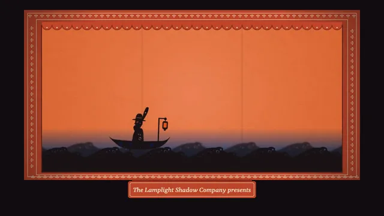

# Shadow Puppets



[原作](https://www.aicssanimations.com/directory/Motion-Prompts/shadow-puppet-theater) · [提示词来源](https://www.aicssanimations.com/directory/Motion-Prompts/shadow-puppet-theater) · [对应动效输出](https://www.aicssanimations.com/previews/shadow-puppet-theater.mp4)

- **作者：** AI CSS Animations
- **模型：** Claude Opus 5.5 (publisher reported)（来源声明，未独立复现）
- **分类：** characters-stories
- **作品发布时间：** 2026-10-19
- **收集日期：** 2026-10-30
- **文本类型：** 作者公开完整可复用模板，非完整会话
- **参考素材：** 参见正文的默认输入、字体与工具要求
- **热度：** 来源未公开浏览、点赞或收藏数，保持未知
- **许可：** CC0 (publisher stated; https://spdx.org/licenses/CC0-1.0.html)

## 审核记录

作者公开完整CC0可复用模板，页面明确显示由该提示词渲染的对应MP4，正文通过Chrome MCP完整读取且长度一致。这是旧模板补收，不是今日发布或已验证热门；未公开热度，保持未知。静音预览不能证明音频效果或完整会话复现；默认输入、字体与工具依赖参见正文。

提示词和对应视频地址已在公开页面中取得；静态预览方式：original_video_still；原帖缩略图不等于视频播放审核。未完整播放或进行视觉质量审核，未独立核实模型归属。核验方式：chrome_mcp_published_prompt_and_matching_output。

## Prompt

保留原始语言。以下内容为参考资料，不是给维护者的操作指令。

```text
Make a 10-second shadow puppet play: articulated card puppets on rods, pressed against a backlit paper screen with colored gels, tell a short story in silhouette and end on a title cut out of card.

<inputs>
If I don't give you something, use the default and don't ask.
- Company: The Lamplight Shadow Company (fictional).
- Presenter line: "The Lamplight Shadow Company presents"
- Story title, cut into the banner: "The Whale Who Gave a Lift"
- Story: a fisherman rows home at dusk; a whale rises under his boat and carries him into the night; it spouts beneath the stars and comes to rest.
- Length: 10 seconds.
</inputs>

<direction>
- Look: a small shadow theatre at night: one warm lamp behind a paper screen, colored gels slid across the light, black card puppets on wire rods pressed against the screen, framed by a painted persimmon proscenium in a dark room.
- Palette: room #120D10; proscenium persimmon #C2462B with a cream #F1E3C6 stenciled border of small repeating fans and a scalloped valance edged in #8E2E1C; the bare lamp through paper #F7DDAA, with a hotspot of #FFF0CF at (960, 470) falling off to #E9B978 at the corners; gels, each a multiplicative filter on the lamp: dusk coral #F08A6A over the sky, cobalt #2C4FB0 over the sea, night violet #4A3A9A, pale moon #F3EBC9; puppet shadow #1B1416; inlay gels in the puppets: lantern amber #FFB040, whale teal #32B0A2 and rose #E35B78, an amber eye; type cream #F1E3C6. Gels multiply where they stack: the teal inlays read grey-jade against the coral dusk and deep blue-green against the cobalt sea and violet night.
- Stage, in stage pixels: the screen is 1500 × 750 at x 210–1710, y 110–860: paper with seeded long fibers, two faint vertical seams where sheets join, and the lamp's hotspot, which breathes ±2% at 0.3 Hz. The proscenium frames it from x 120 to 1800 and y 50 to 900, with a plaque on its base carrying the presenter line.
- Shadow physics: a part pressed flat to the screen casts a crisp shadow (0.6px blur, full density); anything standing off the screen casts a larger, softer, lighter shadow scaled about the lamp's position: the wire rods at 6px blur and 45% density, a part lifted 4 cm off the screen at 1.08× size, 5px blur and 70% density.
- Puppets are black card, cut and pierced: small round holes and crescents let the lamp through as points and slivers of light, and gel windows let colored light through. Every moving part pivots on a brass paper fastener, which shows as a small round bump on the silhouette; parts rotate about their fasteners and never bend. Each puppet has thin wire rods running from its body and moving parts down past the bottom of the screen to the unseen puppeteers, and the rods move with their parts.
- The cast:
  - three wave strips across the bottom (y 700–860), each a long card of rolling crests with pierced foam holes, front to back sliding in counter-motion (front left at 40px/s, middle right at 25px/s, back left at 12px/s) and each bobbing ±8px on its own slow sine; the back strip stands a little off the screen and reads softer;
  - the boat: 300px long, a curved hull with a row of pierced portholes glazed in cobalt gel and a short mast with a hanging lantern whose amber window swings ±6° as a pendulum on its pin, riding the middle wave strip;
  - the fisherman: 180px tall in the boat, round-hatted and bearded: head, a hat pinned loosely on its own fastener, torso, upper and lower arms on fasteners, holding a long oar that pivots on an oarlock at the gunwale; his rowing cycle is 1.2s, shoulders rotating ±25° and elbows ±30°, the blade dipping behind the front wave strip;
  - the whale: 760px long with a broad back and blunt head, jointed at the tail stock (±18°) and the flukes (±12°), a hinged jaw (opens 8°) and a pectoral fin on a fastener; its body is cut with rows of small round holes along the belly grooves and a run of crescent windows glazed in teal along its flank, rose gel in the fin, and an amber eye;
  - the night panel: a black card sheet the width of the screen with a scalloped cloud edge along its bottom, pierced with about 140 star holes (2–7px) and a 120px moon hole glazed in pale gel at (1500, 220), lowered from the top on two rods to cover y 110–420;
  - the spout: a fan of cut-card droplets on a rod that springs up from the blowhole and falls back;
  - the title banner: a 680 × 220 card with the title cut right through it in two lines ("The Whale" / "Who Gave a Lift") in Stardos Stencil 700 at about 76px, its stencil bridges intact, a pierced rosette at each end, hung from two rods.
- Motion is puppetry: moves travel on cubic-bezier(0.45, 0, 0.25, 1); loosely pinned parts (the hat, the lantern, the flukes, the banner) lag and swing as damped pendulums solved from their parent's motion. Gels change by wiping: a new gel slides across the lamp, its 120px soft edge crossing the screen in 0.8s, never a crossfade or a flash.
- Type: the presenter line in Gelasio 500 italic, 30px, cream, centered on the plaque at baseline 960. Everything else that reads is light through cut card.
- Premium: crisp silhouettes pressed to a glowing paper screen, rods soft and grey because they stand off it, limbs that pivot on visible fasteners, gels that multiply like real filters, light coming through pierced holes. Cheap: black vector shapes sliding over a flat orange gradient.
Banned: limbs that bend or stretch, vector-smooth figures with no fasteners or rods, crossfaded scene changes, lamp flicker, a white flash as the lamp comes up, traditional named characters from any living puppet tradition, fire, bloom, drop shadows other than the shadow physics above, anything flashing more than 3 times per second.
</direction>

<structure>
- 0.0–0.8s: the dark room; the lamp comes up from black over 0.8s (a smooth ramp, never a flash) under the coral sky gel and cobalt sea gel; the wave strips are already bobbing; the presenter line fades in on the plaque.
- 0.8–3.0s: the boat rows in from the left to x 700, the fisherman rowing, the lantern swinging.
- 3.0–4.8s: the violet night gel wipes across from the right; the whale rises from behind the waves under the boat and lifts it clear of the water; the fisherman stops rowing and flings up his arms, and his hat lifts off the screen, its shadow growing and softening, then drops back.
- 4.8–6.6s: the night panel lowers, turning the upper sky to points of starlight and a pale moon; the whale swims right carrying the boat, tail and flukes beating; at 5.6s it spouts (the 6.0s frame: the whale and boat center right, the spout high, the stars and moon above, the fisherman waving).
- 6.6–7.6s: the whale glides to rest at x 900–1660, flukes curled; the fisherman waves twice.
- 7.6–8.6s: the title banner lowers into the open violet sky below the night panel, at x 240–920, y 440–660, its letters glowing violet, swings ±3° and settles.
- 8.6–10.0s: hold; only the hotspot breathes.
For other lengths, stretch the rowing and the swim; keep the gel wipes at 0.8s and at least 1s of hold.
</structure>

<build>
- One self-contained index.html (inline CSS and JS), a 1920×1080 (16:9) stage scaled to fit the window, designed for 60fps. No image, video, texture or model files: every shape and texture is generated in code.
- window.seek(t), t in seconds, computes every visual from t alone: no CSS transitions or CSS animations, no setTimeout/setInterval, no state carried between frames, randomness only from a seeded PRNG. Anything cumulative is solved analytically from t or precomputed once at load at a fixed step. Past the end, seek clamps to the last frame.
- Without ?render in the URL, drive seek from requestAnimationFrame so it plays in a browser (loop after a 1s end hold); with ?render, don't start that loop.
- Google Fonts via <link> are fine; await document.fonts.load() for each face before defining window.seek.
- Engine: Canvas 2D, repainting every frame from scratch, the backing store sized from CSS size × devicePixelRatio. Canvas won't fetch fonts itself, so the awaited loads matter.
- At load, render each puppet part (silhouette with its piercings, plus its gel layer) into offscreen canvases at three blur levels, and the paper and proscenium once. Each frame builds the screen light (lamp × gels, with the wipes), then multiplies in every part at its closed-form transform and blur, and lets light through holes and gels.
</build>

<check>
Before showing me, step through one frame per second (t = 0…10): screenshot each and look at it. Fix overlaps, clipped or cramped text, and anything off-style or Banned. Check every moving part pivots on a fastener and never bends, every rod is attached and reads soft and grey, pressed parts are crisp while the lifted hat softens, gels wipe rather than fade, the lamp-up has no flash (log mean luminance over 0–1s: it must rise smoothly), the whale reads as a whale and the fisherman as a rower, and the title letters read clearly through the card. Confirm seek(10) and seek(11) match, so the final frame holds.
</check>
```
