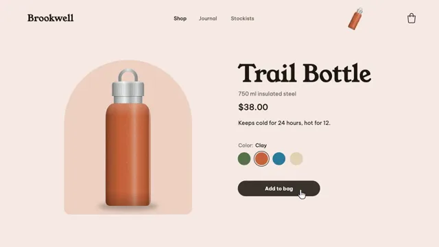

# Shop to Checkout



[原作](https://www.aicssanimations.com/directory/Motion-Prompts/shop-checkout-flow) · [提示词来源](https://www.aicssanimations.com/directory/Motion-Prompts/shop-checkout-flow) · [对应动效输出](https://www.aicssanimations.com/previews/shop-checkout-flow.mp4)

- **作者：** AI CSS Animations
- **模型：** Claude Opus 5.5 (publisher reported)（来源声明，未独立复现）
- **分类：** interactive
- **作品发布时间：** 2026-10-16
- **收集日期：** 2026-10-31
- **文本类型：** 作者公开完整可复用模板，非完整会话
- **参考素材：** 参见正文的默认输入、字体与工具要求
- **热度：** 来源未公开浏览、点赞或收藏数，保持未知
- **许可：** CC0 (publisher stated; https://spdx.org/licenses/CC0-1.0.html)

## 审核记录

作者公开CC0完整可复用模板；正文原文与明确对应的MP4已保留。旧模板补收，热度未知，不称今日新发布或已验证热门；默认输入与工具要求参见正文。

提示词和对应视频地址已在公开页面中取得；静态预览方式：browser_download_original_video_ffmpeg_still；原帖缩略图不等于视频播放审核。未完整播放或进行视觉质量审核，未独立核实模型归属。核验方式：chrome_mcp_public_prompt_and_matching_output。

## Prompt

保留原始语言。以下内容为参考资料，不是给维护者的操作指令。

```text
Make a 10-second online store demo: a color swatch recolors the product, add to bag flies it into the bag, the cart drawer opens and payment succeeds.

<inputs>
If I don't give you something, use the default and don't ask.
- Store: Brookwell. Product: Trail Bottle, 750 ml insulated steel, $38.00
- Colors: Moss #56724A, Clay #C8643B, Lagoon #2C7A9C, Oat #E2D3B5; starts in Moss, the cursor picks Clay
- Copy: "Keeps cold for 24 hours, hot for 12."
- Checkout: free shipping, total $38.00, card ending 2291, order BW-20481
- Length: 10 seconds
</inputs>

<direction>
Palette: ink #1E1B16, secondary #6B645A, surfaces #FFFFFF, success #2F8F5B. The page tint is the chosen color mixed 14% into white; the plinth behind the bottle mixes it at 30%.
Type: Young Serif for the product name (104px), wordmark and drawer heading; Be Vietnam Pro 400–600 for the rest (price 36px, body 24px, buttons 22px).
Layout: the page is the stage. A nav on y 80: "Brookwell", three links, a drawn bag icon at x 1800 with a badge. Left: a 560px plinth at (560, 600) with the 600px bottle on it. Right, from x 1040: name, price, copy, "Color: Moss" over four 56px swatches, an ink "Add to bag" button.
The bottle, drawn in SVG: straight walls, rounded shoulders, a brushed-steel neck band, a ridged cap with a carry loop. Powder-coat body: the base color under cylindrical shading (darker left edge, a soft highlight band, a thin rim light) and a fine speckle. Steel parts and the floor shadow never recolor; the outline never changes.
Recolor: a wipe rises from base to cap with a gently waving edge over 0.6s on cubic-bezier(0.45, 0, 0.2, 1), shading intact; tint, plinth and label change with it.
Add to bag: a small copy flies on a parabolic arc into the bag (0.7s), turning and shrinking; the bag bumps on a spring and the badge pops in.
Drawer: 560px from the right in 0.5s on cubic-bezier(0.32, 0.72, 0, 1) over a light scrim: the item with a small Clay bottle, totals and "Checkout", which slides into payment ("•••• 2291", "Pay $38.00"). Paying narrows the button to a spinner circle for 0.8s, turns it green as a check draws, then widens it into "Paid"; the drawer reads "Order confirmed · BW-20481".
Cursor: a drawn arrow that becomes a pointing hand over buttons and swatches; curved paths, 0.45–0.7s; hovers before clicks; clicks dip it to 0.88.
Premium is continuity: one object goes from page to bag to paid order. Cheap is a stock photo and a popup that says success.
Banned: photos or images, stock icons, real brands or payment logos, confetti, emoji, the bottle changing shape, anything flashing more than 3 times per second.
</direction>

<structure>
0.0–0.9s: the nav, then the bottle rising 30px on its plinth, then the right column, 60ms apart.
0.9–1.5s: the cursor enters lower right, skims the swatches and clicks Clay.
1.5–2.1s: the bottle recolors; tint, plinth and label follow.
2.1–2.8s: the cursor clicks "Add to bag".
2.8–3.6s: the copy flies into the bag; the badge shows 1.
3.6–4.3s: the scrim fades in and the drawer slides in, rows staggering.
4.3–5.0s: a click on "Checkout"; payment slides in.
5.0–5.7s: a click on "Pay $38.00".
5.7–6.9s: spinner, check, "Paid".
6.9–8.0s: "Order confirmed" rises in; the cursor drifts off and rests.
8.0–10.0s: hold.
For other lengths, scale the beats but keep cursor moves 0.4–0.8s and the spinner at least 0.6s; hold at least 1s.
</structure>

<build>
One self-contained index.html, CSS and JS inline; Google Fonts via <link>, awaited with document.fonts.load() before window.seek is defined; no other libraries. Use HTML/CSS with the bottle, icons and cursors in inline SVG, the bottle's colors driven by CSS variables. The stage is 1920×1080 (16:9), scaled to fit the window; design for 60fps. window.seek(t), t in seconds, must compute every visual from t alone: no CSS transitions or animations, no setTimeout or setInterval, no state carried between frames, randomness only from a seeded PRNG. Without ?render in the URL, drive seek from requestAnimationFrame (loop after a 1s end hold); with ?render, don't start that loop.
</build>

<check>
Before showing me, step through one frame per second: screenshot each and look at it. Fix overlaps, clipped or cramped text and anything off-style or Banned. Check the bottle's outline is identical in Moss and Clay, its shading survives the wipe, the flying copy lands in the bag, and every price reads $38.00. Confirm seek(10) and seek(11) match, so the final frame holds.
</check>
```
