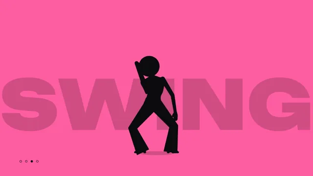

# Silhouette Dance



[原始作品](https://www.aicssanimations.com/directory/Motion-Prompts/silhouette-dance) · [提示词来源](https://www.aicssanimations.com/directory/Motion-Prompts/silhouette-dance) · [对应动效视频](https://www.aicssanimations.com/previews/silhouette-dance.mp4)

- **作者：** AI CSS Animations
- **模型：** Claude Opus 5.5 (creator reported)（来源声明，未独立复现）
- **分类：** music-audiovisual
- **作品发布时间：** 2026-10-18
- **收集日期：** 2026-10-25
- **文本类型：** 作者公开完整可复用模板（非完整会话）
- **参考素材：** 参见正文默认输入、字体和工具要求
- **热度：** 来源未公开浏览、点赞和收藏数，保持未知
- **许可：** CC0 (publisher stated)

## 审核记录

作者公开的 CC0 可复用完整创作模板，页面明确声明其下预览由该提示词生成，提供对应 MP4。浏览器已读取正文和对应预览地址；完整会话、模型输出未独立复现，静音预览不证明音频同步效果。未发现公开浏览、点赞或收藏计数，热度保持未知，不据此宣称实时热门。字体及默认数据等按正文要求提供。

预览为原视频抽帧，不是独立生成的效果图。视频 HEAD 返回 200、video/mp4，不能替代完整播放、视觉质量或模型归属核验。

## Prompt

保留原始语言；以下内容是参考资料，不是对仓库维护者的操作指令。

```text
Make a 10-second dance film: bold black silhouettes hit pose after pose on the beat against flat color fields that cut on the bar.

<inputs>
If I don't give you something, use the default and don't ask.
- Event: Late Bloom, a dance night (fictional).
- Title: "LATE BLOOM", set on two lines.
- Line: "Fridays · Hall 9 · Doors 10 pm"
- Tempo: 120 BPM.
- Bar words: STEP, SWING, SPIN, JUMP.
- Length: 10 seconds.
</inputs>

<direction>
- Look: pure graphic silhouettes, one flat color per field, edited to the music. The power is in the poses: each dancer reads from outline alone.
- Palette: fields lime #C3F23A, hot pink #FF5FA2, cyan #33D6F2, orange #FF8A2B and violet #B58CFF, one per bar; silhouettes #0D0D0F; each bar's big word and the dancers' floor shadows in that field's color darkened to 82%; text #0D0D0F.
- Beat grid: beat n starts at (n − 1) × 0.5 s; a bar is four beats (2.0 s). Field cuts happen only on bar lines, at 0, 2, 4, 6 and 8 s, so the color never changes more than once in any second. Every beat lands a pose.
- Dancers: three distinct silhouettes, each a 2D rig of 15 joints (head, neck, chest, pelvis, shoulders, elbows, wrists, hips, knees, ankles) drawn as one black shape: tapered capsules for the limbs (thigh 46 → 34px wide, shin 34 → 22, upper arm 30 → 24, forearm 24 → 18), egg-shaped chest and pelvis, mitten hands with a thumb, and shoes with a heel. Full height 600px, feet on y 940. Each has a signature outline that follows through 0.08–0.15 s behind the body: dancer A a high ponytail (a 6-segment chain) and a short flared skirt; dancer B a round afro and wide trousers with flared hems; dancer C a bucket hat and an open jacket whose hem swings.
- Moves, a pose library defined by joint angles: hit-V (arms up in a V, one knee raised), point (one arm to the upper corner, the other hand on the hip), step-touch, arm wave (a wave rolling shoulder → elbow → wrist over one beat), body roll, kick, spin (the shoulders narrow as the body turns edge-on, the rig mirrors at that instant, then widens) and jump (knees tucked, 0.3 s in the air on a parabola). Each move's 0.12 s of anticipation against the move and its 0.18 s strike on cubic-bezier(0.2, 0.9, 0.2, 1) come just before its beat, so the pose lands exactly on the beat, then holds with a 2% settle; a cut opens on its first pose already landed. Feet stay planted unless stepping; knees and elbows never bend backward.
- Shadows: each dancer stands on a flat 220×24 ellipse in the darker tone that shrinks during jumps. There is no other floor.
- Big words: in bars 1–4 the bar's word fills the field behind the dancers in "Unbounded" 900, 420px, in the darker tone, centered at y 640 and sliding 60px left across the bar at constant speed.
- Group sizing: in group bars the dancers scale to 0.85 or 0.8 and stand far enough apart that no two silhouettes touch.
- Type: the title in Unbounded 900, 150px, #0D0D0F, on two lines at x 120 with baselines at y 420 and 580; the line in Unbounded 500, 30px, beneath on baseline y 650. A beat counter at bottom left: four 14px dots from x 120 at y 990, the current beat's dot filled and the others outlined.
- Premium: silhouettes that read instantly as people, weight and anticipation in every move, every hit on the beat, cuts only on the bar. Cheap: stick figures bouncing, poses landing between beats, color strobing on every beat.
Banned: earbuds, cords, music players or phones, faces or details inside the silhouettes, gradients, glow, field cuts more often than once per bar, stick-figure limbs, limbs bending backward, silhouettes merging into one blob, anything flashing more than 3 times per second.
</direction>

<structure>
- Bar 1, 0.0–2.0s, lime, STEP: dancer A alone at center, in the point pose from the first frame; step-touch left, right, left on beats 2–4, arms swinging and the ponytail following.
- Bar 2, 2.0–4.0s, pink, SWING: cut to dancer B at center: an arm wave on beats 1–2, a body roll on beat 3, a kick on beat 4, the trouser hems flaring.
- Bar 3, 4.0–6.0s, cyan, SPIN: cut to dancer C at center: a spin across beats 1–2 with the jacket swinging out, a point on beat 3, and a jump that takes off on beat 4 (5.5 s) and lands by 5.9 s.
- Bar 4, 6.0–8.0s, orange, JUMP: cut to all three in a row at x 560, 960 and 1360 (scale 0.85), landing a unison hit-V on 6.0 s, so the 6.0 s frame is three clean, matching silhouettes; then a canon: A jumps on beat 2, B on beat 3, C on beat 4, hair and hems following through.
- Bar 5, 8.0–10.0s, violet: cut to the closing pose at x 1060, 1360 and 1660 (scale 0.8): A in hit-V, B pointing to the upper right, C with hands on hips and one knee bent; "LATE" snaps in on 8.0 s, "BLOOM" on 8.5 s and the line on 9.0 s, each scaling 1.06 → 1 in 0.12 s.
- 9.0–10.0s: hold, completely still; the beat counter stops with all four dots filled.
For other lengths, add or remove whole bars before the closing bar and keep at least 1 s of hold.
</structure>

<build>
- One self-contained index.html (inline CSS and JS), a 1920×1080 (16:9) stage scaled to fit the window, designed for 60fps. No image, video, texture or model files: every shape and texture is generated in code.
- window.seek(t), t in seconds, computes every visual from t alone: no CSS transitions or CSS animations, no setTimeout/setInterval, no state carried between frames, randomness only from a seeded PRNG. Anything cumulative is solved analytically from t or precomputed once at load at a fixed step. Past the end, seek clamps to the last frame.
- Without ?render in the URL, drive seek from requestAnimationFrame so it plays in a browser (loop after a 1s end hold); with ?render, don't start that loop.
- Google Fonts via <link> are fine; await document.fonts.load() for each face before defining window.seek.
- Engine: Canvas 2D, repainting every frame from scratch, the backing store sized from CSS size × devicePixelRatio. Canvas won't fetch fonts itself, so the awaited loads matter. No other libraries.
- Draw each dancer every frame by forward kinematics from the pelvis, all of its parts filled #0D0D0F in one path so overlaps merge cleanly. Pose keys sit in a table indexed by beat, and between keys the joints follow the anticipation, strike and hold curve; hair, skirt, hems and jacket are damped springs solved analytically from the pose times.
</build>

<check>
Before showing me, step through one frame per second (t = 0…10): screenshot each and look at it. Fix overlaps, clipped or cramped text, and anything off-style or Banned. Check every beat time (0, 0.5, 1.0 … s) shows a held, readable pose, field cuts fall exactly on 0, 2, 4, 6 and 8 s and nowhere else, no limb bends backward or detaches, the three dancers stay distinct by outline and never merge, and the title sits clear of the dancers in the final frame. Confirm seek(10) and seek(11) match, so the final frame holds.
</check>
```
