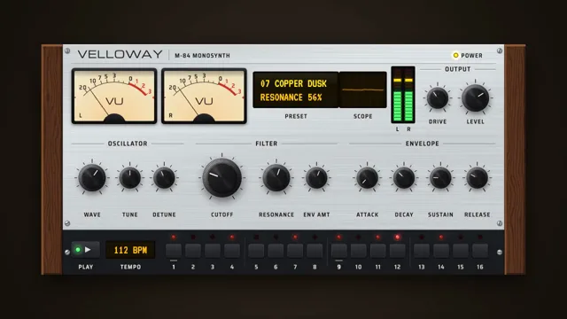

# Skeuomorphic Synth Plugin



[原始作品](https://www.aicssanimations.com/directory/Motion-Prompts/skeuomorphic-synth-plugin) · [提示词来源](https://www.aicssanimations.com/directory/Motion-Prompts/skeuomorphic-synth-plugin) · [对应动效视频](https://www.aicssanimations.com/previews/skeuomorphic-synth-plugin.mp4)

- **作者：** AI CSS Animations
- **模型：** Claude Opus 5.5 (creator reported)（来源声明，未独立复现）
- **分类：** music-audiovisual
- **作品发布时间：** 2026-10-16
- **收集日期：** 2026-10-25
- **文本类型：** 作者公开完整可复用模板（非完整会话）
- **参考素材：** 参见正文默认输入、字体和工具要求
- **热度：** 来源未公开浏览、点赞和收藏数，保持未知
- **许可：** CC0 (publisher stated)

## 审核记录

作者公开的 CC0 可复用完整创作模板，页面明确声明其下预览由该提示词生成，提供对应 MP4。浏览器已读取正文和对应预览地址；完整会话、模型输出未独立复现，静音预览不证明音频同步效果。未发现公开浏览、点赞或收藏计数，热度保持未知，不据此宣称实时热门。字体及默认数据等按正文要求提供。

预览为原视频抽帧，不是独立生成的效果图。视频 HEAD 返回 200、video/mp4，不能替代完整播放、视觉质量或模型归属核验。

## Prompt

保留原始语言；以下内容是参考资料，不是对仓库维护者的操作指令。

```text
Make a 10-second animation of a hardware-style synthesizer plugin playing itself: brushed metal, walnut end cheeks, knobs turning, VU needles swinging and LED meters bouncing.

<inputs>
If I don't give you something, use the default and don't ask.
- Maker and model: default "VELLOWAY", M-84 Monosynth
- Preset: default "07 COPPER DUSK"
- Pattern: default 112 BPM, 16 steps, steps 1, 4, 7, 9, 11, 14 on, accents on 1 and 9
- Sections: default OSCILLATOR (Wave, Tune, Detune), FILTER (Cutoff, Resonance, Env Amt), ENVELOPE (Attack, Decay, Sustain, Release), OUTPUT (Drive, Level)
- Length: default 10 seconds
</inputs>

<direction>
- Stage: a dark desk #16120E under a warm lamp pool (#2B2119); the plugin casts a soft 80px shadow.
- Plugin: 1640×780 at (140, 150): walnut end cheeks, an aluminium faceplate, a black anodized sequencer strip. Top row: two VU meters, an amber display, two LED ladders, OUTPUT knobs. Middle row: knob sections, Cutoff the largest. Strip: 16 step buttons with red LEDs, PLAY, "112 BPM".
- Textures, generated once from a seeded PRNG: aluminium #C9CCCF brushed by per-row value noise (±6%) with a soft specular band; walnut #5A3420 with noise-warped grain #3B2113 and a #8A5634 chamfer; anodized #1B1C1F; slotted screws.
- Silkscreen: Saira Semi Condensed 600 uppercase, tracked 0.1em: section titles 22px between engraved rules, labels 20px. Logo in Michroma 34px; the display in VT323 40px #FFB000 on #1B1206, beside a scope whose harmonics follow Cutoff.
- Knobs (132, 92, 72px): a knurled skirt, a matte black cap whose conic sheen stays fixed to the light, a white indicator, 300° of travel with 11 ticks. Only the indicator and knurl rotate.
- VU: cream faces #F2E7C6, warm backlight, a −20 to +3 scale with a red #C8312A zone, a thin needle with true ballistics (99% in 300ms, about 1.5% overshoot). Ladders: 16 segments (10 green #39D353, 4 amber #FFB000, 2 red #FF3B30, unlit at 14%) with a peak hold.
- Signal: precompute at load, at a fixed 1/240 s step, hits on the active 0.134s steps (5ms attack, 180ms decay, accents × 1.4), then needles, ladders and peaks; seek(t) only reads them.
- Motion: knob moves 0.6–0.9s on cubic-bezier(0.45, 0, 0.2, 1); camera moves 1.2s on cubic-bezier(0.65, 0, 0.35, 1).
- Premium is an object you could touch: light that stays put while knobs turn, needles with weight, real grain. Cheap is grey gradients called metal, spinning knob images and meters that jump.
Banned: highlights rotating with knobs, flat grey "metal", neon, photo textures, real manufacturer names, text under 20px, emoji, anything flashing more than 3 times per second.
</direction>

<structure>
- 0.0–1.0: The lamp pool brightens; the plugin rises 30px into it (0.9s, cubic-bezier(0.22, 1, 0.36, 1)); a sheen glides across the metal.
- 1.0–1.47: PLAY lights; VU backlights warm over 0.6s; the display shows the preset.
- 1.47–4.2: The pattern starts on the downbeat at 1.47s: the step LED chases, needles swing, ladders bounce; Wave, Resonance and Decay ease to new positions.
- 4.2–6.6: A cursor drags Cutoff from −70° to +95°; a tooltip climbs on a log scale from "CUTOFF 380 Hz" to "4.8 kHz"; the scope brightens. The cursor fades.
- 6.5–7.7: The camera pushes in 1.4× on the VU meters, needles kissing 0 VU on accents.
- 7.7–8.9: The last hit lands on the downbeat at 7.90s; the transport stops at 8.4s; the camera pulls back as needles fall, ladders clear and the chase rests on step 1.
- 8.9–10.0: Hold.
For other lengths, add or remove whole bars and hold at least 1s.
</structure>

<build>
One self-contained index.html (inline CSS and JS), a 1920×1080 (16:9) stage scaled to fit the window, built for 60fps. Google Fonts via <link>, awaiting document.fonts.load() for each face before defining window.seek. Canvas 2D sized from CSS size × devicePixelRatio, textures in offscreen canvases; no three.js. window.seek(t) (t in seconds) sets every visual from t alone, clamping past the end: no CSS transitions or animations, no setTimeout/setInterval, no state carried between frames, randomness only from a seeded PRNG. Without ?render in the URL, drive seek from requestAnimationFrame; with ?render, don't start that loop.
</build>

<check>
Before showing me, step through one frame per second (0–10s) and look at each. Fix overlaps, clipped or cramped text and anything off-style or Banned. Knob highlights stay fixed while indicators turn, and needles never jump. Confirm seek(10) and seek(11) match.
</check>
```
