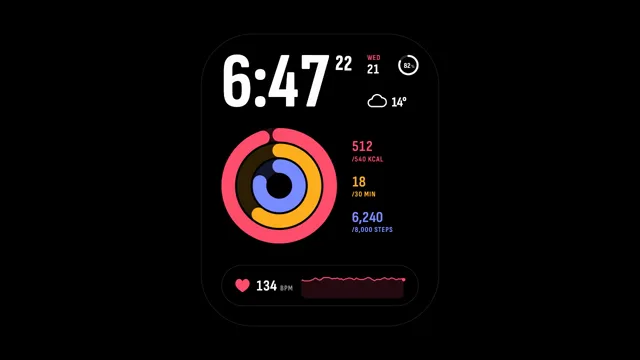

# Smartwatch Activity Face



[原作](https://www.aicssanimations.com/directory/Motion-Prompts/smartwatch-activity-face) · [提示词来源](https://www.aicssanimations.com/directory/Motion-Prompts/smartwatch-activity-face) · [对应动效输出](https://www.aicssanimations.com/previews/smartwatch-activity-face.mp4)

- **作者：** AI CSS Animations
- **模型：** Claude Opus 5.5 (publisher reported)（来源声明，未独立复现）
- **分类：** product-brand
- **作品发布时间：** 2026-10-16
- **收集日期：** 2026-10-31
- **文本类型：** 作者公开完整可复用模板，非完整会话
- **参考素材：** 参见正文的默认输入、字体与工具要求
- **热度：** 来源未公开浏览、点赞或收藏数，保持未知
- **许可：** CC0 (publisher stated; https://spdx.org/licenses/CC0-1.0.html)

## 审核记录

作者公开CC0完整可复用模板；正文原文与明确对应的MP4已保留。旧模板补收，热度未知，不称今日新发布或已验证热门；默认输入与工具要求参见正文。

提示词和对应视频地址已在公开页面中取得；静态预览方式：browser_download_original_video_ffmpeg_still；原帖缩略图不等于视频播放审核。未完整播放或进行视觉质量审核，未独立核实模型归属。核验方式：chrome_mcp_public_prompt_and_matching_output。

## Prompt

保留原始语言。以下内容为参考资料，不是给维护者的操作指令。

```text
Make a 10-second smartwatch face animation on true black: the face wakes, complications tick, three activity rings close and a heart-rate trace runs.

<inputs>
If I don't give you something, use the default and don't ask.
- Watch: Bracken, face "Ridge"
- 6:47, seconds from :20; WED 21; 14°, cloudy; battery 82%
- Rings: Energy 402 → 540 of 540 kcal; Workout 18 → 30 of 30 min; Steps 6,240 → 8,000 of 8,000
- Heart rate: 134 easing to 112 bpm
- Length: 10 seconds
</inputs>

<direction>
Black is the canvas: stage and face #000000, OLED style. Rings: Energy #FF4F6D, Workout #FFB020, Steps #7B8CFF, each over an 18% track of its hue; text #FFFFFF, secondary #9A9A9A. Avoid the familiar red, green and cyan trio.
The face: a 700×860 display with 150px corners, centered, its edge a faint 1px hairline.
Type: Sofia Sans Extra Condensed 700 for the time (230px) and seconds (64px); Sofia Sans Condensed for values (34–44px) and 22px uppercase labels. Changing digits sit in fixed-width cells.
Layout, 60px padding: on top, the time with seconds beside it, a battery arc, the date ("WED" in rose over "21") and the weather. Middle: three concentric rings (outer radius 170, 40px wide, 6px gaps, round caps) beside readouts in ring colors ("402" over "/540 KCAL"). Bottom: a 580×120 heart panel: a drawn heart, the bpm, and the last minute of readings as a rose line with a 15% fill, scrolling left.
Rings fill clockwise from 12 o'clock, each leading cap casting a soft shadow. A close lands exactly on 100%: "DONE" appears and one thin ring of its color ripples 30px outward and fades, once.
Ticks: seconds roll once a second; values count with their ring, never spinning; the bpm updates every 0.8s; the heart pulses at the current rate in scale only, never in brightness.
Always-on: the piece starts and ends at 45% brightness, seconds and trace hidden; waking is a 0.4s brightness ramp with a 2% scale-up, like a raised wrist.
Motion is brief and exact: UI changes 120–300ms on cubic-bezier(0.2, 0.8, 0.2, 1); ring fills 1.2s on cubic-bezier(0.3, 0, 0.2, 1).
Premium is a face read at a glance: big numerals, saturated color on true black. Cheap is neon glow, a grey watch body and spinning numbers.
Banned: any background but #000000, gradients, glows over 20%, a drawn watch case or strap, ECG spikes, emoji, anything flashing more than 3 times per second.
</direction>

<structure>
0.0–0.8s: always-on: "6:47" without seconds, rings resting at 74%, 60% and 78%.
0.8–1.2s: wake; seconds appear at :20; the heart panel fades in and its trace starts moving.
1.2–2.4s: complications settle: the battery arc draws to 82%, the cloud draws, the date steps in.
2.4–3.6s: Energy fills to 540 and closes with its ripple.
3.2–4.4s: Workout fills to 30 and closes.
4.0–5.2s: Steps fill to 8,000 and close.
5.2–8.2s: the pulse eases toward 112; the trace scrolls; seconds tick; a slow 3% push.
8.2–8.7s: wrist down: back to always-on.
8.7–10.0s: hold, perfectly still.
For other lengths, stretch the 5.2–8.2s passage and keep at least 1s of hold.
</structure>

<build>
One self-contained index.html, CSS and JS inline; Google Fonts via <link>, awaited with document.fonts.load() before window.seek is defined; no other libraries. Draw on one Canvas 2D at devicePixelRatio, repainting each frame from scratch. The stage is 1920×1080 (16:9), scaled to fit the window; design for 60fps. window.seek(t), t in seconds, must compute every visual from t alone: no CSS transitions or animations, no setTimeout or setInterval, no state carried between frames, randomness only from a seeded PRNG. Precompute a seeded heart-rate series (two samples a second, ±3 bpm wander) once at load. Without ?render in the URL, drive seek from requestAnimationFrame (loop after a 1s end hold); with ?render, don't start that loop.
</build>

<check>
Before showing me, step through one frame per second: screenshot each and look at it. Fix overlaps, clipped or cramped text and anything off-style or Banned. Check everything outside the content is pure #000000, each ring matches its readout (402 of 540 is 74%), rings close at exactly 100%, and nothing pulses in brightness. Confirm seek(10) and seek(11) match, so the final frame holds.
</check>
```
