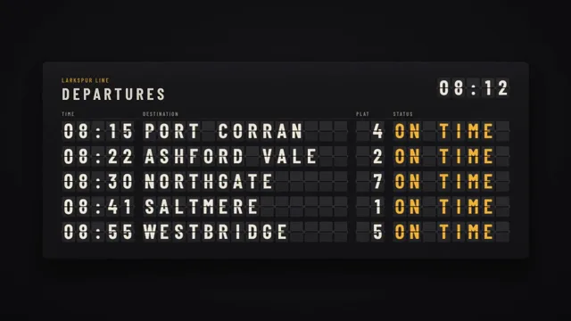

# Split-Flap Departure Board



[原作](https://www.aicssanimations.com/directory/Motion-Prompts/split-flap-board) · [提示词来源](https://www.aicssanimations.com/directory/Motion-Prompts/split-flap-board) · [对应动效输出](https://www.aicssanimations.com/previews/split-flap-board.mp4)

- **作者：** AI CSS Animations
- **模型：** Claude Opus 5.5 (publisher reported)（来源声明，未独立复现）
- **分类：** explainers-data
- **作品发布时间：** 2026-10-12
- **收集日期：** 2026-10-31
- **文本类型：** 作者公开完整可复用模板，非完整会话
- **参考素材：** 参见正文的默认输入、字体与工具要求
- **热度：** 来源未公开浏览、点赞或收藏数，保持未知
- **许可：** CC0 (publisher stated; https://spdx.org/licenses/CC0-1.0.html)

## 审核记录

作者公开CC0完整可复用模板；正文原文与明确对应的MP4已保留。旧模板补收，热度未知，不称今日新发布或已验证热门；默认输入与工具要求参见正文。

提示词和对应视频地址已在公开页面中取得；静态预览方式：browser_download_original_video_ffmpeg_still；原帖缩略图不等于视频播放审核。未完整播放或进行视觉质量审核，未独立核实模型归属。核验方式：chrome_mcp_public_prompt_and_matching_output。

## Prompt

保留原始语言。以下内容为参考资料，不是给维护者的操作指令。

```text
<inputs>
If I don't give you something, use the default and don't ask.
- Operator: default "Larkspur Line"
- Heading: default "DEPARTURES"
- Five rows of time, destination, platform: default 08:15 PORT CORRAN 4; 08:22 ASHFORD VALE 2; 08:30 NORTHGATE 7; 08:41 SALTMERE 1; 08:55 WESTBRIDGE 5; all with status ON TIME
- Closing message, two lines of up to 18 characters: default "EVERY LINE" / "LEADS HOME"
- Length: default 10 seconds
</inputs>

<direction>
A Solari-style mechanical board shot head-on: precise, heavy, slightly worn.

Board: housing #17171A, faintly top-lit. Cells 44×68 px, 5 px gaps, 16 px between rows, 30 px gutters between groups: time (5 cells), destination (14), platform (2), status (8). Upper flap half #2B2B2E, lower #252528, a 2 px #0B0B0C seam, 4 px corners, hinge nubs at the seam ends. Glyphs: Barlow Condensed 600 caps in #EDE7D8 (statuses amber #F2B23A), centered at 70% of cell height and cut by the seam. Heading, operator and column labels are painted on the housing, tracked 0.2em; a 5-cell flap clock sits top right.

Mechanics: each cell steps through one drum, " ABCDEFGHIJKLMNOPQRSTUVWXYZ0123456789:.", one character at a time, never skipping. A flip lasts 45–60 ms: the upper flap rotates 0 → -90° about the seam with ease-in, as if gravity takes it; the incoming lower flap rotates 90° → 0 with ease-out and a 1-frame 2° rebound. Darken flaps toward 60% near edge-on. Each cell starts after a seeded 0–0.3 s delay plus 12 ms per column, so letters land in a ragged order; that raggedness sells it. From t: flips done = min(floor((t−start)/d), steps), and the current flip's phase = ((t−start) mod d)/d. Tune so every cell lands within its beat.

Flips are small same-tone motion, not flashes. Pace: every finished state holds at least 1.2 s.

Authentic: strict drum order, the seam, staggered landings. Cheap: everything landing at once.

Banned: crossfades, random-character scrambles, LED dot-matrix styling, neon, glow, glossy reflections, anything flashing more than 3 times per second.
</direction>

<structure>
Default 10 s, with a slow camera push 1.00 → 1.03 throughout:
- 0.0–0.5: board at rest, flaps blank, clock at 08:12.
- 0.5–3.3: rows 1–5 flip in, each starting 0.12 s after the previous.
- 3.3–4.6: hold to read; at 4.0 the clock flips to 08:13.
- 4.6–6.0: row 2 status flips to BOARDING, row 4 to DELAYED.
- 6.2–8.6: every cell flips onward to the closing message, centered on rows 2–3, other rows blank.
- 8.6–10.0: hold, fully at rest from 9.0.

Other lengths: scale the holds, not the flip speed.
</structure>

<build>
- One self-contained index.html, no libraries (three.js from a CDN only when a style truly needs 3D); a 1920×1080 (16:9) stage scaled to fit the window; designed for 60fps.
- window.seek(t), t in seconds, computes every visual from t alone: no CSS transitions or animations, no setTimeout/setInterval, no state carried between frames. Randomness comes from a seeded PRNG: start delays keyed to each cell, anything per-frame keyed to the frame.
- No ?render in the URL: drive seek from requestAnimationFrame so it plays in a browser. With ?render: don't start that loop.
- Google Fonts via <link>; await document.fonts.load() for each face before assigning window.seek.
- HTML/CSS cells with perspective and hidden backfaces; set each flap's rotateX, brightness and glyph in seek.
</build>

<check>
Before showing me, step through one frame per second and look at each. Fix overlaps, clipped or cramped text and anything off-style. Also seek a few in-between times to see flaps mid-turn. Confirm the final frame holds.
</check>
```
