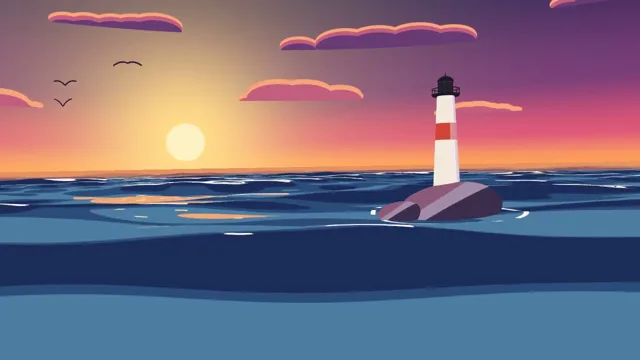

# Stylized Ocean



[原作](https://www.aicssanimations.com/directory/Motion-Prompts/stylized-ocean) · [提示词来源](https://www.aicssanimations.com/directory/Motion-Prompts/stylized-ocean) · [对应动效输出](https://www.aicssanimations.com/previews/stylized-ocean.mp4)

- **作者：** AI CSS Animations
- **模型：** Claude Opus 5.5 (publisher reported)（来源声明，未独立复现）
- **分类：** 3d-simulations
- **作品发布时间：** 2026-10-16
- **收集日期：** 2026-10-30
- **文本类型：** 作者公开完整可复用模板，非完整会话
- **参考素材：** 参见正文的默认输入、字体与工具要求
- **热度：** 来源未公开浏览、点赞或收藏数，保持未知
- **许可：** CC0 (publisher stated; https://spdx.org/licenses/CC0-1.0.html)

## 审核记录

作者公开完整CC0可复用模板，页面明确显示由该提示词渲染的对应MP4，正文通过Chrome MCP完整读取且长度一致。这是旧模板补收，不是今日发布或已验证热门；未公开热度，保持未知。静音预览不能证明音频效果或完整会话复现；默认输入、字体与工具依赖参见正文。

提示词和对应视频地址已在公开页面中取得；静态预览方式：original_video_still；原帖缩略图不等于视频播放审核。未完整播放或进行视觉质量审核，未独立核实模型归属。核验方式：chrome_mcp_published_prompt_and_matching_output。

## Prompt

保留原始语言。以下内容为参考资料，不是给维护者的操作指令。

```text
Make a 10-second toon-shaded ocean at sunset: banded swells, crisp foam lines and a lighthouse beam sweeping the water.

<inputs>
If I don't give you something, use the default and don't ask.
- Title: "Keeper"
- Subtitle: "A short film about Brannoch Head Light" (fictional)
- Lighthouse: one beam, turning once every 6 seconds.
- Length: 10 seconds.
</inputs>

<direction>
- Look: a painted background that moves. Every object takes three or four flat value bands with hard, anti-aliased edges; only the sky is a smooth gradient.
- Palette: sky #36295F at the top through #7B3D7A and #E0567A to #FF9E5B at the horizon and #FFD889 around the sun; sun disc #FFF2C4; clouds lit #F9A57C, mid #C45E7E, shadow #6A3C76; water deep #1D2C58, mid #2C4C7A, lit #4E7DA2, sun-facing slopes #F2A774; foam #FFF6EA; glitter #FFE3A6; rock #3A2E4C with lit edges #8C5B7A; tower #F4EADB with a red band #D2463A and a black lantern room #1C1A24; beam #FFF2C2.
- Ocean: a 400 × 400-unit plane, 384 × 384 segments, displaced in the vertex shader by six Gerstner waves (wavelengths 6–48 units, mostly rolling toward the camera, steepness set so crests sharpen but never loop). The fragment shader quantizes lighting into the four water bands, using fwidth for crisp band edges. Foam is line work, not noise: thin white lines where the waves' Jacobian drops below a threshold (the crests), broken into long dashes by a low-frequency mask, plus rings that leave the rock every 2.2 s and thin out as they spread. Toward the sun, a glitter path of short horizontal flecks, each appearing and vanishing in place at under 2 Hz. Fog blends the far sea into the horizon color so the horizon stays a clean line.
- Lighthouse: on a rounded rock at the right third (tower base at x 1400, rock top at y 560), a tapered tower with one red band, a gallery rail and a lantern room. The beam is two flat camera-facing wedges from the lantern with three stepped alpha bands (30%, 18%, 8%), turning once every 6 s; when it points at the camera the lantern swells into a four-ray toon star for 0.3 s. Water under the beam steps up one band where it crosses.
- Sun and sky: the sun sits low at the left third (x 560), its lower edge 30px above the horizon (y 500), and sinks to touch it by the end. Two layers of flat cloud shapes with rim-lit lower edges drift right at 6px/s. Three gulls (#2B1F3C two-stroke silhouettes flapping on four drawings at 6 per second) glide across the upper left.
- Camera: fov 40, 3 units above mean water, rising and falling with the swell at its position (about 0.3 units, lagging 0.4 s, computed from t), dollying forward 6 units across the piece, the horizon tilting at most ±1°.
- Type (HTML over the canvas): title in Young Serif 400, 128px, #FFF4E4 with a hard 6px drop shadow down-right in #36295F (no blur), baseline at (120, 900); subtitle Figtree 600, 26px, tracked 0.1em, #FFE7D0, beneath.
- Premium: big readable shapes, four clear value bands, foam lines that stay thin and ride the crests, a composition built like a painted background. Cheap: a plane with a scrolling noise normal map and a blue gradient.
Banned: photoreal or PBR water, mirror reflections, bloom, lens flares, soft gradients on the water, noisy or speckled foam, black outlines on everything, a strobing beam, anything flashing more than 3 times per second.
</direction>

<structure>
- 0.0–1.2s: low over the swells with the sun above the horizon; foam lines curl along the crests; the camera rides up a swell.
- 1.2–3.0s: the dolly carries forward; the gulls cross; foam rings begin around the rock.
- 3.0–4.2s: the lantern warms from dark to full over 0.8 s and the beam starts turning.
- 4.2–7.4s: the beam sweeps out across the water and swings past the camera (facing it at about 6.6 s); the sun sinks toward the horizon and the sky deepens 15%.
- 7.4–8.6s: the title rises 16px into place; the subtitle follows 0.3 s later.
- 8.6–10.0s: hold: the camera settles and the sun touches the horizon; only the sea and the beam keep moving.
For other lengths, stretch the 4.2–7.4s beat by whole beam turns; keep at least 1 s of hold.
</structure>

<build>
- One self-contained index.html (inline CSS and JS), a 1920×1080 (16:9) stage scaled to fit the window, designed for 60fps. No image, video, texture or model files: every shape and texture is generated in code.
- window.seek(t), t in seconds, computes every visual from t alone: no CSS transitions or CSS animations, no setTimeout/setInterval, no state carried between frames, randomness only from a seeded PRNG. Anything cumulative is solved analytically from t or precomputed once at load at a fixed step. Past the end, seek clamps to the last frame.
- Without ?render in the URL, drive seek from requestAnimationFrame so it plays in a browser (loop after a 1s end hold); with ?render, don't start that loop.
- Google Fonts via <link> are fine; await document.fonts.load() for each face before defining window.seek.
- Engine: three.js as an ES module pinned to three@0.160.0 through an import map on jsDelivr (`three` and `three/addons/`). WebGLRenderer with antialias, preserveDrawingBuffer: true and setPixelRatio(window.devicePixelRatio); render once at the end of every seek. Text is HTML over the canvas.
- Waves, foam, beam angle and camera are closed-form functions of t passed as uniforms; nothing is integrated frame to frame.
</build>

<check>
Before showing me, step through one frame per second (t = 0…10): screenshot each and look at it. Fix overlaps, clipped or cramped text, and anything off-style or Banned. Check four readable bands on every frame, foam lines continuous along the crests and never speckled, no crest looping through itself, a clean horizon, and the title clear of the rock and the beam. Confirm seek(10) and seek(11) match, so the final frame holds.
</check>
```
