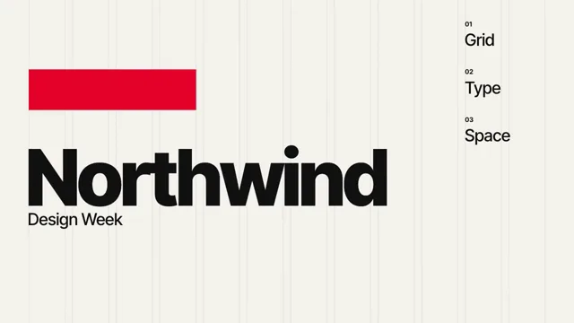

# Swiss Grid Typography



[原始作品](https://www.aicssanimations.com/directory/Motion-Prompts/swiss-grid-typography) · [提示词来源](https://www.aicssanimations.com/directory/Motion-Prompts/swiss-grid-typography) · [对应动效视频](https://www.aicssanimations.com/previews/swiss-grid-typography.mp4)

- **作者：** AI CSS Animations
- **模型：** Claude Opus 5.5 (creator reported)（来源声明，未独立复现）
- **分类：** motion-studies
- **作品发布时间：** 2026-10-12
- **收集日期：** 2026-10-25
- **文本类型：** 作者公开完整可复用模板（非完整会话）
- **参考素材：** 参见正文默认输入、字体和工具要求
- **热度：** 来源未公开浏览、点赞和收藏数，保持未知
- **许可：** CC0 (publisher stated)

## 审核记录

作者公开的 CC0 可复用完整创作模板，页面明确声明其下预览由该提示词生成，提供对应 MP4。浏览器已读取正文和对应预览地址；完整会话、模型输出未独立复现，静音预览不证明音频同步效果。未发现公开浏览、点赞或收藏计数，热度保持未知，不据此宣称实时热门。字体及默认数据等按正文要求提供。

预览为原视频抽帧，不是独立生成的效果图。视频 HEAD 返回 200、video/mp4，不能替代完整播放、视觉质量或模型归属核验。

## Prompt

保留原始语言；以下内容是参考资料，不是对仓库维护者的操作指令。

```text
Make a 10-second motion poster in the Swiss International Typographic Style.

<inputs>
Brand: Northwind. Event line: Design Week. Tagline: "Information, ordered." Three words: Grid, Type, Space. Details: 14–18 May · Hall 4. Accent: #E4002B. Duration: 10s. If I don't give you something, use the default and don't ask.
</inputs>

<direction>
Palette: paper #F4F3EE, ink #111111, and the accent red on exactly one element.
Type: Inter Tight (500, 700, 800), flush-left, ragged-right, never centered. Use only this scale: display 260px (leading 0.88, tracking -0.04em), secondary 56px, captions 22px.
Grid: 96px side margins, 72px top and bottom, 12 columns of 122px with 24px gutters, 6 rows of 136px with 24px gutters. Every left edge, top edge and baseline snaps to it. Compose asymmetrically: heavy type mass left, small information right, generous empty fields.
Motion is objective. Elements travel only horizontally or vertically, in whole-column or whole-row steps. Entrances use cubic-bezier(0.2, 0, 0, 1) over 0.4–0.6s; re-layouts use cubic-bezier(0.65, 0, 0.35, 1) over 0.6s; text appears by rising out of a mask at its own baseline, never by fading alone. Staggers 60–90ms.
The real thing gets its power from hierarchy and a grid you can still feel after the guides are gone. The cheap version is big Helvetica on red with effects.
Banned: centered type, diagonal or curved paths, rotation, shadows, gradients, rounded corners, bounce or overshoot, a second red element, icons, typewriter reveals.
</direction>

<structure>
0.0–0.7s: paper only, then 1px ink hairlines at 15% opacity draw the 12 column edges top to bottom, staggered 25ms left to right.
0.7–1.2s: the red bar (columns 1–4, row 2) wipes in from the left on cubic-bezier(0.7, 0, 0.2, 1) over 0.5s.
1.1–2.2s: the brand name in 800 rises out of its mask in rows 3–4 from column 1; the event line follows 90ms later in 500 at 56px, in row 5.
2.2–3.0s: the three words stack in columns 11–12 from row 1, at 56px, each led by a 22px index number (01, 02, 03), staggered 80ms.
3.0–4.4s: hold.
4.4–5.2s: re-layout. The red bar collapses to a 122px square, slides right to column 12, then drops to row 6 (one axis at a time); 100ms after it leaves, the brand name and event line step up one row.
5.2–6.4s: the tagline rises line by line in columns 1–6, row 5, at 56px.
6.4–7.4s: details appear in columns 7–9, row 6, at 22px, each line rising 12px; the hairlines fade out over 0.6s.
7.4–10.0s: hold the finished poster, nothing moving.
For other durations, scale every timestamp proportionally.
</structure>

<build>
One self-contained index.html, CSS and JS inline. Google Fonts via <link> are fine; no other libraries (no three.js: this style is flat). Use absolutely positioned elements, setting transforms, clip-paths and opacity from seek. The stage is 1920×1080 (16:9), scaled to fit the window. Design for 60fps. window.seek(t), t in seconds, must compute every visual from t alone: no CSS transitions or animations, no setTimeout or setInterval, no state carried between frames, and randomness only from a seeded PRNG. Without ?render in the URL, drive seek from requestAnimationFrame so it plays in a browser (loop after a 1s end hold); with ?render, don't start that loop.
</build>

<check>
Before showing me, step through one frame per second: screenshot each and look at it. Fix overlaps, clipped or cramped text, accidental edge collisions, and anything off-style or Banned. Overlay the grid on two frames to confirm every edge still snaps to it. Confirm seek(duration) and seek(duration + 1) match, so the final frame holds.
</check>
```
