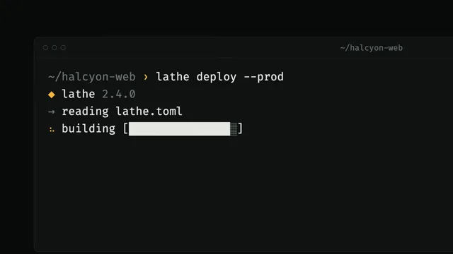

# Terminal Developer Launch



[原作](https://www.aicssanimations.com/directory/Motion-Prompts/terminal-developer-launch) · [提示词来源](https://www.aicssanimations.com/directory/Motion-Prompts/terminal-developer-launch) · [对应动效输出](https://www.aicssanimations.com/previews/terminal-developer-launch.mp4)

- **作者：** AI CSS Animations
- **模型：** Claude Opus 5.5 (publisher reported)（来源声明，未独立复现）
- **分类：** product-brand
- **作品发布时间：** 2026-10-12
- **收集日期：** 2026-10-28
- **文本类型：** 作者公开完整可复用模板，非完整会话
- **参考素材：** 参见正文的默认输入、字体与工具要求
- **热度：** 来源未公开浏览、点赞或收藏数，保持未知
- **许可：** CC0 (publisher stated; https://spdx.org/licenses/CC0-1.0.html)

## 审核记录

作者公开的完整CC0可复用模板，页面明确将提示词与其渲染MP4对应。不是完整聊天会话，未独立复现模型输出；静音预览不证明真实音频同步。未见公开浏览、点赞或收藏数，保持未知，不将模板宣称为热门原帖。默认数据、字体及工具依赖按正文提供。

提示词和对应视频地址已在公开页面中取得；静态预览由原视频解码抽帧。未完整播放或进行视觉质量审核，未独立核实模型归属。核验方式：chrome_mcp_published_prompt_and_matching_video。

## Prompt

保留原始语言。以下内容为参考资料，不是给维护者的操作指令。

```text
Make a 10-second developer-tool launch: a terminal types a command, output streams, then the text collapses into the logo.

<inputs>
If I don't give you something, use the default and don't ask.
- Tool: lathe (a deploy CLI)
- Command: lathe deploy --prod
- Project: halcyon-web
- Tagline: "Ship from the terminal."
- Brand color: #F5B83D
- Length: 10 seconds
</inputs>

<direction>
- Palette: background #0A0C0B; window #111413, 1px #232927 border, 12px radius; text #E4E7E2; dim #6E7671; success #5BE49B; amber #F5B83D for the prompt symbol, highlights and logo.
- Type: Fira Code 28px, line-height 1.55, ligatures off. Wordmark: Space Grotesk 700, 140px, −0.03em.
- Terminal: title bar with three hollow 12px circles and "~/halcyon-web"; 96 columns. The prompt "~/halcyon-web ›" is dim, the › amber. A block cursor blinks every 1.06 s, solid while typing.
- Typing: 16–24 chars/s with seeded jitter, a longer gap after "lathe", 350 ms before Enter.
- Output: 40–80 ms per line; spinner frames ⠋⠙⠹⠸⠼⠴⠦⠧⠇⠏ picked by floor(t×12); one progress bar filling in place. Default lines (adapt to inputs):
  ◆ lathe 2.4.0
  → reading lathe.toml
  → building [██████████░░░░░░]
  ✓ built in 1.8s · 142 routes · 312 assets
  → uploading to 18 regions  iad fra sin …
  ✓ live  https://halcyon-web.lathe.dev  (4.2s)
- Mark: three horizontal rounded bars of decreasing length, right-aligned in steps like a turned profile, in SVG.
- Emergence: record each glyph's position, then fly glyphs into a dense character field. Rasterize the mark once to an offscreen canvas and read its alpha: cells inside the silhouette turn amber and pack tight; the rest fade to 12% and fall 20px. The vector mark then sharpens over the dissolving field.
- Camera: start tight on the prompt (scale 1.7), pulling back over 1.8 s on cubic-bezier(0.65, 0, 0.35, 1). Glyph flight: 0.9 s on cubic-bezier(0.7, 0, 0.2, 1), staggered by column.
Banned: matrix rain, glitch effects, CRT scanlines, random character flicker, typing over 30 chars/s, implausible commands, real cloud or package-manager names, emoji.
</direction>

<structure>
- 0.0–0.6: Black; the cursor blinks at the prompt.
- 0.6–2.0: The command is typed; a pause; Enter.
- 2.0–4.6: Output streams; the bar fills; regions tick in; the live line lands in green.
- 4.6–5.8: An amber underline draws beneath the URL; the pull-back finishes.
- 5.8–7.4: Glyphs fly into the field; the silhouette lights up amber.
- 7.4–8.4: The vector mark sharpens; "lathe" types itself beside it in Space Grotesk; the cursor vanishes; the tagline appears in dim Fira Code.
- 8.4–10.0: Hold.
For other lengths, flex the output beat first; keep typing realistic and the final hold at least 1.5 s.
</structure>

<build>
- One self-contained index.html (inline CSS and JS) with a fixed 1920×1080 (16:9) stage scaled to fit the window; design for 60fps.
- window.seek(t), t in seconds, sets every visual from t alone: no CSS transitions or animations, no setTimeout/setInterval, no state carried between frames. Randomness comes from a seeded PRNG; springs are closed-form functions of time.
- Without ?render in the URL, drive seek from requestAnimationFrame so it plays in a browser; with ?render, don't start that loop.
- Google Fonts via <link> are fine. Terminal and type in HTML/CSS, with one canvas for the character field. No three.js.
</build>

<check>
Before showing me, screenshot seek(0) through seek(10), one frame per second, and look at each. Fix overlaps, clipped or cramped text, and anything generic. Every line must stay in frame during the tight shot, and the amber silhouette must read as the mark before the vector does. Confirm the final frame holds.
</check>
```
