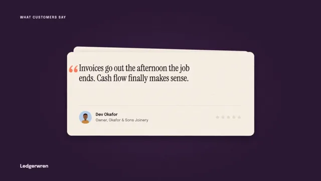

# Testimonial Cards



[原作](https://www.aicssanimations.com/directory/Motion-Prompts/testimonial-quote-cards) · [提示词来源](https://www.aicssanimations.com/directory/Motion-Prompts/testimonial-quote-cards) · [对应动效输出](https://www.aicssanimations.com/previews/testimonial-quote-cards.mp4)

- **作者：** AI CSS Animations
- **模型：** Claude Opus 5.5 (publisher reported)（来源声明，未独立复现）
- **分类：** product-brand
- **作品发布时间：** 2026-10-18
- **收集日期：** 2026-10-30
- **文本类型：** 作者公开完整可复用模板，非完整会话
- **参考素材：** 参见正文的默认输入、字体与工具要求
- **热度：** 来源未公开浏览、点赞或收藏数，保持未知
- **许可：** CC0 (publisher stated; https://spdx.org/licenses/CC0-1.0.html)

## 审核记录

作者公开完整CC0可复用模板，页面明确显示由该提示词渲染的对应MP4，正文通过Chrome MCP完整读取且长度一致。这是旧模板补收，不是今日发布或已验证热门；未公开热度，保持未知。静音预览不能证明音频效果或完整会话复现；默认输入、字体与工具依赖参见正文。

提示词和对应视频地址已在公开页面中取得；静态预览方式：original_video_still；原帖缩略图不等于视频播放审核。未完整播放或进行视觉质量审核，未独立核实模型归属。核验方式：chrome_mcp_published_prompt_and_matching_output。

## Prompt

保留原始语言。以下内容为参考资料，不是给维护者的操作指令。

```text
Make a 10-second testimonial sequence: three customer quote cards with illustrated avatars, star ratings and company names flip in and stack, then the whole stack turns over to reveal one big rating.

<inputs>
If I don't give you something, use the default and don't ask.
- Product: Ledgerwren, accounting for small businesses (fictional).
- Kicker: WHAT CUSTOMERS SAY
- Quote 1: "We close the month in two days now, not nine." Mara Ellison, Finance Lead, Copperloaf Bakery. 5 stars. Key phrase: "two days now".
- Quote 2: "Invoices go out the afternoon the job ends. Cash flow finally makes sense." Dev Okafor, Owner, Okafor & Sons Joinery. 5 stars. Key phrase: "the afternoon the job ends".
- Quote 3: "Tax season took one evening this year, not a week of them." Lucia Ferrante, Founder, Ferrante Floral Studio. 5 stars. Key phrase: "one evening".
- Rating: 4.9 out of 5, from 2,316 reviews.
- Length: 10 seconds.
</inputs>

<direction>
- Palette: stage aubergine #2A1631, lifting to #3A1F43 behind the cards, with a 3% grain; cards cream #F7EFE4 with a faint fibre grain generated once; ink #241520; secondary #6E5F68; card rule #E2D5C6; stars amber #F5A524 over empty #E6D9C9; quote marks coral #FF7A59; the key-phrase marker coral #FF7A59 at 35%; avatar backdrops sage #B9D4B4, sky #B8CFEA and blush #F2C1B5; light text on the stage #EBDDEA.
- Type: quotes in Instrument Serif 400, 54px, leading 1.12, ink, with a hanging 140px coral opening quote mark outside the measure; names in Epilogue 600, 24px; role and company in Epilogue 400, 22px, secondary; the kicker in Epilogue 600, 20px, uppercase, tracked 0.16em, at (120, 110); "Ledgerwren" in Epilogue 700, 28px, at bottom-left on baseline y 1000; the rating "4.9" in Instrument Serif 400, 280px, ink.
- Cards: 1120×500, 28px radius, centered at (960, 560), 72px padding: the quote at top-left, a 1px rule, then the person row: a 76px avatar, the name over role and company, and five 28px stars right-aligned.
- Avatars, drawn in code: flat illustrated busts in a circle on their backdrop, built from shoulders (a rounded trapezoid in a shirt color), a neck, an oval head and hair as one or two shapes (a low bun, a short crop, long waves), with only a small nose line for features. Three different skin tones (#8D5A3B, #E8B892, #C68B62) and hair colors. No photos.
- The stack is physical: CSS 3D with a 1800px perspective. A new card flips in about its vertical axis from rotateY(−100°), 60px to the right, to flat over 0.7s on cubic-bezier(0.2, 0.8, 0.2, 1), landing on top; a 2px darker cream edge shows mid-flip so it reads as card stock, and backfaces stay hidden. The card below sinks back: scale 0.94, 34px up, rotated a seeded ±2.5°, its content dimming to 55%, so older cards peek above it, at most two. A lifted card's shadow is 0 40px 80px rgba(12,4,14,0.5); a landed card's is 0 18px 36px rgba(12,4,14,0.35).
- On landing: the five stars fill left to right, 70ms apart, each scaling 0.6 → 1 with at most 10% overshoot; then a coral marker stroke draws left to right under the key phrase over 0.4s, behind the text.
- The finale: the stack squares up (rotations and offsets to zero over 0.4s), then turns over as one about its horizontal axis (rotateX 0 → 180° over 0.8s on cubic-bezier(0.65, 0, 0.35, 1)) to show its back, the rating card: "4.9" with "out of 5" (Epilogue 500, 30px) beside it, five 44px stars beneath and "from 2,316 reviews" (Epilogue 500, 26px, secondary). The number rolls up from 4.0 in tenths over 0.8s while the stars fill; the fifth star fills to exactly 90%, clipped, so the stars read 4.9.
- Premium: three distinct voices, each with a specific result, physical card stock with weight and shadow, and stars that add up to the number. Cheap: a sliding carousel of generic praise with stock photos and flashing five-star badges.
Banned: real company names or logos, photo avatars, emoji, confetti, glow, gradients on the cards, carousel arrows, ratings that don't match the stars, text under 20px, anything flashing more than 3 times per second.
</direction>

<structure>
- 0.0–0.6s: the aubergine stage; the kicker and the brand line rise in.
- 0.6–1.3s: card 1 flips in and lands.
- 1.3–2.2s: its stars fill; the marker draws under "two days now".
- 2.4–3.1s: card 2 flips in as card 1 sinks back.
- 3.1–4.1s: its stars; the marker under "the afternoon the job ends".
- 4.4–5.1s: card 3 flips in; the stack is three deep.
- 5.1–6.0s: its stars; the marker under "one evening". At 6.0s card 3 reads in full on top of the stack.
- 6.6–7.0s: the stack squares up.
- 7.0–7.8s: the stack turns over to the rating card.
- 7.8–8.6s: 4.0 rolls to 4.9 as the stars fill; "from 2,316 reviews" rises in.
- 8.6–10.0s: hold, completely still.
For other lengths, stretch the reading time on each card evenly; keep each flip at 0.7s and at least 1s of hold.
</structure>

<build>
- One self-contained index.html (inline CSS and JS), a 1920×1080 (16:9) stage scaled to fit the window, designed for 60fps. No image, video, texture or model files: every shape and texture is generated in code.
- window.seek(t), t in seconds, computes every visual from t alone: no CSS transitions or CSS animations, no setTimeout/setInterval, no state carried between frames, randomness only from a seeded PRNG. Anything cumulative is solved analytically from t or precomputed once at load at a fixed step. Past the end, seek clamps to the last frame.
- Without ?render in the URL, drive seek from requestAnimationFrame so it plays in a browser (loop after a 1s end hold); with ?render, don't start that loop.
- Google Fonts via <link> are fine; await document.fonts.load() for each face before defining window.seek.
- Engine: HTML/CSS with CSS 3D transforms (perspective on the stage, transform-style: preserve-3d on the stack, backface-visibility: hidden on every face), set from seek; avatars, stars and quote marks in inline SVG; the paper grain painted once at load into a canvas.
- Each card's flip, sink and star fill are closed-form functions of the time since its trigger.
</build>

<check>
Before showing me, step through one frame per second (t = 0…10): screenshot each and look at it. Fix overlaps, clipped or cramped text, and anything off-style or Banned. Check each quote, name and company reads fully on the top card, every marker sits behind its exact phrase, no more than two cards ever peek, no backface or z-fighting shows during the flips, the rating card reads 4.9 with the fifth star 90% filled, and everything stays 60px clear of the edges. Confirm seek(10) and seek(11) match, so the final frame holds.
</check>
```
