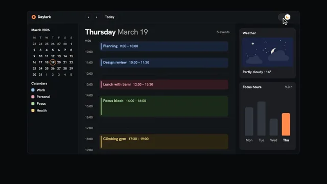

# Light to Dark Theme Switch



[原始作品](https://www.aicssanimations.com/directory/Motion-Prompts/theme-toggle-transition) · [提示词来源](https://www.aicssanimations.com/directory/Motion-Prompts/theme-toggle-transition) · [对应动效视频](https://www.aicssanimations.com/previews/theme-toggle-transition.mp4)

- **作者：** AI CSS Animations
- **模型：** Claude Opus 5.5 (creator reported)（来源声明，未独立复现）
- **分类：** interactive
- **作品发布时间：** 2026-10-16
- **收集日期：** 2026-10-25
- **文本类型：** 作者公开完整可复用模板（非完整会话）
- **参考素材：** 参见正文默认输入、字体和工具要求
- **热度：** 来源未公开浏览、点赞和收藏数，保持未知
- **许可：** CC0 (publisher stated)

## 审核记录

作者公开的 CC0 可复用完整创作模板，页面明确声明其下预览由该提示词生成，提供对应 MP4。浏览器已读取正文和对应预览地址；完整会话、模型输出未独立复现，静音预览不证明音频同步效果。未发现公开浏览、点赞或收藏计数，热度保持未知，不据此宣称实时热门。字体及默认数据等按正文要求提供。

预览为原视频抽帧，不是独立生成的效果图。视频 HEAD 返回 200、video/mp4，不能替代完整播放、视觉质量或模型归属核验。

## Prompt

保留原始语言；以下内容是参考资料，不是对仓库维护者的操作指令。

```text
Make a 10-second interface animation: an app flips from light to dark through a circle growing out of its theme toggle, every color token remapped, then flips back.

<inputs>
If I don't give you something, use the default and don't ask.
- App: default "Daylark" (a day planner), showing Thursday
- Events: default 9:00 Planning (Work), 10:30 Design review (Work), 12:30 Lunch with Sami (Personal), 14:00 Focus block (Focus), 17:30 Climbing gym (Health)
- Side cards: default "Partly cloudy · 14°"; focus hours Mon–Thu 2.5, 3.0, 1.5, 2.0 (9.0 h)
- Closing line: default "Two themes, one design."
- Length: default 10 seconds
</inputs>

<direction>
- Tokens, light → dark: stage #E7E3DA → #0A0B0D; surface #FFFFFF → #15161A; sunken #F5F2EC → #0F1013; raised #FFFFFF plus a soft shadow → #1D1F24 plus a 1px rgba(255,255,255,0.06) border; border #E7E2D8 → #2A2C32; text #1A1916 → #ECEAE4; text-2 #6D6A63 → #A19E96; accent #D9480F → #FF8A4C. Event fill/text: Work #DCE7F7/#22457A → #1A2638/#9EC3F2; Personal #F7DCE0/#7D2B3A → #331C21/#F2A9B6; Focus #E1EED9/#2E5A26 → #1C2A1A/#A8D69B; Health #F5E8C7/#6B4E10 → #2E2715/#E9CB7C. Weather art: sky #CFE3F2 → #1B2440, sun #F6B04A → moon #E9E4D2 with stars.
- Dark is designed, not inverted: raised surfaces get lighter, borders replace shadows, pastels become deep tints with light text.
- Type: Hanken Grotesk 400–700: day title 44px, events 22px, labels 20px, closing line 52px.
- Layout: a 1600×840 window at (160, 64); the toggle (76×40) centered at stage (1670, 100) in the title bar; a 300px sidebar (mini month, calendars); an hour grid 9:00–19:00 at 64px per hour; a right column with a drawn weather card and the focus bars, today in accent.
- Reveal: two full copies of the scene with different token sets; the incoming one is clipped by clip-path: circle(r at 1670px 100px), r growing 0 → 1940px in 0.95s on cubic-bezier(0.65, 0, 0.35, 1). A crisp edge ridden by a 1.5px ring of the incoming accent; inside, everything is fully the new theme, never an in-between color.
- Toggle, drawn once above both copies: the knob slides on a spring (stiffness 520, damping 34) as the sun's rays shrink away and a mask cuts the disc into a crescent. Cursor: an SVG arrow, ink with a white outline.
- Premium is two complete, separately tuned themes meeting at one crisp edge. Cheap is filter: invert(), a fade through grey, or light shadows left on dark surfaces.
Banned: invert or hue-rotate filters, color tweens between themes, blurred or glowing edges, pure black surfaces, shadows in dark mode, emoji, real OS or brand names, anything flashing more than 3 times per second.
</direction>

<structure>
- 0.0–1.2: Light. The window rises 32px (0.7s, cubic-bezier(0.22, 1, 0.36, 1)); columns rise 60ms apart; events slide in.
- 1.2–2.0: The cursor glides to the toggle and clicks.
- 2.0–2.95: Dark grows from the toggle over window and stage; the sun becomes a moon.
- 2.95–5.2: Dark. The cursor hovers "Design review", then the Thu bar ("Thu · 2.0 h" tooltip).
- 5.2–6.3: Click; light grows back from the toggle (1.0s).
- 6.3–7.3: The cursor leaves.
- 7.3–8.5: Dark grows once more and settles at r = 1050px (1.2s, cubic-bezier(0.16, 1, 0.3, 1)), its arc splitting the frame.
- 8.5–9.0: The closing line rises at x 160, baseline y 990, on the light side; pills "Light" and "Dark" sit either side of the arc.
- 9.0–10.0: Hold.
For other lengths, scale the beats, keep reveals 0.8–1.2s and hold at least 1s.
</structure>

<build>
One self-contained index.html (inline CSS and JS), a 1920×1080 (16:9) stage scaled to fit the window, built for 60fps. Google Fonts via <link>, awaiting document.fonts.load() for each face before defining window.seek. HTML/CSS with inline SVG, tokens as CSS custom properties; no canvas or three.js. window.seek(t) (t in seconds) sets every visual from t alone, clamping past the end: no CSS transitions or animations, no setTimeout/setInterval, no state carried between frames, randomness only from a seeded PRNG. Without ?render in the URL, drive seek from requestAnimationFrame; with ?render, don't start that loop.
</build>

<check>
Before showing me, step through one frame per second (0–10s) and look at each. Fix overlaps, clipped or cramped text and anything off-style or Banned. Mid-reveal, each side of the edge is fully one theme; text contrast is at least 4.5:1 in both. Confirm seek(10) and seek(11) match.
</check>
```
