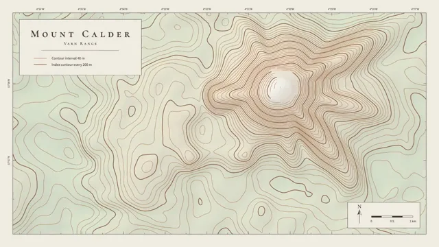

# Topographic Contour Map



[原作](https://www.aicssanimations.com/directory/Motion-Prompts/topographic-contours) · [提示词来源](https://www.aicssanimations.com/directory/Motion-Prompts/topographic-contours) · [对应动效输出](https://www.aicssanimations.com/previews/topographic-contours.mp4)

- **作者：** AI CSS Animations
- **模型：** Claude Opus 5.5 (publisher reported)（来源声明，未独立复现）
- **分类：** explainers-data
- **作品发布时间：** 2026-10-12
- **收集日期：** 2026-10-30
- **文本类型：** 作者公开完整可复用模板，非完整会话
- **参考素材：** 参见正文的默认输入、字体与工具要求
- **热度：** 来源未公开浏览、点赞或收藏数，保持未知
- **许可：** CC0 (publisher stated; https://spdx.org/licenses/CC0-1.0.html)

## 审核记录

作者公开完整CC0可复用模板，页面明确显示由该提示词渲染的对应MP4，正文通过Chrome MCP完整读取且长度一致。这是旧模板补收，不是今日发布或已验证热门；未公开热度，保持未知。静音预览不能证明音频效果或完整会话复现；默认输入、字体与工具依赖参见正文。

提示词和对应视频地址已在公开页面中取得；静态预览方式：original_video_still；原帖缩略图不等于视频播放审核。未完整播放或进行视觉质量审核，未独立核实模型归属。核验方式：chrome_mcp_published_prompt_and_matching_output。

## Prompt

保留原始语言。以下内容为参考资料，不是给维护者的操作指令。

```text
<inputs>
You're making a topographic contour animation. I may supply any of these; if I don't give you something, use the default and don't ask.
- Place: Mount Calder and Ardel Tarn in the fictional Varn Range.
- Title: "Mount Calder".
- Elevations: 1,200–3,140 m; contour interval 40 m; index contour every 200 m.
- Length: 10 seconds.
</inputs>

<direction>
Paper #F2EDE2. Hypsometric tints stepped per 200 m band: #DCE4CF (low) → #E8E6D2 → #EFE4CF → #ECDCC6 → #F7F4EE (summit). Contours #B07A4F at 1.25px; index contours #87573A at 2.5px; water #A8C7D4 with a #6F9BB0 shoreline; labels #3D3A35; one accent, #C2452D, for summit triangles and the trail. Multiply a 10% hillshade (light from the northwest) over the tints.
Terrain: a heightfield of a few gaussian peaks and ridges plus seeded value noise, sampled on a 240×135 grid. Trace contours with marching squares and linear interpolation, chain them into polylines, and smooth with two Chaikin passes so nothing stair-steps. Every terrain change comes from blending heightfield parameters by t.
Lettering follows map convention: title and peak names in "Cormorant SC" 600, tracking 0.3em (title 44px); water names in "Cormorant Garamond" italic, #4F7F96; elevations on index contours in "Source Sans 3" 600, 15px, rotated to the line with the tops of the numbers facing uphill, the line knocked out behind each with a 6px gap.
Map furniture: thin neatline, graticule ticks on the edges, north arrow, 0–1 km scale bar, a legend reading "Contour interval 40 m".
Motion is calm and continuous: long easeInOutSine curves of 2–4s, no snaps or bounces. The camera drifts at most 25px/s and zooms 6% across the piece.
Authentic: a constant interval, legible index lines, labels that interrupt lines cleanly. Cheap: neon on black, rainbow ramps, jagged lines.
Banned: glow, dark backgrounds, rainbow ramps, 3D tilt, unsmoothed lines, labels without knockouts, flicker from reseeded noise.
</direction>

<structure>
- 0–1.0s: paper and tints fade up to 30%; the neatline, ticks and a cartouche with title and legend draw.
- 1.0–3.5s: contours appear lowest to highest, 40ms apart, each drawing on from its start point; tints rise to full.
- 3.5–6.5s: the terrain morphs: a second peak rises and the valley between deepens; contours split and merge; water rises in the valley floor to form the tarn.
- 6.5–8.0s: index labels fade in, sliding 8px along their lines; peak names, the tarn name and spot heights ("3 140") appear.
- 8.0–9.0s: a dashed accent trail draws from the tarn to the summit as a small dot walks it.
- 9.0–10s: hold while the drift eases to stillness.
Other lengths: stretch the morph first and keep at least 1s of hold.
</structure>

<build>
One self-contained index.html (inline CSS and JS; Google Fonts via <link> are fine), a 1920×1080 (16:9) stage scaled to fit the window, built for 60fps. Draw on Canvas 2D; three.js isn't needed.
window.seek(t) (t in seconds) sets every visual from t alone, clamping past the end to the last frame. No CSS transitions or CSS animations, no setTimeout/setInterval, no state carried between frames. Value noise comes from a seeded PRNG, keyed to the frame only where something varies over time; never Math.random.
With no ?render in the URL, call seek from requestAnimationFrame so it plays in a browser; with ?render, don't start that loop.
</build>

<check>
Before showing me, step through one frame per second (0–10s) and look at each. Fix overlaps, clipped or cramped text and anything off-style: contours never crossing, no stair-stepped segments, elevation labels oriented uphill with clean knockouts, names clear of the trail. Confirm the final frame holds.
</check>
```
