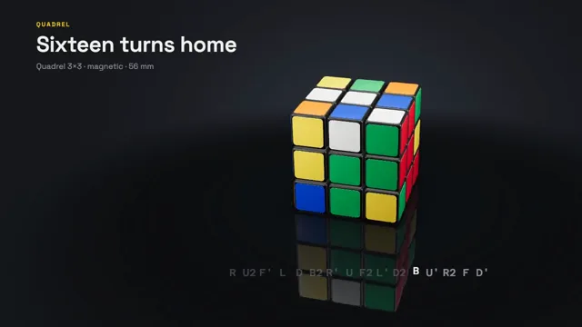

# Puzzle Cube Solve



[原作](https://www.aicssanimations.com/directory/Motion-Prompts/twisty-cube-solve) · [提示词来源](https://www.aicssanimations.com/directory/Motion-Prompts/twisty-cube-solve) · [对应动效输出](https://www.aicssanimations.com/previews/twisty-cube-solve.mp4)

- **作者：** AI CSS Animations
- **模型：** Claude Opus 5.5 (publisher reported)（来源声明，未独立复现）
- **分类：** 3d-simulations
- **作品发布时间：** 2026-10-18
- **收集日期：** 2026-10-30
- **文本类型：** 作者公开完整可复用模板，非完整会话
- **参考素材：** 参见正文的默认输入、字体与工具要求
- **热度：** 来源未公开浏览、点赞或收藏数，保持未知
- **许可：** CC0 (publisher stated; https://spdx.org/licenses/CC0-1.0.html)

## 审核记录

作者公开完整CC0可复用模板，页面明确显示由该提示词渲染的对应MP4，正文通过Chrome MCP完整读取且长度一致。这是旧模板补收，不是今日发布或已验证热门；未公开热度，保持未知。静音预览不能证明音频效果或完整会话复现；默认输入、字体与工具依赖参见正文。

提示词和对应视频地址已在公开页面中取得；静态预览方式：original_video_still；原帖缩略图不等于视频播放审核。未完整播放或进行视觉质量审核，未独立核实模型归属。核验方式：chrome_mcp_published_prompt_and_matching_output。

## Prompt

保留原始语言。以下内容为参考资料，不是给维护者的操作指令。

```text
Make a 10-second 3D film of a 3×3 puzzle cube that scrambles itself, then solves in crisp face turns timed like a speedsolve.

<inputs>
If I don't give you something, use the default and don't ask.
- Brand: Quadrel (fictional), a puzzle-cube maker.
- Title: "Sixteen turns home"
- Line: "Quadrel 3×3 · magnetic · 56 mm"
- Scramble, in standard notation: R U2 F' L D B2 R' U F2 L' D2 B U' R2 F D'
- Solve, its exact inverse: D F' R2 U B' D2 L F2 U' R B2 D' L' F U2 R'
- Length: 10 seconds.
</inputs>

<direction>
- Look: a premium product macro on a dark set: a glossy black-bodied cube with bright tiles under big soft studio lights, every turn crisp and mechanical.
- Palette: set graphite #17181C with a soft #2C2F37 pool of light behind the cube; floor dark satin acrylic #121316; tiles white #F2F2EE, yellow #FFD21F, red #D3212F, orange #FF6A14, blue #1450C8, green #12A05A, in the standard scheme: white opposite yellow, red opposite orange, blue opposite green, and with white on top and green in front, red is on the right; type #F2F2EE, secondary #8E929C, accent yellow.
- The cube, built like the real thing: 26 cubies, each a RoundedBoxGeometry 0.96 units (radius 0.07) in black plastic (MeshPhysicalMaterial #121214, roughness 0.32, clearcoat 0.5), with 0.04 gaps so the seams read. Every outward face carries a tile: a rounded square 0.84 units (corner radius 0.09), 0.012 thick and very slightly domed, MeshPhysicalMaterial, roughness 0.18, clearcoat 1. The white center tile has a small embossed "Q" mark (a CanvasTexture, 12% darker). While a layer turns, the opening gap shows a dark rounded core.
- Turns: a layer turn rotates its nine cubies about the face axis by 90° or 180° on cubic-bezier(0.55, 0, 0.1, 1) with a 2° overshoot that settles in 0.04 s, like a magnetic click. Moves follow the notation exactly: R, L, U, D, F and B are clockwise quarter turns seen looking straight at that face, ' is counterclockwise and 2 is a half turn. Precompute at load the cube's state before every move, each cubie's position snapped to the integer grid and its rotation to exact 90° multiples, so seek(t) restores the state before the current move and applies only that move's partial rotation.
- Timing: the scramble runs from 1.20 s with quarter turns of 0.11 s, half turns of 0.15 s and 0.03 s between moves, ending at 3.61 s. The solve starts at 4.40 s with quarter turns of 0.13 s, half turns of 0.19 s and 0.05 s between, plus one 0.35 s recognition pause after the eighth move (5.97–6.32 s), and ends at 7.83 s, so the timer stops at 3.43.
- Light: an overhead softbox (a 3 × 3 RectAreaLight #FFFFFF at intensity 6, with RectAreaLightUniformsLib) and two tall strip softboxes left and right; build the same three panels into an environment with PMREMGenerator.fromScene, so every tile shows a long soft window reflection and the black plastic shows clean highlights along its edges. A HemisphereLight #FFFFFF / #303238 at 0.6 keeps the tiles at true color. Under the cube, a soft contact shadow (a blurred rounded square at 55%) and a faint reflection: a Reflector floor (three/addons/objects/Reflector.js) under a #121316 plane at 86% opacity, so the reflection reads at about 14%. ACESFilmic, exposure 1.15. White tiles render near white, never grey, and the cube is clearly lit from the first frame.
- Camera: fov 26, the cube about 520px tall and centered at (1180, 500), in a classic three-quarter view (yaw 35°, pitch 26°) showing the white top, green front and red right. During the scramble the whole cube yaws 40° and back; during the inspection it tumbles to show its back faces (120° of yaw and a 30° pitch dip) and returns, then it holds the hero view through the solve so every turn reads. A 4% dolly in across the piece.
- Move strip (HTML): along the bottom at y 900, centered under the cube (x 740–1620), 16 tokens in Azeret Mono 500, 34px, each 55px wide. During the scramble it shows the scramble in secondary; the current move lifts 6px and turns white; done moves dim to 40%. At 3.8 s it swaps to the solve.
- Timer: Azeret Mono 600, 112px, tabular figures, at (120, 560) in the left column under a label "SOLVE" (Space Grotesk 600, 20px, tracked 0.2em, secondary), reading 0.00 from 4.0 s, running with the solve, then stopping at 3.43 and turning yellow for the hold.
- Type: kicker "QUADREL" in Space Grotesk 600, 20px, tracked 0.18em, accent; title Space Grotesk 600, 72px, #F2F2EE, top-left at (120, 110); line Space Grotesk 400, 26px, secondary, beneath. Text rises 12px as it fades in over 0.5 s on cubic-bezier(0.22, 1, 0.36, 1).
- Premium: tiles with real reflections, visible seams and core, turns that click exactly into place, notation that matches the moves. Cheap: a flat-shaded cube of colored squares spinning at random, turns that never quite land on 90°.
Banned: real puzzle brands or logos, motion blur, cubies left misaligned after a turn, impossible moves, colored lights, bloom, hands, confetti, anything flashing more than 3 times per second.
</direction>

<structure>
- 0.0–1.2s: the solved cube on its dark floor, the camera easing in; the kicker, title and line rise in.
- 1.2–3.6s: the scramble: sixteen quick turns as the strip ticks through them and the cube yaws 40° and back.
- 3.6–4.4s: inspection: the cube tumbles to show its scrambled back faces and returns to the hero view; the strip swaps to the solve; the timer appears at 0.00.
- 4.4–7.83s: the solve: turns click in and the timer runs; the 6.0 s frame falls in the recognition pause, a still, half-solved cube.
- 7.83–8.6s: solved: the timer stops at 3.43 and turns yellow, and the cube eases through a final 20° yaw to its hero angle.
- 8.6–10.0s: hold, still.
For other lengths, change the opening, the inspection and the hold; keep the turn timings so the timer still reads 3.43.
</structure>

<build>
- One self-contained index.html (inline CSS and JS), a 1920×1080 (16:9) stage scaled to fit the window, designed for 60fps. No image, video, texture or model files: every shape and texture is generated in code.
- window.seek(t), t in seconds, computes every visual from t alone: no CSS transitions or CSS animations, no setTimeout/setInterval, no state carried between frames, randomness only from a seeded PRNG. Anything cumulative is solved analytically from t or precomputed once at load at a fixed step. Past the end, seek clamps to the last frame.
- Without ?render in the URL, drive seek from requestAnimationFrame so it plays in a browser (loop after a 1s end hold); with ?render, don't start that loop.
- Google Fonts via <link> are fine; await document.fonts.load() for each face before defining window.seek.
- Engine: three.js as an ES module pinned to three@0.160.0 through an import map on jsDelivr (`three` and `three/addons/`). WebGLRenderer with antialias, preserveDrawingBuffer: true and setPixelRatio(window.devicePixelRatio); render once at the end of every seek. Text is HTML over the canvas.
- Every move's start time and the cube state before it are precomputed once at load; seek(t) finds the current move and applies its closed-form partial rotation, so any frame is direct.
</build>

<check>
Before showing me, step through one frame per second (t = 0…10): screenshot each and look at it. Fix overlaps, clipped or cramped text, and anything off-style or Banned. Check each turn ends exactly square with every tile aligned, every turn on screen matches its highlighted token and turns the right way, the cube is fully solved at 7.83 s with each face a single color, white tiles read white and every tile shows a soft reflection, and the 6.0 s frame falls between turns. Confirm seek(10) and seek(11) match, so the final frame holds.
</check>
```
