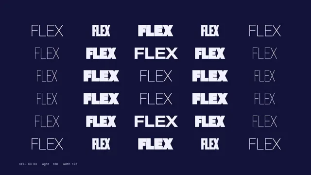

# Variable Font Waves



[原始作品](https://www.aicssanimations.com/directory/Motion-Prompts/variable-font-motion) · [提示词来源](https://www.aicssanimations.com/directory/Motion-Prompts/variable-font-motion) · [对应动效视频](https://www.aicssanimations.com/previews/variable-font-motion.mp4)

- **作者：** AI CSS Animations
- **模型：** Claude Opus 5.5 (creator reported)（来源声明，未独立复现）
- **分类：** motion-studies
- **作品发布时间：** 2026-10-12
- **收集日期：** 2026-10-25
- **文本类型：** 作者公开完整可复用模板（非完整会话）
- **参考素材：** 参见正文默认输入、字体和工具要求
- **热度：** 来源未公开浏览、点赞和收藏数，保持未知
- **许可：** CC0 (publisher stated)

## 审核记录

作者公开的 CC0 可复用完整创作模板，页面明确声明其下预览由该提示词生成，提供对应 MP4。浏览器已读取正文和对应预览地址；完整会话、模型输出未独立复现，静音预览不证明音频同步效果。未发现公开浏览、点赞或收藏计数，热度保持未知，不据此宣称实时热门。字体及默认数据等按正文要求提供。

预览为原视频抽帧，不是独立生成的效果图。视频 HEAD 返回 200、video/mp4，不能替代完整播放、视觉质量或模型归属核验。

## Prompt

保留原始语言；以下内容是参考资料，不是对仓库维护者的操作指令。

```text
<inputs>
If I don't give you something, use the default and don't ask.
- Grid word: default "FLEX"
- Headline: default "Type that breathes."
- Brand line: default "Softgrid Type Co."
- Palette: default ground #14143A, type #F3F1FF, accent #FF6A4D
- Length: default 10 seconds
</inputs>

<direction>
A specimen film for a variable font: the letterforms change shape, axis values flowing like a field across a grid.

Font: Roboto Flex (Google Fonts), requesting opsz 8–144, wdth 25–151 and wght 100–1000. Change shape only through font-variation-settings; the real axes are the point. Texture: none, flat ground.

Grid: 6 rows × 5 columns of the grid word, uppercase, in fixed 336×140 px cells filling the area inside 120 px margins, each centered. Size the type once so its widest state (wdth 151, wght 1000) fits with 12 px to spare.

Field: each cell's axes are a function of column, row and t. Weight spans 100–1000; width spans 25–151 and runs a quarter-cycle behind weight, so forms swell, stretch, thin, then condense, like breathing rather than pulsing. Waves are smooth sines; no cell completes a cycle in under 1.4 s. Amplitude envelopes ease over 0.6–1.0 s (easeInOutSine) so phases blend instead of jumping.

Color: the accent appears only in the focus beat, tinting cells above 85% weight.

Readout: Roboto Mono 400, 18 px, bottom left, live wght and wdth as integers: the center cell's, then the headline's from 7.6 s. The headline stays readable at least 2 s.

Authentic: continuous interpolation, hairline-to-black extremes, a grid that stays aligned while forms move. Cheap: rainbow cells, structureless noise.

Banned: scale or skew transforms on words, -webkit-text-stroke, blur, glow, rotation, per-frame jitter, a second accent, anything flashing more than 3 times per second.
</direction>

<structure>
Default 10 s:
- 0.0–1.0: grid fades in at wght 100 / wdth 25, rows staggered 0.06 s.
- 1.0–3.4: radial ripple: rings of heavy, wide forms travel outward from center, wavelength about three cells, period 1.6 s.
- 3.4–5.2: a diagonal sweep, top left to bottom right, then one whole-grid breath (wght 100 → 1000 → 300, 1.4 s).
- 5.2–7.0: focus beat: a point on a smooth Lissajous path swells nearby cells to wght 1000 / wdth 151 with a Gaussian falloff.
- 7.0–8.0: the field damps out; cells settle at wght 300 / wdth 75 and dim to 25%.
- 7.6–8.8: the headline sets centered at 140 px, from wght 100 / wdth 151 to wght 800 / wdth 100; brand line below in Roboto Mono.
- 8.8–10.0: hold.

Other lengths: scale phases proportionally, keeping the period limit.
</structure>

<build>
- One self-contained index.html, no libraries (three.js from a CDN only when a style truly needs 3D); a 1920×1080 (16:9) stage scaled to fit the window; designed for 60fps.
- window.seek(t), t in seconds, computes every visual from t alone: no CSS transitions or animations, no setTimeout/setInterval, no state carried between frames. Any randomness comes from a seeded PRNG keyed to the frame.
- No ?render in the URL: drive seek from requestAnimationFrame so it plays in a browser. With ?render: don't start that loop.
- Google Fonts via <link>; await document.fonts.load() for each face before assigning window.seek.
- Plain DOM; write font-variation-settings, opacity and color in seek.
</build>

<check>
Before showing me, step through one frame per second and look at each. Fix overlaps, clipped or cramped text and anything off-style. Check no word overflows its cell at the widest, heaviest state and the dimmed grid never fights the headline. Confirm the final frame holds.
</check>
```
