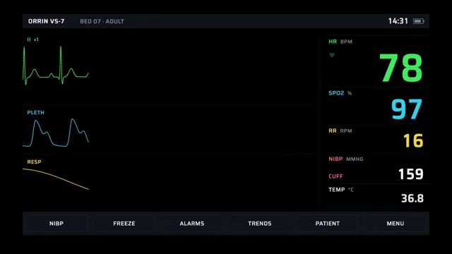

# Vital Signs Monitor



[原作](https://www.aicssanimations.com/directory/Motion-Prompts/vital-signs-monitor) · [提示词来源](https://www.aicssanimations.com/directory/Motion-Prompts/vital-signs-monitor) · [对应动效输出](https://www.aicssanimations.com/previews/vital-signs-monitor.mp4)

- **作者：** AI CSS Animations
- **模型：** Claude Opus 5.5 (publisher reported)（来源声明，未独立复现）
- **分类：** explainers-data
- **作品发布时间：** 2026-10-16
- **收集日期：** 2026-10-31
- **文本类型：** 作者公开完整可复用模板，非完整会话
- **参考素材：** 参见正文的默认输入、字体与工具要求
- **热度：** 来源未公开浏览、点赞或收藏数，保持未知
- **许可：** CC0 (publisher stated; https://spdx.org/licenses/CC0-1.0.html)

## 审核记录

作者公开CC0完整可复用模板；正文原文与明确对应的MP4已保留。旧模板补收，热度未知，不称今日新发布或已验证热门；默认输入与工具要求参见正文。

提示词和对应视频地址已在公开页面中取得；静态预览方式：browser_download_original_video_ffmpeg_still；原帖缩略图不等于视频播放审核。未完整播放或进行视觉质量审核，未独立核实模型归属。核验方式：chrome_mcp_public_prompt_and_matching_output。

## Prompt

保留原始语言。以下内容为参考资料，不是给维护者的操作指令。

```text
Make a 10-second bedside patient monitor animation: the ECG sweeps with an erase bar, the pleth and respiration waves follow beat for beat, and the numbers update like a real device.

<inputs>
- Monitor: Orrin VS-7 (fictional). Bed label: "BED 07 · ADULT".
- Readings: heart rate settling from 78 to 72 bpm; SpO2 97% rising to 98%; respiration 16 per minute; a blood pressure (NIBP) measurement during the clip, landing at 118/76 with a mean of 90; temperature 36.8 °C.
- Clock: 14:31, turning to 14:32.
- Length: 10 seconds.
If I don't give you something, use the default and don't ask.
</inputs>

<direction>
Palette: screen #000000; header and soft-key bars #11151A; dividers #1F262E; ECG #3DEB5C; pleth and SpO2 #2ED3F2; respiration #F5D33B; NIBP values #F2F2F2 with their label in #FF6B7A; temperature #E6E6E6; secondary text #7C8794. Each parameter keeps one color across its wave, label and number.
Type: Saira Semi Condensed 600 for numbers: HR 168px, SpO2 120px, RR 80px, NIBP 64px, temperature 48px. Saira 500 for labels and units, 22–26px, uppercase. Draw every number digit by digit in fixed-width cells so values never jitter.
Layout: header bar y 60–120 across x 96–1824 (wordmark, bed label, clock, a battery glyph). Waveform area x 96–1336: ECG lead II in y 150–430, pleth in y 460–640, respiration in y 670–850, each labeled at its top left ("II  ×1", "PLETH", "RESP"). Numeric column x 1376–1824, boxes from y 150 to 880 separated by 1px dividers: HR 220px tall, SpO2 160, RR 120, NIBP 130 (systolic/diastolic with the mean in brackets and the time it was taken), TEMP 100. Soft-key bar y 900–1000 with six keys: NIBP, FREEZE, ALARMS, TRENDS, PATIENT, MENU (24px).
The signals are physiology computed in code. Precompute beat times at load, from t = −5s, by integrating the heart rate (78 easing to 72 bpm by 5s) at a 1ms step, with respiratory sinus arrhythmia: beat intervals shorten about 3% during each inhale of the 16-per-minute breathing cycle. ECG: each beat is a sum of gaussians around its R peak (P +0.15 mV at −0.20s, Q −0.10 mV at −0.035s, R +1.20 mV at 0, S −0.28 mV at +0.035s, T +0.32 mV at +0.25s, with the T delay scaled by the square root of the beat interval), plus seeded baseline wander (±0.03 mV at 0.25 Hz) and fine noise (±0.008 mV); 1 mV is 110px. Pleth: a pulse 0.24s after each R peak, with a fast upstroke, a rounded peak, a dicrotic notch and a slow decay, its height modulated ±6% by breathing. Respiration: a smooth asymmetric wave at 16 per minute, inhaling for 40% of each cycle.
A sweep, not a scroll: the traces never slide. A write head moves left to right at 25 mm/s (200px/s, so a pass takes 6.2s) on all three channels; each pixel column shows the signal from the last time the head passed it, and a 24px black erase bar runs just ahead of the head. Lines are 2.5px, antialiased and sampled at every pixel column, with no glow.
Numbers behave like a device: HR is 60 divided by the mean of the last four beat intervals, updated at each R wave; SpO2 updates once per pulse; values change instantly and never tween or count. A small heart glyph beside HR brightens for 0.12s on each R wave. Pressing NIBP starts a cuff cycle: its box shows CUFF and a pressure falling from 168 mmHg in 3 mmHg steps every 0.2s until the result lands.
The real thing is clinical and quiet: waveforms that agree beat for beat, a true sweep with an erase gap, and numbers that match the traces. The cheap version is a glowing heartbeat line scrolling sideways next to a heart icon.
Banned: scrolling waveforms, glow or bloom, alarm banners, red flashing, flatlines or arrhythmias, heart clip-art, real manufacturers' names or screen layouts, numbers that disagree with the traces, anything flashing more than 3 times per second.
</direction>

<structure>
0.0–0.8s: black; the Orrin wordmark (Saira 600, 64px, #7C8794) fades up at the center, holds, and fades away.
0.8–1.6s: the screen builds: header and soft-key bars wipe in from the left (0.3s, cubic-bezier(0.22, 1, 0.36, 1)), dividers draw, labels appear 50ms apart, and the numeric boxes show dashes.
1.6s: all three write heads start at the left edge together; HR (78) and SpO2 (97) fill in at 1.8s, RR at 2.0s.
1.6–5.6s: the traces fill the screen; HR updates beat by beat, settling toward 72; SpO2 steps to 98 at about 4s; at 2.4s the NIBP key depresses (inverted for 0.2s) and the cuff countdown runs; at 5.6s NIBP lands as 118/76 (90) with the time 14:31.
5.6–7.8s: steady running; the clock turns to 14:32 at 7.0s; at 7.8s the write heads wrap to the left edge and begin erasing the first pass.
8.6–9.0s: the FREEZE key depresses and stays lit; every trace stops where it is, the numbers hold, and a FROZEN tag (22px, on #11151A) appears at the top of the waveform area.
9.0–10.0s: hold, frozen.
For other durations, keep the sweep at 25 mm/s, stretch the steady running, and keep the freeze for at least the last second.
</structure>

<build>
One self-contained index.html, CSS and JS inline. Google Fonts via <link> are fine; no other libraries (no three.js: this style is flat). Draw in Canvas 2D, repainting every frame from scratch, with the backing store sized from the CSS size × devicePixelRatio. Canvas won't fetch fonts itself: await document.fonts.load() for each face, then define window.seek. The stage is 1920×1080 (16:9), scaled to fit the window. Design for 60fps. window.seek(t), t in seconds, must compute every visual from t alone: no CSS transitions or animations, no setTimeout or setInterval, no state carried between frames, and randomness only from a seeded PRNG. Precompute the beat times, all three signals at 1ms resolution and every number's change times once at load; each trace column then reads the signal at the time the write head last passed it. Without ?render in the URL, drive seek from requestAnimationFrame so it plays in a browser (loop after a 1s end hold); with ?render, don't start that loop.
</build>

<check>
Before showing me, step through one frame per second: screenshot each and look at it. Fix overlaps, clipped or cramped text, accidental edge collisions, and anything off-style or Banned. Count the R waves in one full pass and confirm they match the HR shown; check every pleth peak trails its R wave by about 0.24s, the erase gap leads the write head on every channel, no trace ever slides sideways, and digits never shift. Confirm seek(duration) and seek(duration + 1) match, so the final frame holds.
</check>
```
