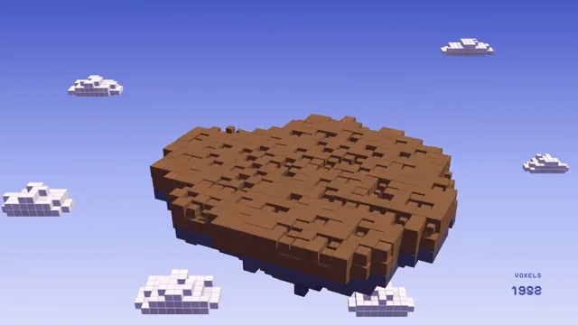

# Voxel Island Diorama



[原作](https://www.aicssanimations.com/directory/Motion-Prompts/voxel-island-diorama) · [提示词来源](https://www.aicssanimations.com/directory/Motion-Prompts/voxel-island-diorama) · [对应动效输出](https://www.aicssanimations.com/previews/voxel-island-diorama.mp4)

- **作者：** AI CSS Animations
- **模型：** Claude Opus 5.5 (publisher reported)（来源声明，未独立复现）
- **分类：** 3d-simulations
- **作品发布时间：** 2026-10-16
- **收集日期：** 2026-10-30
- **文本类型：** 作者公开完整可复用模板，非完整会话
- **参考素材：** 参见正文的默认输入、字体与工具要求
- **热度：** 来源未公开浏览、点赞或收藏数，保持未知
- **许可：** CC0 (publisher stated; https://spdx.org/licenses/CC0-1.0.html)

## 审核记录

作者公开完整CC0可复用模板，页面明确显示由该提示词渲染的对应MP4，正文通过Chrome MCP完整读取且长度一致。这是旧模板补收，不是今日发布或已验证热门；未公开热度，保持未知。静音预览不能证明音频效果或完整会话复现；默认输入、字体与工具依赖参见正文。

提示词和对应视频地址已在公开页面中取得；静态预览方式：original_video_still；原帖缩略图不等于视频播放审核。未完整播放或进行视觉质量审核，未独立核实模型归属。核验方式：chrome_mcp_published_prompt_and_matching_output。

## Prompt

保留原始语言。以下内容为参考资料，不是给维护者的操作指令。

```text
Make a 10-second voxel diorama: a floating island builds itself layer by layer, sprouts trees, a tiny house and a waterfall, and turns slowly like a model on a turntable.

<inputs>
- Island name: Thistle Isle.
- Caption: "Population: two and a cat."
- Counter label: VOXELS.
- Length: 10 seconds.
If I don't give you something, use the default and don't ask.
</inputs>

<direction>
Sky: a vertical gradient #4A5BC7 → #A9B5F4 → #D9DCFA; blocky white voxel clouds drift at different depths, two below the island.
Island, one unit per voxel: a 26×22 footprint from seeded noise; grass #7CC56A, two soil layers #9B6B44, rock #6E6A80 tapering over 10 layers to a stalactite tip #545066. On top: a pond #5CC4EE, four trees (trunks #7A4E2D, lumpy canopies #3D9A56 and #5BB868), a house (walls #F3E6CC, stepped roof #D8633A, windows #FFD98A, chimney) and a four-voxel cat #2B2B33.
Each voxel jitters ±5% in lightness and is darkened up to 20% by occlusion baked from its neighbors. One InstancedMesh per material of RoundedBoxGeometry (radius 0.06), roughness 0.9. A warm sun #FFF0D6 from the upper right with soft shadows, plus a lilac hemisphere fill, gives every cube three values: lit top, mid side, dark side.
Water: a two-voxel fall of #6FCBF2 with #CFF3FF foam runs from the pond over the edge and past the tip, each voxel at y = top − ((t·5 + k·0.5) mod length), shrinking away below. Smoke: three pale voxels on a 1.5s loop.
Camera: fov 28, 30° elevation, the island 55% of frame width near (1000, 570); it turns 50° on easeInOutSine, at rest by 9.0s, and bobs 0.15 units on a 4s sine.
Type: name in Pixelify Sans 600, 72px, white, at x 120, cap top y 110; caption in Pixelify Sans 400, 28px, #E6EAFF, beneath. Counter right-aligned at x 1800, baseline y 980: a 22px label over the 44px tabular count of voxels placed so far.
Build: each voxel scales from 0 with easeOutBack (1.5) over 0.22s, starts within a layer spread over 0.18s.
Premium is a clean silhouette, true unit cubes, darker creases, three values per face. Cheap is random colors, flat light and a fast spin.
Banned: textures on cubes, round shapes, mixed voxel sizes, outlines, bloom, turning past 60°, anything flashing more than 3 times per second.
</direction>

<structure>
- 0.0–0.6s: sky and drifting clouds; the counter reads 0.
- 0.6–3.4s: the island builds from the tip up, a layer every 0.2s, ending with the grass.
- 3.4–4.8s: trees grow, trunks a voxel at a time, canopies popping 0.25s apart.
- 4.8–6.2s: the house builds course by course; smoke starts; the cat appears.
- 6.2–7.4s: the pond fills and the waterfall runs over the edge.
- 7.4–8.4s: the name types on at 30ms per letter; the caption follows.
- 8.4–10s: hold; the turn eases out by 9.0s while water, smoke and bob continue.
Other lengths: scale the build beats; keep at least 1s of hold.
</structure>

<build>
One self-contained index.html, inline CSS and JS, on a 1920×1080 (16:9) stage scaled to fit the window, built for 60fps. Google Fonts via <link>, awaited with document.fonts.load() before seek exists.
window.seek(t) sets every visual from t alone: no CSS transitions or animations, no setTimeout/setInterval, no state carried between frames, randomness only from a seeded PRNG. Bake layout, colors and occlusion once at load; build, water and smoke are closed-form in t.
Without ?render in the URL, drive seek from requestAnimationFrame; with ?render, don't start that loop.
three.js as an ES module pinned to three@0.160.0 via a jsDelivr import map (`three`, `three/addons/`); preserveDrawingBuffer: true; one render per seek. No image, model or typeface files beyond Google Fonts.
</build>

<check>
Before showing me, step through one frame per second (0–10s) and look at each. Fix overlaps, clipped or cramped text and anything off-style or Banned. Look for cubes of different sizes, a waterfall detached from pond or edge, a counter that disagrees with what is built, the title touching trees at any angle. Confirm the final frame holds.
</check>
```
