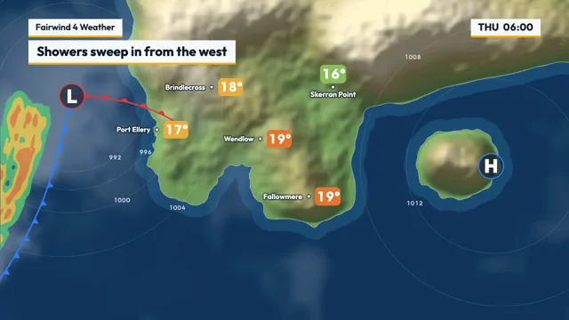

# TV Weather Forecast



[原作](https://www.aicssanimations.com/directory/Motion-Prompts/weather-forecast-map) · [提示词来源](https://www.aicssanimations.com/directory/Motion-Prompts/weather-forecast-map) · [对应动效输出](https://www.aicssanimations.com/previews/weather-forecast-map.mp4)

- **作者：** AI CSS Animations
- **模型：** Claude Opus 5.5 (publisher reported)（来源声明，未独立复现）
- **分类：** explainers-data
- **作品发布时间：** 2026-10-16
- **收集日期：** 2026-10-30
- **文本类型：** 作者公开完整可复用模板，非完整会话
- **参考素材：** 参见正文的默认输入、字体与工具要求
- **热度：** 来源未公开浏览、点赞或收藏数，保持未知
- **许可：** CC0 (publisher stated; https://spdx.org/licenses/CC0-1.0.html)

## 审核记录

作者公开完整CC0可复用模板，页面明确显示由该提示词渲染的对应MP4，正文通过Chrome MCP完整读取且长度一致。这是旧模板补收，不是今日发布或已验证热门；未公开热度，保持未知。静音预览不能证明音频效果或完整会话复现；默认输入、字体与工具依赖参见正文。

提示词和对应视频地址已在公开页面中取得；静态预览方式：original_video_still；原帖缩略图不等于视频播放审核。未完整播放或进行视觉质量审核，未独立核实模型归属。核验方式：chrome_mcp_published_prompt_and_matching_output。

## Prompt

保留原始语言。以下内容为参考资料，不是给维护者的操作指令。

```text
Make a 10-second TV weather forecast segment on a map of a fictional coastal region.

<inputs>
- Station: Fairwind 4 Weather.
- Region: the Selmark Coast (fictional), with five towns: Port Ellery, Brindlecross, Wendlow, Fallowmere and Skerran Point.
- Headline: "Showers sweep in from the west". Outlook line: "Cooler, brighter weekend".
- Temperatures in °C, before → after the cold front passes: Port Ellery 17 → 12, Brindlecross 18 → 13, Wendlow 19 → 14, Fallowmere 19 → 15, Skerran Point 16 → 12.
- Five-day outlook, high / low: THU 19° / 11° showers; FRI 14° / 8° showers and wind; SAT 13° / 6° sunny intervals; SUN 15° / 7° sunny; MON 17° / 9° sunny.
- Length: 10 seconds.
If I don't give you something, use the default and don't ask.
</inputs>

<direction>
Palette: sea #12355B, with a shallower shelf #1B4A73 within 40px of the coast; land on a hill-shaded ramp from lowland #6F9A5A through upland #A49C67 to tops #D8CDAF; coastline #E9F1F6 at 1.5px and 60%; cloud white at up to 35%. Radar rain in three crisp bands: light #58C878, moderate #F2D04B, heavy #F08A3C, each at 80%. Cold front #2F7DF6, warm front #E5383B, isobars white at 22%, 1px. Graphics: plates #F7F9FB with ink #0F1C2E, accent amber #FFB000, frosted panel #0B1B2C at 85%. Temperature bubbles take their fill from a fixed scale, always with white numerals: 12° or less #3E8FD6, 13–14° #4FA9A6, 15–16° #8DBE5E, 17–18° #EBAE3C, 19° or more #E8742F.
Type: Outfit throughout. Station plate 600 at 30px; headline 700 at 44px; time chip 700 at 34px; town names 600 at 24px with a 4px #0B1B2C halo at 60%; temperatures 700 at 44px; isobar labels 500 at 20px; five-day day names 700 at 26px tracked 0.08em, highs 700 at 52px, lows 500 at 32px in #9FB3C8. Canvas has no tabular figures, so draw every number digit by digit in fixed-width cells.
Map: author the coastline as a coarse polygon of about 18 points: open sea down the left quarter and along the bottom, the mainland across the upper and middle stage, a peninsula reaching south to about (1060, 760) with a deep bay to its west, and a large island near (1520, 560). Roughen it with four rounds of seeded midpoint displacement (±20px, halving each round) and smooth once. Elevation is a few gaussian ridges plus seeded value noise, hill-shaded once at load with light from the northwest. Draw the map in a world 8% larger than the stage on every side so camera moves never reveal an edge. Towns: Port Ellery (540, 440) on the west coast, Brindlecross (720, 300), Wendlow (880, 470), Fallowmere (1040, 660) near the peninsula tip, Skerran Point (1120, 300) on the north-east coast. Each is a 10px white dot with a 2px ink ring, its name on one side and its 84×60 temperature bubble (14px radius) on the other, never sitting on the coastline.
Weather: a low (an L in Outfit 800 at 64px, white, inside a 4px red ring) moves from (260, 330) to (1260, 250); a high (H, blue ring) sits at (1640, 560). The cold front hangs from the low toward the south-south-west as a smooth curve through five points, about 700px long, and advances east, swinging around the low the way real fronts do; it must cross all five towns between 3.6s and 6.2s, west to east. The warm front runs about 400px east-south-east from the low, ahead of it. Front lines are 5px; symbols sit every 64px on the side the front moves toward: 22px triangles for cold, 11px-radius semicircles for warm. The rain band rides 40–220px behind the cold front: value noise in a domain that moves with the front (never reseeded), thresholded into the three bands with 2px soft edges, heaviest in the band's middle. A cloud shield covers the frontal zone and thins elsewhere. Six isobars come from an analytic pressure field (the low as a negative gaussian, the high as a positive one), traced with marching squares on a 10px grid and labeled 992 to 1012.
Motion: the weather moves, the graphics stay locked. The low and fronts follow one easeInOutSine curve; clouds and rain drift with the wind at about 30px/s, the noise domain translating rather than boiling. The camera pushes from 1.00 to 1.05 over the piece while the graphics stay screen-locked. Plates build in broadcast order: the amber accent scales in from the left (0.22s, cubic-bezier(0.22, 1, 0.36, 1)), the plate wipes in 60ms later (0.32s), and the text rises 16px out of a mask (0.28s). Bubbles pop from scale 0 with one small overshoot (cubic-bezier(0.34, 1.4, 0.64, 1), 0.35s). When the cold front crosses a town (test which side of the curve it sits on at t), its temperature rolls down one degree at a time, 0.12s per degree, and the bubble's fill steps along the scale with it.
Five-day panel: 1664×220 at (128, 790), 20px radius, five equal columns divided by 1px lines of white at 12%: day, a flat icon drawn in code (sun: an amber disc with 8 rays; cloud: three overlapping white circles on a flat base; showers: the cloud plus three slanted 4px #58C878 streaks; wind: three curved white strokes), then high and low.
The real thing reads in one glance: an accurate map where the weather moves and the graphics hold a broadcast grid. The cheap version is clip-art suns on a flat blue rectangle with spinning 3D text.
Banned: real coastlines or place names, clip-art or emoji icons, rainbow radar ramps, lightning or flashing alerts, lens flares, 3D extruded type, rain ahead of the cold front, a temperature that disagrees with the front's position, anything flashing more than 3 times per second.
</direction>

<structure>
0.0–0.8s: the map is already there under drifting cloud. The station plate builds at (96, 64), then a time chip at the top right (right edge at 1824) reading THU 06:00.
0.8–1.6s: L and H pop in; the isobars draw outward from the low over 0.6s, their labels fading up as each finishes.
1.6–2.4s: both fronts draw on from the low along their length over 0.7s, each symbol popping (scale 0 → 1, 0.15s) as the line reaches it; rain fades up behind the cold front.
2.4–3.4s: town dots, names and bubbles pop in west to east, 90ms apart, showing the before temperatures; the headline plate builds under the station plate at (96, 136).
3.4–6.4s: the clock runs THU 06:00 → 18:00 in whole hours as the low drifts north-east and the front and its rain sweep across the land; each town rolls to its after temperature as the front crosses it.
6.4–7.4s: the map dims to 70% and the camera rises 80px; the five-day panel slides up 60px into place (0.5s, cubic-bezier(0.16, 1, 0.3, 1)) and its columns build 70ms apart, icons drawing on.
7.4–8.4s: highs and lows count up over 0.5s; the outlook line builds as a plate just above the panel's left end; SAT and SUN get a 4px amber underline beneath their day names.
8.4–9.0s: the cloud and rain drift eases to a stop.
9.0–10.0s: hold, completely still.
For other durations, stretch the front's sweep first, keep the build timings as given, and end on at least 1s of hold.
</structure>

<build>
One self-contained index.html, CSS and JS inline. Google Fonts via <link> are fine; no other libraries (no three.js: this style is flat). Draw in Canvas 2D, repainting every frame from scratch, with the backing store sized from the CSS size × devicePixelRatio. Canvas won't fetch fonts itself: await document.fonts.load() for each face, then define window.seek. The stage is 1920×1080 (16:9), scaled to fit the window. Design for 60fps. window.seek(t), t in seconds, must compute every visual from t alone: no CSS transitions or animations, no setTimeout or setInterval, no state carried between frames, and randomness only from a seeded PRNG. Build the coastline and hillshade once at load into an offscreen canvas; fronts, rain, clouds, isobars and every town's state are functions of t. Without ?render in the URL, drive seek from requestAnimationFrame so it plays in a browser (loop after a 1s end hold); with ?render, don't start that loop.
</build>

<check>
Before showing me, step through one frame per second: screenshot each and look at it. Fix overlaps, clipped or cramped text, accidental edge collisions, and anything off-style or Banned. Check that every town behind the cold front shows its after temperature and every town ahead shows its before one, rain never sits ahead of the cold front, front symbols face the direction of travel, and no name or bubble covers the coastline or hides under the panel. Confirm seek(duration) and seek(duration + 1) match, so the final frame holds.
</check>
```
