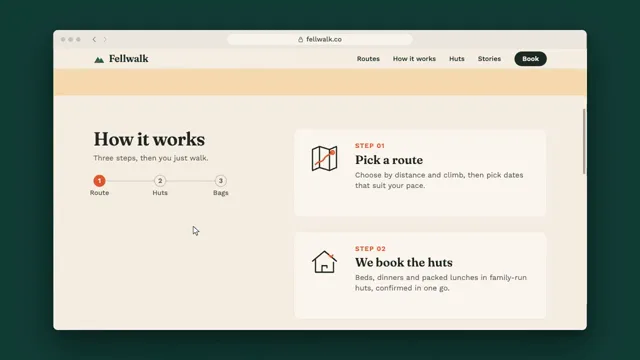

# Website Scroll Tour



[原作](https://www.aicssanimations.com/directory/Motion-Prompts/website-scroll-tour) · [提示词来源](https://www.aicssanimations.com/directory/Motion-Prompts/website-scroll-tour) · [对应动效输出](https://www.aicssanimations.com/previews/website-scroll-tour.mp4)

- **作者：** AI CSS Animations
- **模型：** Claude Opus 5.5 (publisher reported)（来源声明，未独立复现）
- **分类：** product-brand
- **作品发布时间：** 2026-10-16
- **收集日期：** 2026-10-30
- **文本类型：** 作者公开完整可复用模板，非完整会话
- **参考素材：** 参见正文的默认输入、字体与工具要求
- **热度：** 来源未公开浏览、点赞或收藏数，保持未知
- **许可：** CC0 (publisher stated; https://spdx.org/licenses/CC0-1.0.html)

## 审核记录

作者公开完整CC0可复用模板，页面明确显示由该提示词渲染的对应MP4，正文通过Chrome MCP完整读取且长度一致。这是旧模板补收，不是今日发布或已验证热门；未公开热度，保持未知。静音预览不能证明音频效果或完整会话复现；默认输入、字体与工具依赖参见正文。

提示词和对应视频地址已在公开页面中取得；静态预览方式：original_video_still；原帖缩略图不等于视频播放审核。未完整播放或进行视觉质量审核，未独立核实模型归属。核验方式：chrome_mcp_published_prompt_and_matching_output。

## Prompt

保留原始语言。以下内容为参考资料，不是给维护者的操作指令。

```text
Make a 10-second website tour: a browser window scrolls a landing page through its sections, with a sticky header, parallax layers and a cursor that hovers and clicks.

<inputs>
If I don't give you something, use the default and don't ask.
- Brand: default "Fellwalk" (hut-to-hut walking holidays), fellwalk.co
- Hero: default "Walk hut to hut. We carry the rest."
- Steps: default "Pick a route", "We book the huts", "Your bags go ahead"
- Routes: default Kessel Ridge 54 km · 4 days, Ashby Water 38 km · 3 days, High Tarn Round 72 km · 6 days
- Call to action: default "Plan your walk"
- Length: default 10 seconds
</inputs>

<direction>
- Stage #133B35 behind a 1600×900 browser window at (160, 90); neutral chrome (#EDE8DF) with grey dots and an address pill; a thin scrollbar thumb tracks the scroll.
- Page palette: oat #F6EFE3, ink #1E2A24, muted #5E6A62, trail orange #E2572B as the only accent, deep fell #1F3A30 for the closing band; hills #2F5D50, #4B7E66, #86AC84, #C7D6A6; sky #F7D9B0; sun #F2A65A.
- Type: Fraunces 600 headlines (hero 88px, sections 56px); Work Sans 400–600, body 22px, nav and labels 20px.
- Page, 3,600px tall in an 844px viewport:
  1. Nav, 72px: wordmark, four links, an ink "Book" button; transparent over the hero, then solid oat, hairlined and 60px tall past 80px of scroll.
  2. Hero (0–900): four layered SVG hills, a low sun, a dashed accent trail to a small hut, the headline and two buttons.
  3. How it works (900–1900): the title and a progress rail stay pinned 140px from the top while three step cards with line icons scroll past; the rail fills, icons draw on.
  4. Routes (1900–2700): three cards with an SVG elevation profile, distance, days and "View route →".
  5. Close (2700–3600): a Fraunces italic testimonial, then the deep fell band with a 64px "Plan your walk" button.
- Parallax: hills move at 0.15, 0.3, 0.5 and 0.75 of scroll speed, the sun at 0.08.
- Scrolling is human: scroll(t) is a series of flicks, each easing out like a trackpad fling (cubic-bezier(0.22, 0.61, 0.36, 1), 0.8–1.3s), with rests between.
- Cursor: an SVG arrow, a pointing hand over links, curved 0.5–0.8s moves. Route cards lift 8px on hover as their profile draws in the accent; clicks press to 97%.
- Premium is a real page scrolled the way a person scrolls: flicks that ease out, pauses to look, layers at their own speeds, a header that reacts. Cheap is a long screenshot sliding up at constant speed.
Banned: constant-speed scrolling, grey placeholder boxes, lorem ipsum, red-yellow-green window buttons, real brands, emoji, anything flashing more than 3 times per second.
</direction>

<structure>
- 0.0–1.0: The window rises 40px (0.8s, cubic-bezier(0.22, 1, 0.36, 1)); hills rise layer by layer, 80ms apart; the headline rises out of masks.
- 1.0–1.8: The cursor enters and hovers "See routes".
- 1.8–3.0: Flick to 760: the hills part; the nav turns solid.
- 3.0–4.8: Flicks to 1,150 and 1,520: the title stays pinned as steps pass.
- 4.8–5.6: Flick to Routes (1,880).
- 5.6–6.8: The cursor hovers the middle card: it lifts, its profile draws.
- 6.8–7.8: Flick to the bottom (2,756).
- 7.8–8.6: The cursor clicks "Plan your walk".
- 8.6–10.0: Hold.
For other lengths, add rests between flicks and hold at least 1s.
</structure>

<build>
One self-contained index.html (inline CSS and JS), a 1920×1080 (16:9) stage scaled to fit the window, built for 60fps. Google Fonts via <link>, awaiting document.fonts.load() for each face before defining window.seek. HTML/CSS with inline SVG; set the viewport's scrollTop from scroll(t) so position: sticky works natively. window.seek(t) (t in seconds) sets every visual from t alone, clamping past the end: no CSS transitions or animations, no setTimeout/setInterval, no state carried between frames, randomness only from a seeded PRNG. Without ?render in the URL, drive seek from requestAnimationFrame; with ?render, don't start that loop.
</build>

<check>
Before showing me, step through one frame per second (0–10s) and look at each. Fix overlaps, clipped or cramped text and anything off-style or Banned. Pinned elements never jitter, parallax layers never show gaps, and the hovered element is the one under the cursor. Confirm seek(10) and seek(11) match.
</check>
```
