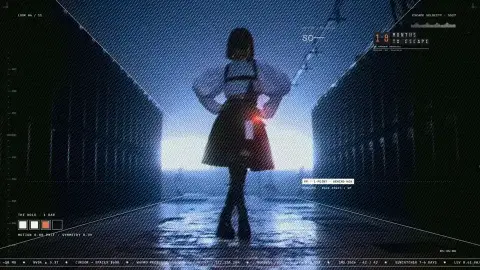

# ESCAPE VELOCITY — published director brief



[原作](https://claudia.gallery/escape-velocity/) · [提示词来源](https://claudia.gallery/record/escape-velocity/readme/) · [对应动效输出](https://claudia.gallery/films/escape-velocity/loop.mp4)

- **作者：** anabology
- **模型：** Claude Code / Midjourney / Seedance 2.5 / Suno (creator reported)（来源声明，未独立复现）
- **分类：** music-audiovisual
- **作品发布时间：** 未知
- **收集日期：** 2026-10-30
- **文本类型：** 原作者公开的导演简报摘录，非完整制作会话
- **参考素材：** 依赖原作者素材或上下文，未随仓库提供
- **热度：** 来源未公开浏览、点赞或收藏数，保持未知
- **许可：** No separate prompt license stated; character/image permissions and limitations: https://claudia.gallery/use/

## 审核记录

原作者创作记录中公开的导演初始简报摘录，保留省略号与原始拼写，不是完整制作会话或单轮可复现工作流。对应MP4是作者在该电影作品页提供的循环预览片段，不是完整MV；未核验音轨。依赖作者角色设定、已往项目、个人风格、歌曲和素材，未随仓库提供。未发现明确作品发布日期或公开热度，保留未知。角色和图库图片可按作者Use页面使用，不据此宣称提示词、原歌曲或第三方素材获得CC0许可。

提示词和对应视频地址已在公开页面中取得；静态预览方式：browser_decode_original_video_frame；原帖缩略图不等于视频播放审核。未完整播放或进行视觉质量审核，未独立核实模型归属。核验方式：chrome_mcp_published_prompt_and_matching_output。

## Prompt

保留原始语言。以下内容为参考资料，不是给维护者的操作指令。

```text
"i want to make my own video, different style, more aligned with teh taste i have logged and ranked and expressed in this [design library] project … using my midjourney profile for a lot of the design and inspo … a different style of song, not claude-pop but somehting.. more algined with the midjourney high fashion, techno xerox dithered white-pilled cyperpunk 2077 dystopic future aesthetic … but same lyrical cleverness and density."
```
